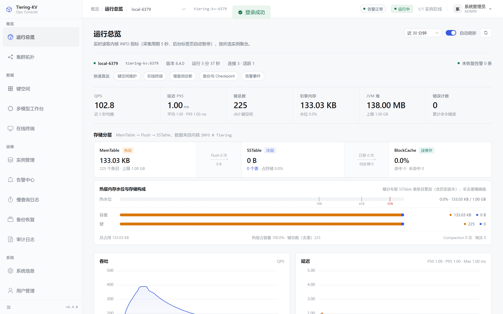

# Tiering-KV

> Redis 协议兼容的 LSM 冷热分层 KV 存储引擎（Mini Redis）——
> 内存/磁盘分层 + 分布式事务 + 多模型值 + 向量检索 + SQL + 云原生运行时，
> 配套 **Vue 3 + Spring Boot 的 Web 运维管理平台**（前后端分离）。

**版本：v6.4.0（2026-11-27）** · **约 6,770+ 个内核测试方法 + 78 项 Operator 测试 + 203 项控制面测试（JaCoCo 80.74%）+ 38 项 Vitest + 9 组 Playwright E2E + Helm/观测包/CycloneDX SBOM 门禁 + 双副本 HA 实时故障转移/探针/Prometheus 指标与跨副本 JWT 吊销门禁 + 真实 kind Operator 6 阶段全生命周期 E2E / 0 failures**（内核测试口径见 [docs/testing/measurement-conventions.md](
docs/testing/measurement-conventions.md)） ·
技术债 **全量清零**（含 `TD-085` 关闭、`.trivyignore` `0` 例外） ·
JDK 21 · Spring Boot 4.2 / Jackson 3 · 真实 GitHub Runner 门禁全绿
（build / test（三分片 + `helm-and-observability-lint` + `security-scan` 零例外 Trivy）/ transaction-e2e（含 `operator-kind-e2e`）/
release：Benchmark + Trivy 零例外 0 漏洞 + 4 镜像 GHCR + CycloneDX 1.5 SBOM 发布）

## 项目定位

一个从零实现、具有工程完整性的分布式 KV 存储系统：单机侧对齐 Redis
协议与冷热分层存储（WAL → MemTable → SSTable → Compaction），分布式
侧对齐 Raft/Multi-Raft 集群、Region 生命周期、跨地域复制与 Percolator
风格分布式事务；在此之上提供 JSON / 时序 / 向量 / SQL 多模型能力与
云原生（Kubernetes Operator、备份恢复、PITR、CDC）生产闭环。

## 快速开始

前置：JDK 21 + Maven 3.9。

```bash
# 全量测试（benchmark 组由 release 门禁显式执行）
mvn -Dsurefire.excludedGroups=benchmark test

# 启动单机服务（默认 0.0.0.0:6379，配置见 config/application.yaml）
mvn exec:java -Dexec.mainClass=io.tieringkv.Main
```

```bash
# redis-cli 验证
redis-cli -p 6379 PING
redis-cli -p 6379 SET k v
redis-cli -p 6379 GET k
redis-cli -p 6379 INFO
redis-cli -p 6379 INFO vector        # 可观测性 sections：vector/replication/multimodel/backup/tracing
```

## Web 运维管理平台（前后端）

`console-web`（Vue 3 + Vite + Element Plus 按需引入 + ECharts 6）与
`console-server`（Spring Boot 4.2 + Jackson 3 + JPA + Flyway 12 + MySQL 8）构成独立的**控制面**：
通过 RESP 协议（支持批量 Pipeline 与 TLS/自定义 CA）纳管内核实例，提供认证授权、
指标看板、键空间浏览、在线终端、告警与 Webhook 推送、异步备份恢复与审计，不与数据面共享进程。



| 模块 | 能力 |
| --- | --- |
| 认证 | JWT + BCrypt + `token_version` 跨副本实时吊销（登出/改密/禁用/变角即时失效），ADMIN / OPS / VIEWER 三级角色，用户名 + IP 双维度登录限流（支持受信代理 CIDR），Actuator 细粒度鉴权，登录与写操作全审计 |
| 总览 | 5s 采集 INFO，QPS/延迟/连接数/键数/内存水位趋势图，防重入轮询（后台标签页自动暂停）、`ResizeObserver` 容器自适应重绘与 SSTable 清单抽屉 |
| 拓扑 | `/#/topology` 解析 `# Cluster`/`# Transaction`/`# Persistence` 与 16384 HashSlot ECharts 分布图，纯 JDK 21 `HttpClient` 零依赖桥接 K8s Operator（在线扩缩容、滚动升级、按需备份） |
| 实例 | 纳管、探测连通性与版本、有界连接池复用、RESP TLS 加密传输与自定义 CA PEM 校验、口令静态加密且不回显 |
| 键空间 | SCAN 游标分页与批量 Pipeline 元数据/值读取、类型识别（string/hash/list/set/zset/json/stream）、值查看与改写、TTL；内置只读「大键 / 前缀 / TTL 诊断」分析器（Top-N BigKeys、命名空间前缀柱图、TTL 健康度分桶与优化建议） |
| 多模型 | `/#/multimodel` 多模型工作台：Vector HNSW 集合管理/Top-K 相似度检索/索引落盘、TimeSeries 时序 ECharts 折线图与 7 种桶聚合、JSONPath 查询/字段下钻与原地编辑（标准 Redis 自动降级） |
| 终端 | 任意命令直连执行、危险命令拦截、历史回放 |
| 告警 | 阈值 + 持续时长规则、触发/恢复闭环、Webhook 异步推送（HMAC-SHA256 签名 + 静默窗口 + 5xx 重试）、事件人工处置 |
| 备份 | 异步逻辑备份与恢复（100 键批量 Pipeline + 实时进度条 + 同实例并发 `409` 保护）、流式 SHA-256 摘要与归档完整性校验、两步「安全恢复向导」（Dry-Run 冲突预检 + 预恢复自动保护快照）、定时备份策略（Cron + 逻辑/物理双模式 + HA 单活调度与留存清理）、ADMIN/OPS 下载与物理 Checkpoint（`BGSAVE`） |
| 审计 | 操作留痕（动作/对象/来源 IP/`Request ID` 全链路追踪/成败），支持 W3C `traceparent` / `X-Request-Id` 串联、按条件检索与 CSV 导出 |
| 可观测 | Micrometer `/actuator/prometheus` 暴露被纳管实例水位/QPS/P99/冷层 SSTable、RESP 连接池治理与告警/备份/审计计数；Spring Boot 4 `liveness`/`readiness` 探针 + 开箱即用 Grafana 看板与 Prometheus 告警包（`deploy/observability/`） |

本地一键启动（Windows，PowerShell）：

```powershell
. .\scripts\env.ps1          # 固定 JDK 21
. .\scripts\dev-up.ps1       # MySQL(3307) + 内核(6379) + 控制面(8080) + 前端(5173)
```

容器化部署（内核 + 控制面 + 前端 + MySQL，全服务内置 `healthcheck`）：

```bash
# 开发 / 演示环境
cd deploy/console && docker compose up -d --build --wait
# 控制台 http://localhost:8081

# 生产环境覆盖（开启 prod 启动门禁、强口令与加密主密钥约束、DB 登录限流、容器内存上限）
cp deploy/console/.env.example deploy/console/.env   # 填入生产密钥后执行：
cd deploy/console && docker compose -f docker-compose.yml -f docker-compose.prod.yml up -d --build --wait

# 双副本高可用覆盖（2 个无状态 console-server 副本 + Nginx 负载均衡 + MySQL 租约锁/共享限流 + RustFS S3）
cd deploy/console && docker compose -f docker-compose.yml -f docker-compose.ha.yml --profile s3 up -d --build --wait
```

设计与接口文档：
[架构](docs/design/console-platform-architecture.md) ·
[数据模型](docs/design/console-data-model.md) ·
[REST API](docs/api/console-rest-api.md) ·
[ADR-0356](docs/adr/ADR-0356-web-console-control-plane.md) /
[ADR-0357](docs/adr/ADR-0357-console-resp-client-and-metrics.md) /
[ADR-0358](docs/adr/ADR-0358-logical-backup-format.md)

### 验证证据

| 层级 | 命令 | 结果 |
| --- | --- | --- |
| 控制面测试与覆盖率门禁 | `cd console-server && mvn -B test org.jacoco:jacoco-maven-plugin:check` | 203 项测试 0 失败，JaCoCo 行覆盖率 80.74%（≥ 75% 门禁） |
| 控制面静态缺陷扫描 | `cd console-server && mvn -B -DskipTests test-compile com.github.spotbugs:spotbugs-maven-plugin:check -Dspotbugs.threshold=High -Dspotbugs.failOnError=true` | SpotBugs High 0 缺陷 |
| 前端质量、构建、单测与安全审计 | `cd console-web && npm run lint && npm run build && npm test && npm audit` | ESLint / `vue-tsc` / Vite 0 告警，38 项 Vitest 全绿，`npm audit` 0 漏洞 |
| 零例外安全扫描（Trivy） | `trivy fs . --severity CRITICAL,HIGH --ignore-unfixed --ignorefile .trivyignore` | `.trivyignore` 0 有效例外，0 CRITICAL/HIGH |
| Helm / 观测包 / CycloneDX SBOM 校验 | `helm lint deploy/helm/tiering-kv --strict && bash scripts/sbom.sh --cdx --offline` | 单机/多副本 HA/集群三套模板、10 面板 Grafana、10 条告警规则与 CycloneDX 1.5 SBOM 全绿 |
| OpenAPI 契约漂移校验 | `cd console-web && npm run gen:api && git diff --exit-code -- src/api/schema.d.ts ../docs/api/openapi.json` | 0 漂移 |
| 全栈容器 E2E 回归 | `cd console-web && E2E_BASE_URL=http://127.0.0.1:8081 npm run test:e2e` | 9 组 Playwright 规范全绿，双副本 HA 故障转移/探针/Prometheus 指标与跨副本 JWT 吊销、S3/RustFS 门禁全绿 |
| 负载演示 | `node scripts/demo-load.mjs --seconds 60 --conns 6` | 约 6.7 万 ops/s（本机） |

分布式事务栈（coordinator/participant/metadata/gateway 五容器）：

```bash
docker compose -f deploy/docker-compose.transaction.yml up -d --wait
redis-cli -p 6379 SET k v   # 自动 2PC 事务
```

Kubernetes（Operator 生产清单 + 真实 `kind` 6 阶段全生命周期验证，fabric8 6.13.4）：

```bash
kubectl apply -f deploy/operator/tieringkvcluster-crd.yaml
kubectl apply -f deploy/operator/rbac.yaml
kubectl apply -f deploy/operator/deployment.yaml
kubectl apply -f deploy/operator/kind-cluster-sample.yaml
```

## 能力矩阵

| 域 | 能力 |
| --- | --- |
| 协议 | RESP2/RESP3 完整类型、Pub/Sub、Redis Cluster 网关（MOVED/ASK/TRYAGAIN + ASKING）、redis-cli 兼容 |
| 存储 | WAL（CRC32C + 崩溃恢复 + 并行恢复）、MemTable（分段 SkipList + TTL）、SSTable（Bloom/索引/mmap/BlockCache）、Leveled Compaction、冷热分层 + 自动 Flush/迁移 + 背压 |
| 缓存 | LFU（衰减 + TreeSet 索引）、ARC（byte 口径）、Segment LFU + Async Buffer、Hot Key 缓存 + Request Coalescing |
| 分布式 | 16384 hash slot、Raft（持久化日志/快照/选举/转移）、Multi-Raft Region、在线迁移、跨地域复制（批量 + 水位 + LWW/CRDT）、Key Sharding 异步执行 |
| 事务 | MVCC + HLC、Snapshot Read、Percolator 2PC（Prewrite/Commit/Rollback）、锁解析、事务恢复、PITR/CDC、跨集群 2PC |
| 多模型 | JSON 路径（JSON.SET/GET/...）、时序（TS.ADD/RANGE/INCRBY/...）、VECTOR 值 + HNSW 检索、SQL 引擎（join/聚合/分片执行） |
| 可观测性 | INFO sections（server/cluster/txn/mvcc/vector/replication/multimodel/backup/tracing）、Prometheus 文本端点（/metrics/prometheus）、W3C traceparent 透传、JFR 管线 |
| 安全 | RBAC/ACL、mTLS + HMAC 签名 RPC、密钥轮换、证书生命周期、审计/合规证明 |
| 云原生 | Kubernetes Operator（fabric8 reconcile + CRD 状态）、备份/恢复（含向量索引与复制水位）、滚动升级、优雅停机、容量模型 |
| 工程 | JDK 21、命令表驱动（CommandCatalog）、包边界固化（PackageBoundaryTest）、三分片 CI + JFR、Conventional Commits、ADR 全记录 |

## 性能基线（摘要，详见 docs/benchmark/）

| 指标 | 数值 |
| --- | --- |
| 存储层 GET（1M 数据集） | P99 ≈ 2.5μs |
| 网络端到端 GET | P99 ≈ 0.19ms |
| HNSW 检索（20K×64，v6.3.0） | P50 0.133ms / P99 0.322ms（v6.2.0 0.847ms；SQ8 向量内存 -69%~75%） |
| 63 万键 × 64B 存活堆（v6.3.0） | 174.0 MB（Sampled-LFU，较旧 LFU 504.0 MB 下降 65.5%，8 线程并发读 9.13×） |
| 流水线回环吞吐（c=50, P=16） | SET 651K / GET 681K rps（详见 [v6.3.0 压测报告](docs/benchmark/v6.3.0-kernel-optimization-report.md)） |
| 全栈容器实测（v6.4.0，Docker Linux） | P=16 GET `643,087 rps`（Epoll 较 NIO `+17.7%`/P99 `-36.2%`）、630K 键调优 ZGC RSS `698.1 MiB`、冷热分层 350K 键 `100%` 命中；100K 逻辑备份/Pipeline 恢复 `3.52–3.66s` / `2.57–2.63s`（Local/S3）；双副本 HA 故障转移 `10.70s`（详见 [v6.4.0 全栈容器压测报告](docs/benchmark/v6.4.0-container-and-console-benchmark-report.md)） |
| WAL Group Commit（fsync=ALWAYS） | 16 线程合并 avgBatch=12.31 writes/fsync，刷盘次数 -91.9% |
| 并行迁移（100B） | 209MB/s |
| 虚拟线程服务（JDK 21 POC） | 941K ops/s |
| WAL append（buffered） | 1.44M ops/s |
| 冷层 mmap 随机读 | P99 0.012–0.048ms（page-cache 热口径） |

## 发布历史

| 版本 | 日期 | 说明 |
| --- | --- | --- |
| v3.7.0 | 2026-08-14 | GA 收口（真实 Runner 门禁 7/7） |
| v3.7.1 | 2026-08-14 | 维护补丁（依赖漏洞/CI 稳定化） |
| v4.0.0-rc1 | 2026-08-14 | 向量存储 M1 + 多模型 M2 + 跨集群复制 M3 |
| v4.1.0 | 2026-08-16 | P4 工程现代化（JDK 21/命令目录）+ 可观测性收口 + 依赖升级 + 发布门禁加固 + 容器级磁盘混沌闭环（TD-046/049）；技术债 49/49 全部关闭 |
| v5.0.0 | 2026-10-24 | Web 运维管理平台（Vue 3 + Spring Boot）+ INFO 标准 section（ADR-0355）+ MetricsRegistry 接线修复（TD-082） |
| v5.0.1 | 2026-10-24 | 内存超限改为 OOM 拒绝，修复进程假活（TD-083，ADR-0359） |
| v5.1.0 | 2026-10-28 | 冷层读回退修复（TD-086/ADR-0361）：迁移后 100% 可读、DBSIZE 精确；容量模型 ≈ 值 + 74B/键 |
| v5.2.0 | 2026-11-25 | 控制面 O1–O5 生产级增强：异步备份恢复与进度条、RESP 批量 Pipeline + TLS、双维度限流 + HMAC Webhook 告警、前端按需瘦身（CSS -83.3%）与 Dashboard 拆分、SpotBugs/JaCoCo/5 组 E2E 门禁与三镜像 GHCR 发布 |
| v5.3.0 | 2026-11-25 | 控制面 S3/RustFS 真实对象存储 E2E 闭环（M2）、MySQL 租约锁 + DB 登录限流双副本无状态高可用与实时故障转移门禁（M3）、内核扩展 INFO 段落脱敏透出与系统页分栏观测面板（M4） |
| v5.4.0 | 2026-11-25 | Kubernetes Operator 真实集群实战闭环（A1–A3）：CRD `status` 子资源与安全 Patch、TCP 探针与真实 RESP 备份 Job、`:8088` 健康服务与 Lease 选主、最小权限 RBAC、真实 `kind` 6 阶段全生命周期门禁 `operator-kind-e2e` 与 4 镜像 GHCR 发布 |
| v6.0.0 | 2026-11-26 | 控制面底座现代化与零 CVE 例外清零（B1–B3）：Spring Boot 4.2.0 / Spring Framework 7.1.0 / Jackson 3.1.8 / springdoc 3.2.1 / jjwt 0.13.0（零 Jackson 2 `jackson-databind` 残留）、清空 `.trivyignore` 关闭 `TD-085` 并增设常驻 Trivy CI 门禁、`console-web` 升级 ECharts 6.1 / `vue-tsc` 3.3 实现 `npm audit` 全级别 0 漏洞、4 镜像 GHCR 发布 |
| v6.1.0 | 2026-11-26 | 分布式运维全链路与安全闭环（A1–A3）：分布式 Gateway 全面支持 `SCAN`/`DBSIZE`/`SLOWLOG`/`BGSAVE`/`LASTSAVE` 与 `INFO # Cluster/# Transaction/# Persistence`，Participant 物理快照原子落盘与重启恢复（`operator-kind-e2e` Stage 5 硬断言真实 `DBSIZE>=1` & `BGSAVE`）；控制面 Flyway V11 定时备份策略（Cron + 逻辑/物理双模式 + HA 单活调度与留存清理）及 JWT `token_version` 跨副本即时吊销；7 组 Playwright E2E 与 4 镜像 GHCR 发布 |
| v6.2.0 | 2026-11-26 | 控制面多模型工作台与集群拓扑/K8s 桥接（C1–C3）：`RespCodec` 兼容 RESP2/RESP3 浮点与 `VECTOR.CHECKPOINT` 落盘接线，落地 `/#/multimodel`（Vector HNSW + TimeSeries ECharts 6 + JSONPath）与 `/#/topology`（16384 HashSlot 分布 + 2PC 事务面板 + 纯 JDK 21 `HttpClient` 零依赖 K8s Operator 桥接）；新增 Flyway 多副本冷启动 MySQL 咨询锁；194 项控制面测试（JaCoCo 80.48%）、8 组 Playwright E2E 与 4 镜像 GHCR 发布 |
| v6.3.0 | 2026-11-26 | 高性能内核专版（Path B：B1–B4）：零分配 RESP + Linux 原生 Epoll + 批冲刷 + 去争用分片调度（消除 c=200 倒挂、P=16 651k/681k rps）；24-bit 内联 Morris-LFU + `SampledLfuPolicy` + Generational ZGC（63 万键存活堆 `-65.5%`、8 线程读 `9.13×`）；WAL Group Commit（`avgBatch=12.31`）+ 16 分片 S3-FIFO + 并发冷读 + FastRange Bloom；HNSW 扁平图 + SQ8 + FMA 核（20K×64D P99 `0.847→0.322ms`，SQ8 内存 `-69%~75%`）；0 CVE 例外与 4 镜像 GHCR 发布 |
| v6.4.0 | 2026-11-27 | 企业级运维闭环与云原生标准交付（D1–D4）：Flyway V12 备份流式 SHA-256 摘要/归档完整性校验/Dry-Run 冲突预览与预恢复保护快照；键空间只读 BigKey/前缀/TTL 诊断分析器；零依赖 Micrometer/Prometheus 自定义业务指标（实例水位/RESP 连接池/告警/备份/审计）+ Spring Boot 4 `liveness`/`readiness` 探针 + W3C `traceparent`/`X-Request-Id` 全链路审计追踪；标准 Helm v3 全栈 Chart + Grafana/Prometheus 观测包 + CycloneDX 1.5 SBOM 交付；203 项控制面测试（JaCoCo 80.74%）、38 项 Vitest、9 组 Playwright E2E、4 镜像 GHCR 与 SBOM 资产发布 |
| v5.0.3 | 2026-10-24 | 发布链路自动化：任意 v* 标签自动发版，门禁加控制面与前端作业（ADR-0360） |
| v5.0.2 | 2026-10-24 | 版本号对齐：pom / 脚本 / 文档统一到 5.0.2，构建脚本不再写死构件名 |
| v4.1.0 维护补丁 | 2026-08-16 | 生产链 TTL 修复（ADR-0351）+ 集群复制原子操作（ADR-0352，TD-081）+ 选举窗口/CI 稳定性加固（ADR-0353）+ RPC ERROR 帧 term 污染修复（ADR-0354）；技术债 50/50；约 6,738 个测试方法 / 14,957 次测试执行全绿 |

## 目录与文档

```text
src/main/java/io/tieringkv/   协议/存储/集群/事务/多模型/云原生实现
src/test/java/io/tieringkv/   约 6,738 个测试方法 / 14,957 次测试执行（口径见
                              docs/testing/measurement-conventions.md）
docs/adr/                     ADR-0001 ~ ADR-0354（架构决策记录）
docs/requirements/             需求与验收
docs/architecture/            总体/存储/网络/并发架构
docs/design/                  详细设计
docs/benchmark/               性能报告
docs/review/                  阶段评审与最终收尾
docs/planning/                P0–P4 优化路线图 + RFC-0001/0002 规划
.codex/tasks/                 各 Phase 任务与状态
deploy/                       Docker/K8s/Operator 产物
scripts/                      build/benchmark/stress/混沌/发布脚本
docs/project-history.md       Phase 0–54 逐阶段演进历史（旧 README 归档）
```

更多：需求见 [docs/requirements/requirements.md](docs/requirements/requirements.md)，
架构见 [docs/architecture/overview.md](docs/architecture/overview.md)，
路线图见 [ROADMAP.md](ROADMAP.md)，变更见 [CHANGELOG.md](CHANGELOG.md)，
历史演进见 [docs/project-history.md](docs/project-history.md)，
最终收尾报告见 [docs/review/final-project-closure.md](docs/review/final-project-closure.md)，
维护期运行手册见 [docs/operations/maintenance-runbook.md](docs/operations/maintenance-runbook.md)，
测试度量口径见 [docs/testing/measurement-conventions.md](docs/testing/measurement-conventions.md)，
可复现基准见 [docs/benchmark/reproducible-benchmark-guide.md](docs/benchmark/reproducible-benchmark-guide.md)。

## 开发与贡献

- 流程：需求 → 设计 → ADR → TDD → 全量回归 → 真实 Runner 门禁 → Conventional Commit；
- 分支：`main`（发布）/ `develop`（集成）/ `feature/*`；
- 本地全量：`mvn '-Dsurefire.excludedGroups=benchmark' test`；
- 发布：打 `vX.Y.Z` tag 触发 release workflow（分片测试 + Benchmark + Trivy + GHCR + GitHub Release）。

参见 [CONTRIBUTING.md](CONTRIBUTING.md) 与 [LICENSE](LICENSE)。
