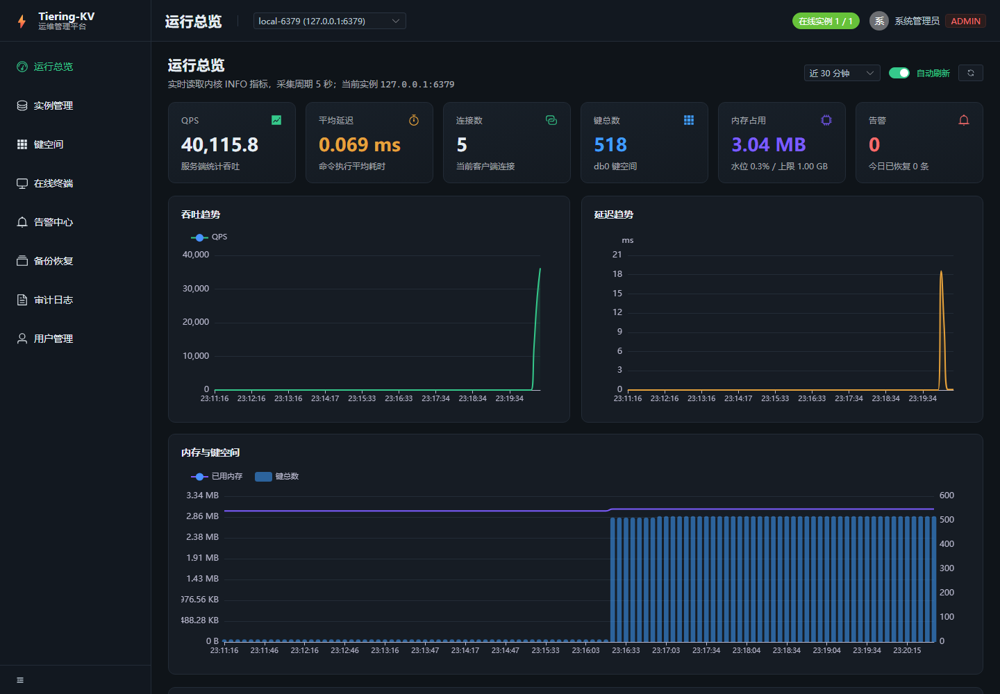

# Tiering-KV

> Redis 协议兼容的 LSM 冷热分层 KV 存储引擎（Mini Redis）——
> 内存/磁盘分层 + 分布式事务 + 多模型值 + 向量检索 + SQL + 云原生运行时，
> 配套 **Vue 3 + Spring Boot 的 Web 运维管理平台**（前后端分离）。

**版本：v5.0.3（2026-10-24）** · **约 6,738 个测试方法、累计
14,957 次测试执行 / 0 failures**（Surefire Tests run，含参数化
invocation；口径见 [docs/testing/measurement-conventions.md](
docs/testing/measurement-conventions.md)） ·
技术债 **50/50 处置完成**（含 TD-081 集群复制原子操作，ADR-0352） ·
JDK 21 · 真实 GitHub Runner 门禁全绿
（build / test（三分片）/ transaction-e2e /
release：Benchmark + Trivy 0 漏洞 + GHCR 镜像）

## 项目定位

一个从零实现、具有工程完整性的分布式 KV 存储系统：单机侧对齐 Redis
协议与冷热分层存储（WAL → MemTable → SSTable → Compaction），分布式
侧对齐 Raft/Multi-Raft 集群、Region 生命周期、跨地域复制与 Percolator
风格分布式事务；在此之上提供 JSON / 时序 / 向量 / SQL 多模型能力与
云原生（Kubernetes Operator、备份恢复、PITR、CDC）生产闭环。

## 快速开始

前置：JDK 21 + Maven 3.9。

```bash
# 全量测试（benchmark 组由 release 门禁显式执行）
mvn -Dsurefire.excludedGroups=benchmark test

# 启动单机服务（默认 0.0.0.0:6379，配置见 config/application.yaml）
mvn exec:java -Dexec.mainClass=io.tieringkv.Main
```

```bash
# redis-cli 验证
redis-cli -p 6379 PING
redis-cli -p 6379 SET k v
redis-cli -p 6379 GET k
redis-cli -p 6379 INFO
redis-cli -p 6379 INFO vector        # 可观测性 sections：vector/replication/multimodel/backup/tracing
```

## Web 运维管理平台（前后端）

`console-web`（Vue 3 + Vite + Element Plus + ECharts）与
`console-server`（Spring Boot 3.3 + JPA + MySQL 8）构成独立的**控制面**：
通过 RESP 协议纳管内核实例，提供认证授权、指标看板、键空间浏览、在线终端、
告警、备份恢复与审计，不与数据面共享进程。



| 模块 | 能力 |
| --- | --- |
| 认证 | JWT + BCrypt，ADMIN / OPS / VIEWER 三级角色，登录与写操作全审计 |
| 总览 | 5s 采集 INFO，QPS/延迟/连接数/键数/内存水位趋势图，多实例切换 |
| 实例 | 纳管、探测连通性与版本、连接池复用、口令不回显 |
| 键空间 | SCAN 游标分页、类型识别（string/hash/list/set/zset/json/stream）、值查看与改写、TTL |
| 终端 | 任意命令直连执行、危险命令拦截、历史回放 |
| 告警 | 阈值 + 持续时长规则、触发/恢复闭环、事件人工处置 |
| 备份 | 逻辑备份（SCAN → JSONL）、下载、按类型回放恢复 |
| 审计 | 操作留痕（动作/对象/来源 IP/成败），按动作检索 |

本地一键启动（Windows，PowerShell）：

```powershell
. .\scripts\env.ps1          # 固定 JDK 21
. .\scripts\dev-up.ps1       # MySQL(3307) + 内核(6379) + 控制面(8080) + 前端(5173)
```

容器化部署（内核 + 控制面 + 前端 + MySQL）：

```bash
cd deploy/console && docker compose up -d --build
# 控制台 http://localhost:8081
```

设计与接口文档：
[架构](docs/design/console-platform-architecture.md) ·
[数据模型](docs/design/console-data-model.md) ·
[REST API](docs/api/console-rest-api.md) ·
[ADR-0356](docs/adr/ADR-0356-web-console-control-plane.md) /
[ADR-0357](docs/adr/ADR-0357-console-resp-client-and-metrics.md) /
[ADR-0358](docs/adr/ADR-0358-logical-backup-format.md)

### 验证证据

| 层级 | 命令 | 结果 |
| --- | --- | --- |
| 控制面单元/接口测试 | `cd console-server && mvn test` | 40 用例通过（H2 + MockMvc） |
| 接口端到端 | `node scripts/api-smoke.mjs` | 25 项断言通过 |
| 前端构建与冒烟 | `cd console-web && npm run build && node scripts/smoke.mjs` | 构建通过 + 6 页截图 |
| 负载演示 | `node scripts/demo-load.mjs --seconds 60 --conns 6` | 约 6.7 万 ops/s（本机） |

分布式事务栈（coordinator/participant/metadata/gateway 五容器）：

```bash
docker compose -f deploy/docker-compose.transaction.yml up -d --wait
redis-cli -p 6379 SET k v   # 自动 2PC 事务
```

Kubernetes：`deploy/kubernetes/*.yaml` + Operator（fabric8 6.13.4）。

## 能力矩阵

| 域 | 能力 |
| --- | --- |
| 协议 | RESP2/RESP3 完整类型、Pub/Sub、Redis Cluster 网关（MOVED/ASK/TRYAGAIN + ASKING）、redis-cli 兼容 |
| 存储 | WAL（CRC32C + 崩溃恢复 + 并行恢复）、MemTable（分段 SkipList + TTL）、SSTable（Bloom/索引/mmap/BlockCache）、Leveled Compaction、冷热分层 + 自动 Flush/迁移 + 背压 |
| 缓存 | LFU（衰减 + TreeSet 索引）、ARC（byte 口径）、Segment LFU + Async Buffer、Hot Key 缓存 + Request Coalescing |
| 分布式 | 16384 hash slot、Raft（持久化日志/快照/选举/转移）、Multi-Raft Region、在线迁移、跨地域复制（批量 + 水位 + LWW/CRDT）、Key Sharding 异步执行 |
| 事务 | MVCC + HLC、Snapshot Read、Percolator 2PC（Prewrite/Commit/Rollback）、锁解析、事务恢复、PITR/CDC、跨集群 2PC |
| 多模型 | JSON 路径（JSON.SET/GET/...）、时序（TS.ADD/RANGE/INCRBY/...）、VECTOR 值 + HNSW 检索、SQL 引擎（join/聚合/分片执行） |
| 可观测性 | INFO sections（server/cluster/txn/mvcc/vector/replication/multimodel/backup/tracing）、Prometheus 文本端点（/metrics/prometheus）、W3C traceparent 透传、JFR 管线 |
| 安全 | RBAC/ACL、mTLS + HMAC 签名 RPC、密钥轮换、证书生命周期、审计/合规证明 |
| 云原生 | Kubernetes Operator（fabric8 reconcile + CRD 状态）、备份/恢复（含向量索引与复制水位）、滚动升级、优雅停机、容量模型 |
| 工程 | JDK 21、命令表驱动（CommandCatalog）、包边界固化（PackageBoundaryTest）、三分片 CI + JFR、Conventional Commits、ADR 全记录 |

## 性能基线（摘要，详见 docs/benchmark/）

| 指标 | 数值 |
| --- | --- |
| 存储层 GET（1M 数据集） | P99 ≈ 2.5μs |
| 网络端到端 GET | P99 ≈ 0.19ms |
| HNSW 检索（20K×64） | P50 0.473ms / P99 0.847ms（旧暴力 9.9ms） |
| 并行迁移（100B） | 209MB/s |
| 虚拟线程服务（JDK 21 POC） | 941K ops/s |
| WAL append（buffered） | 1.44M ops/s |
| 冷层 mmap 随机读 | P99 0.012–0.048ms（page-cache 热口径） |

## 发布历史

| 版本 | 日期 | 说明 |
| --- | --- | --- |
| v3.7.0 | 2026-08-14 | GA 收口（真实 Runner 门禁 7/7） |
| v3.7.1 | 2026-08-14 | 维护补丁（依赖漏洞/CI 稳定化） |
| v4.0.0-rc1 | 2026-08-14 | 向量存储 M1 + 多模型 M2 + 跨集群复制 M3 |
| v4.1.0 | 2026-08-16 | P4 工程现代化（JDK 21/命令目录）+ 可观测性收口 + 依赖升级 + 发布门禁加固 + 容器级磁盘混沌闭环（TD-046/049）；技术债 49/49 全部关闭 |
| v5.0.0 | 2026-10-24 | Web 运维管理平台（Vue 3 + Spring Boot）+ INFO 标准 section（ADR-0355）+ MetricsRegistry 接线修复（TD-082） |
| v5.0.1 | 2026-10-24 | 内存超限改为 OOM 拒绝，修复进程假活（TD-083，ADR-0359） |
| v5.0.3 | 2026-10-24 | 发布链路自动化：任意 v* 标签自动发版，门禁加控制面与前端作业（ADR-0360） |
| v5.0.2 | 2026-10-24 | 版本号对齐：pom / 脚本 / 文档统一到 5.0.2，构建脚本不再写死构件名 |
| v4.1.0 维护补丁 | 2026-08-16 | 生产链 TTL 修复（ADR-0351）+ 集群复制原子操作（ADR-0352，TD-081）+ 选举窗口/CI 稳定性加固（ADR-0353）+ RPC ERROR 帧 term 污染修复（ADR-0354）；技术债 50/50；约 6,738 个测试方法 / 14,957 次测试执行全绿 |

## 目录与文档

```text
src/main/java/io/tieringkv/   协议/存储/集群/事务/多模型/云原生实现
src/test/java/io/tieringkv/   约 6,738 个测试方法 / 14,957 次测试执行（口径见
                              docs/testing/measurement-conventions.md）
docs/adr/                     ADR-0001 ~ ADR-0354（架构决策记录）
docs/requirements/             需求与验收
docs/architecture/            总体/存储/网络/并发架构
docs/design/                  详细设计
docs/benchmark/               性能报告
docs/review/                  阶段评审与最终收尾
docs/planning/                P0–P4 优化路线图 + RFC-0001/0002 规划
.codex/tasks/                 各 Phase 任务与状态
deploy/                       Docker/K8s/Operator 产物
scripts/                      build/benchmark/stress/混沌/发布脚本
docs/project-history.md       Phase 0–54 逐阶段演进历史（旧 README 归档）
```

更多：需求见 [docs/requirements/requirements.md](docs/requirements/requirements.md)，
架构见 [docs/architecture/overview.md](docs/architecture/overview.md)，
路线图见 [ROADMAP.md](ROADMAP.md)，变更见 [CHANGELOG.md](CHANGELOG.md)，
历史演进见 [docs/project-history.md](docs/project-history.md)，
最终收尾报告见 [docs/review/final-project-closure.md](docs/review/final-project-closure.md)，
维护期运行手册见 [docs/operations/maintenance-runbook.md](docs/operations/maintenance-runbook.md)，
测试度量口径见 [docs/testing/measurement-conventions.md](docs/testing/measurement-conventions.md)，
可复现基准见 [docs/benchmark/reproducible-benchmark-guide.md](docs/benchmark/reproducible-benchmark-guide.md)。

## 开发与贡献

- 流程：需求 → 设计 → ADR → TDD → 全量回归 → 真实 Runner 门禁 → Conventional Commit；
- 分支：`main`（发布）/ `develop`（集成）/ `feature/*`；
- 本地全量：`mvn '-Dsurefire.excludedGroups=benchmark' test`；
- 发布：打 `vX.Y.Z` tag 触发 release workflow（分片测试 + Benchmark + Trivy + GHCR + GitHub Release）。

参见 [CONTRIBUTING.md](CONTRIBUTING.md) 与 [LICENSE](LICENSE)。
