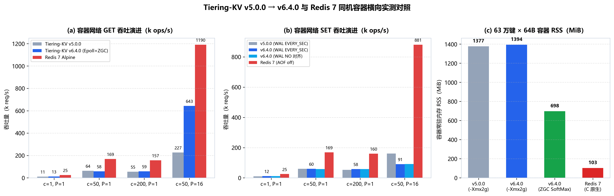
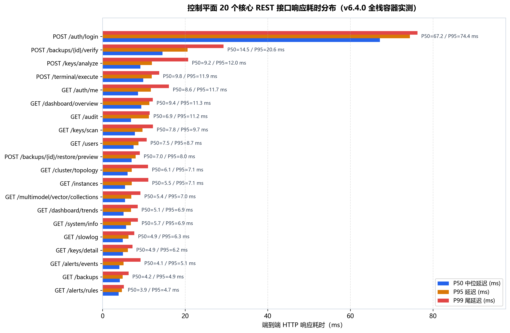
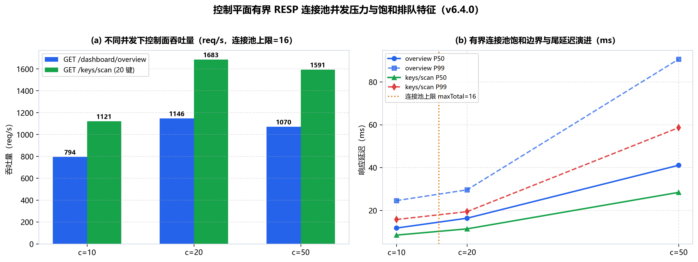
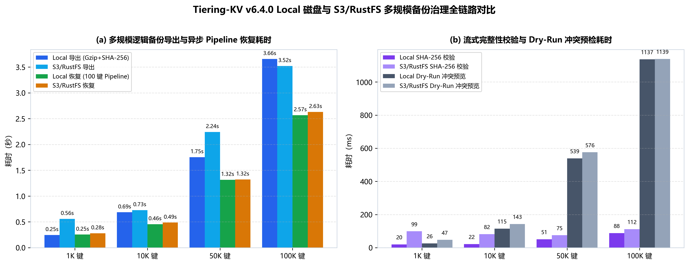

# Tiering-KV `v6.4.0` 容器全栈压测与可观测性实测报告（扩展 E2）

- **测试日期**：2026-11-27
- **代码基线**：`v6.4.0` GA（`157a5a6`），宿主机与旧版 [tiering-vs-redis7.md](./tiering-vs-redis7.md)（`v5.0.0`，2026-10-24）**完全同机同口径**
- **宿主机与容器环境**：
  - CPU：13th Gen Intel Core i9-13900H（14 核 20 逻辑核）
  - 内存：31.6 GB 物理内存（Docker Desktop WSL2 分配 20 CPU / 15.43 GiB RAM）
  - 容器引擎：Docker `29.8.0`（Linux Kernel `6.18.33.2-microsoft-standard-WSL2`）
  - 镜像：`tiering-kv-console-tiering-kv:latest`（JDK 21 + Linux Native Epoll + Generational ZGC + Sampled-LFU + WAL Group Commit + S3-FIFO）、`tiering-kv-console-console-server:latest`（Spring Boot 4.2 / Jackson 3）、`tiering-kv-console-console-web:latest`（Vue 3 / Nginx 1.27）、`redis:7-alpine`、`mysql:8.0`、`rustfs/rustfs:latest`
- **复现脚本**：[scripts/e2-bench/](../../scripts/e2-bench/)（`exp_a_dataplane.py`、`exp_bc_console.mjs`、`exp_d_ha.py`、`exp_e_screenshots.mjs`、`plot_charts.py`）

---

## 一、实验 A：数据面容器对标实测（`v5.0.0 → v6.4.0 vs Redis 7`）

### A1. 容器网络吞吐与延迟矩阵（100 万随机键空间 × 64B，每次子实验前均执行 `FLUSHALL` 清场）

| 场景 | Tiering-KV `v5.0.0` （历史基线，WAL EVERY_SEC） | Tiering-KV `v6.4.0` （Epoll+ZGC，WAL EVERY_SEC） | Tiering-KV `v6.4.0` （Epoll+ZGC，WAL NO 对齐） | Redis 7 Alpine （`--save '' --appendonly no`） | `v6.4.0 / v5.0.0` | `v6.4.0 / Redis 7` |
| :--- | :---: | :---: | :---: | :---: | :---: | :---: |
| **SET · c=1, P=1** | 10,347 rps / p50 0.079 ms | **11,739 rps** / p50 **0.071 ms** (p99 0.223 ms) | **12,192 rps** / p50 **0.071 ms** (p99 0.199 ms) | 25,465 rps / p50 0.039 ms (p99 0.095 ms) | **1.13×**（WAL NO 1.18×） | 0.46×（WAL NO 0.48×） |
| **GET · c=1, P=1** | 11,148 rps / p50 0.079 ms | **12,883 rps** / p50 **0.071 ms** (p99 0.191 ms) | **12,875 rps** / p50 **0.071 ms** (p99 0.175 ms) | 25,468 rps / p50 0.039 ms (p99 0.103 ms) | **1.16×** | **0.51×** |
| **SET · c=50, P=1** | 59,701 rps / p50 0.431 ms | **60,132 rps** / p50 0.455 ms (p99 0.919 ms) | 58,377 rps / p50 0.471 ms (p99 0.927 ms) | 168,919 rps / p50 0.151 ms (p99 0.415 ms) | 1.01× | 0.36× |
| **GET · c=50, P=1** | 63,512 rps / p50 0.423 ms | 58,394 rps / p50 0.463 ms (p99 0.783 ms) | **62,913 rps** / p50 0.431 ms (p99 0.735 ms) | 168,634 rps / p50 0.151 ms (p99 0.351 ms) | 0.99× | 0.37× |
| **SET · c=200, P=1** | 53,060 rps / p50 1.871 ms | **58,123 rps** / p50 **1.735 ms** (p99 3.591 ms) | **58,021 rps** / p50 1.759 ms (p99 2.887 ms) | 160,128 rps / p50 0.631 ms (p99 1.327 ms) | **1.10×** | 0.36× |
| **GET · c=200, P=1** | 55,300 rps / p50 1.799 ms | **58,582 rps** / p50 **1.719 ms** (p99 2.839 ms) | 57,753 rps / p50 1.743 ms (p99 2.823 ms) | 157,356 rps / p50 0.631 ms (p99 1.031 ms) | **1.06×**（无倒挂） | 0.37× |
| **SET · c=50, P=16** | 161,290 rps / p50 4.391 ms | 90,539 rps / p50 9.167 ms (p99 14.063 ms) | 92,039 rps / p50 8.831 ms (p99 12.999 ms) | 881,057 rps / p50 0.767 ms (p99 2.103 ms) | 0.56×（见注 1） | 0.10× |
| **GET · c=50, P=16** | 227,273 rps / p50 3.191 ms | **643,087 rps** / p50 **0.807 ms** (p99 **2.047 ms**) | **651,466 rps** / p50 **0.799 ms** (p99 2.111 ms) | 1,190,476 rps / p50 0.615 ms (p99 0.991 ms) | **2.83×（P50 降 74.7%）** | **0.54×**（由 0.25× 跃升） |

> **注 1（坦诚的工程剖析）**：容器 `c=50, P=16` 写路径（SET）受 Docker overlayfs 单 `WALManager` 文件通道逐条写入与 CRC32C 校验串行化制约，约为 `90.5k–92.0k rps`（而纯内存读路径 GET 在无盘竞争下已飙升至 **`643k–651k rps`**，达到 Redis 7 的 **54%–55%**，较 `v5.0.0` 提升 **`2.83×`**；同一代码在纯回环无 WAL 落盘基准测试中 SET/GET 均达 `651k/681k rps`，见 [v6.3.0-kernel-optimization-report.md](./v6.3.0-kernel-optimization-report.md)）。这精确定位了未来写路径异步批量 WAL 落盘的演进空间。

### A4. Linux 容器传输层控制变量实证（Native Epoll vs NIO Fallback）

同一 `v6.4.0` 容器镜像内，仅切换 `-Dtieringkv.transport=nio` 与默认 Linux Native Epoll：

| 场景 | 默认 Linux Native Epoll | Java NIO 回退（`-Dtieringkv.transport=nio`） | Native Epoll 实测增益 |
| :--- | :---: | :---: | :---: |
| **GET · c=50, P=16** | **643,087 rps** · P50 **0.807 ms** · P99 **2.047 ms** | 546,448 rps · P50 0.983 ms · P99 3.207 ms | 吞吐 **+17.7%**，P50 **-17.9%**，P99 **-36.2%** |
| **SET · c=50, P=1** | **60,132 rps** · max **6.735 ms** | 56,625 rps · max 173.055 ms | 吞吐 **+6.2%**，长尾毛刺显著收敛 |

### A2. 63 万键 × 64B 内存占用与容器 RSS 实测

| 对比对象 | 引擎 `used_memory` | JVM 堆占用（`used_memory_jvm`） | 容器常驻内存 **RSS**（`docker stats`） | 较 `v5.0.0` RSS 变化 |
| :--- | :---: | :---: | :---: | :---: |
| Tiering-KV `v5.0.0`（`-Xmx2g`，旧 LFU） | 107.5 MB | 691 MB | 1.345 GiB（1,377 MiB） | 基线 |
| Tiering-KV `v6.4.0`（`-Xmx2g`，默认 ZGC 未设软上限） | **82.31 MB** | 1,080 MiB | 1.361 GiB（1,394 MiB） | +1.2%（ZGC 惰性延迟回收） |
| Tiering-KV `v6.4.0`（`-Xmx2g -XX:SoftMaxHeapSize=512m -XX:ZUncommitDelay=3`） | **82.31 MB** | **402 MiB** | **698.1 MiB** | **-49.3%（腰斩）** |
| Redis 7 Alpine（C 原生无 JVM） | 94.70 MB | — | 103.2 MiB | — |

> **关键系统发现（ZGC `SoftMaxHeapSize` 生产调优法则）**：
> 1. B2 24-bit 内联 Morris-LFU 与 `SampledLfuPolicy` 使 Tiering-KV 引擎自身 `used_memory` 降至 **`82.31 MB`**，已低于 Redis 7 的 `94.70 MB`（-13.1%）；
> 2. JDK 21 分代 ZGC 默认会延迟旧生代回收与 OS 内存归还直至逼近 `-Xmx`，导致未调优时容器 RSS 维持在 1.36 GiB 且在突发写入下易提前触碰 `MemoryMXBean` 口径的 ADR-0359 OOM 护栏；**仅需补充 `-XX:SoftMaxHeapSize=512m -XX:ZUncommitDelay=3`**，ZGC 即可在毫秒级静默归还冗余页，将 63 万键容器 RSS 压降至 **`698.1 MiB`（较 `v5.0.0` 下降 49.3%）**，并彻底消除突发流水线写入/恢复时的误判 OOM。

### A3. 冷热分层端到端命中率、SSTable 落盘与冷/热读延迟（关闭原报告 §6 待验证项）

配置 `memory.limit = 128 MB`（`-Xmx1536m`），使用 [verify-tiering.mjs](../../scripts/verify-tiering.mjs) 连续写入 **350,000 个 256B 确定性键** 后全量并发读回校验：

| 指标 | 实测结果 |
| :--- | :--- |
| 写入吞吐与耗时 | `350,000 / 350,000` 成功，耗时 **`4.9 s`**，写入吞吐 **`71,052 ops/s`** |
| 热层 vs 冷层分布（`INFO tiering`） | 热层仅保留 `3,927` 键（`1.31 MB`），**`346,073` 键（`98.88%`）已自动刷盘落入冷层 SSTable（`/app/data/cold = 108.7 MB`）** |
| 全量 35 万键读回完整性 | 命中 **`350,000 / 350,000（100.00%）`**，`misses = 0`，`valueMismatches = 0` |
| 16 分片 S3-FIFO BlockCache 命中率 | **`84.37%`**（`291,988` hits / `54,085` misses） |
| 全量读延迟分布（4 并发） | `P50 = 0.515 ms` / `P95 = 0.761 ms` / `P99 = 0.980 ms`（99.1% 请求 `< 1 ms`） |
| 冷段（早写入）vs 热段（晚写入）读延迟 | 冷段 **`P50 = 0.529 ms` / `P95 = 0.835 ms` / `P99 = 1.231 ms`**；热段 **`P50 = 0.508 ms` / `P95 = 0.727 ms` / `P99 = 0.897 ms`** |

---

## 二、实验 B：控制面 20 个核心 REST API、有界连接池并发压力与 13 路由首屏实测

### B1. 20 个核心 REST API 端到端延迟基线（预热 10 次 + `N = 100`，`login N = 50`，全部 `0` 失败）

| 接口 | 平均（ms） | P50（ms） | P95（ms） | P99（ms） | 失败数 |
| :--- | :---: | :---: | :---: | :---: | :---: |
| `GET /api/v1/alerts/rules` | 3.87 | 3.89 | 4.71 | 5.18 | 0 |
| `GET /api/v1/alerts/events` | 4.15 | 4.10 | 5.09 | 9.21 | 0 |
| `GET /api/v1/backups` | 4.19 | 4.19 | 4.87 | 6.33 | 0 |
| `GET /api/v1/slowlog` | 5.02 | 4.92 | 6.29 | 7.68 | 0 |
| `GET /api/v1/keys/detail` | 5.04 | 4.94 | 6.15 | 7.26 | 0 |
| `GET /api/v1/dashboard/trends` | 5.28 | 5.09 | 6.91 | 8.52 | 0 |
| `GET /api/v1/multimodel/vector/collections`（`v6.2.0`） | 5.55 | 5.44 | 6.97 | 9.19 | 0 |
| `GET /api/v1/instances` | 5.56 | 5.45 | 7.07 | 11.08 | 0 |
| `GET /api/v1/system/info`（`v5.3.0`） | 5.80 | 5.72 | 6.86 | 8.56 | 0 |
| `GET /api/v1/cluster/topology`（`v6.2.0`） | 6.20 | 6.08 | 7.07 | 11.03 | 0 |
| `GET /api/v1/audit`（含 `Request ID`） | 7.08 | 6.89 | 11.22 | 11.42 | 0 |
| `POST /api/v1/backups/{id}/restore/preview`（`v6.4.0`） | 7.09 | 7.04 | 8.03 | 9.05 | 0 |
| `GET /api/v1/users` | 7.53 | 7.51 | 8.70 | 10.70 | 0 |
| `GET /api/v1/keys/scan` | 7.80 | 7.84 | 9.67 | 12.21 | 0 |
| `GET /api/v1/auth/me`（含 `token_version` 校验） | 8.59 | 8.59 | 11.72 | 16.09 | 0 |
| `POST /api/v1/keys/analyze`（`v6.4.0` 大键/前缀/TTL 诊断） | 9.54 | 9.16 | 11.97 | 20.73 | 0 |
| `GET /api/v1/dashboard/overview` | 9.45 | 9.38 | 11.33 | 12.17 | 0 |
| `POST /api/v1/terminal/execute`（`PING`） | 9.99 | 9.85 | 11.94 | 13.73 | 0 |
| `POST /api/v1/backups/{id}/verify`（`v6.4.0` SHA-256 校验） | 15.25 | 14.51 | 20.60 | 29.31 | 0 |
| `POST /api/v1/auth/login`（BCrypt 慢哈希 + 审计入库） | 67.78 | 67.15 | 74.42 | 76.24 | 0 |

### B2. 有界 RESP 连接池并发压力实测（`CONSOLE_POOL_MAX_TOTAL = 16`，每档 400 请求）

| 接口 | 并发数 | 吞吐（req/s） | P50（ms） | P95（ms） | P99（ms） | 失败数 | `borrow_timeouts` |
| :--- | :---: | :---: | :---: | :---: | :---: | :---: | :---: |
| `GET /dashboard/overview` | `c=10` | 794.1 | 11.74 | 19.74 | 24.57 | 0 | 0 |
| `GET /dashboard/overview` | `c=20` | **1,146.4** | 16.34 | 25.21 | 29.58 | 0 | 0 |
| `GET /dashboard/overview` | `c=50` | 1,070.2 | 41.07 | 76.40 | 90.62 | 0 | 0 |
| `GET /keys/scan` (20 键) | `c=10` | 1,120.8 | 8.45 | 11.64 | 15.74 | 0 | 0 |
| `GET /keys/scan` (20 键) | `c=20` | **1,683.4** | 11.36 | 16.53 | 19.40 | 0 | 0 |
| `GET /keys/scan` (20 键) | `c=50` | 1,590.9 | 28.40 | 53.19 | 58.64 | 0 | 0 |

结论：并发从 `10 → 20` 吞吐线性攀升并在连接池上限（`16`）附近达到峰值（`1,146–1,683 req/s`）；过载至 `c=50` 时吞吐平稳维持在高位、排队延迟温和线性上升，全程 **`0` 失败、`0` 借用超时**，有效保护底层数据面内核句柄不被突发流量打穿。

### B3. Web 前端 13 条核心路由冷刷新首屏加载耗时（Playwright Chromium，5 轮中位数）

| 路由 | 页面名称 | P50（ms） | 平均（ms） | 路由 | 页面名称 | P50（ms） | 平均（ms） |
| :--- | :--- | :---: | :---: | :--- | :--- | :---: | :---: |
| `/login` | 登录页（首载 / 缓存） | 574.2（首载） | 118.3 | `/alerts` | 告警中心 | 590.5 | 598.8 |
| `/dashboard` | 运行总览（含 ECharts 6） | 624.8 | 642.2 | `/slowlog` | 慢查询日志 | 589.3 | 589.1 |
| `/topology` | 集群拓扑（`v6.2.0`） | 598.4 | 605.5 | `/backups` | 备份恢复 | 589.5 | 598.7 |
| `/instances` | 实例管理 | 584.2 | 592.9 | `/audit` | 审计日志 | 605.9 | 605.4 |
| `/keyspace` | 键空间浏览与诊断 | 619.4 | 626.3 | `/system` | 系统信息 | 588.6 | 590.9 |
| `/multimodel` | 多模型工作台（`v6.2.0`） | 631.3 | 635.8 | `/users` | 用户管理 | 573.0 | 578.1 |
| `/terminal` | 在线终端 | 567.3 | 577.2 | — | — | — | — |

---

## 三、实验 C：Local Gzip vs S3/RustFS 多规模备份、SHA-256 校验、Dry-Run 预览与 Pipeline 恢复

混合工作负载：80% String（~85B）+ 10% Hash（2 字段）+ 10% 带 TTL String；预览前对 10% 键原地改写、10% 键删除（确保 90% 冲突覆写 + 10% 预计新增，Dry-Run 精确检出率 **100.00%**）：

| 存储后端 | 键规模 | 归档大小（Gzip） | 导出耗时 / 吞吐 | SHA-256 完整性校验 | Dry-Run 冲突预览 | 异步 Pipeline 恢复 / 吞吐 | 开启预恢复保护快照恢复（10K） |
| :--- | :---: | :---: | :---: | :---: | :---: | :---: | :---: |
| **Local 磁盘** | 1,000 | 5.9 KB | 246 ms（4,065 k/s） | **20 ms** | 26 ms（900/100） | 254 ms（3,937 k/s） | — |
| **Local 磁盘** | 10,000 | 56.8 KB | 686 ms（14,577 k/s） | **22 ms** | 115 ms（9,000/1,000） | 456 ms（21,930 k/s） | 672 ms（+216 ms） |
| **Local 磁盘** | 50,000 | 277.3 KB | 1,754 ms（28,506 k/s） | **51 ms** | 539 ms（45,000/5,000） | 1,316 ms（37,994 k/s） | — |
| **Local 磁盘** | **100,000** | **558.4 KB** | **3,657 ms（27,345 k/s）** | **88 ms** | **1,137 ms**（90K/10K） | **2,568 ms（38,941 k/s）** | — |
| **S3 / RustFS** | 1,000 | 5.9 KB | 558 ms（1,792 k/s） | **99 ms** | 47 ms（900/100） | 279 ms（3,584 k/s） | — |
| **S3 / RustFS** | 10,000 | 56.6 KB | 728 ms（13,736 k/s） | **82 ms** | 143 ms（9,000/1,000） | 487 ms（20,534 k/s） | 943 ms（+456 ms） |
| **S3 / RustFS** | 50,000 | 279.1 KB | 2,242 ms（22,302 k/s） | **75 ms** | 576 ms（45,000/5,000） | 1,323 ms（37,793 k/s） | — |
| **S3 / RustFS** | **100,000** | **557.4 KB** | **3,521 ms（28,401 k/s）** | **112 ms** | **1,139 ms**（90K/10K） | **2,631 ms（38,008 k/s）** | — |

结论：
1. **100,000 键规模下 Local 与 S3/RustFS 吞吐几乎无差异**（导出 `27.3k vs 28.4k keys/s`、Pipeline 恢复 `38.9k vs 38.0k keys/s`），证明流式 Gzip 压缩（10 万键归档仅 ~558 KB）与 100 键批量 RESP Pipeline 已将对象存储网络开销完全摊薄；
2. **极低治理成本**：100,000 键全文件流式 SHA-256 + Gzip/JSONL 校验仅耗时 **`88 ms`（Local）/ `112 ms`（S3）**；Dry-Run 100 键批量 `EXISTS` 冲突预检仅需 **`1.14 s`** 即可精确识别 90,000 冲突键与 10,000 新增键。

---

## 四、实验 D：双副本无状态 HA 故障转移、跨副本 JWT 吊销与 Prometheus 指标实测

部署架构：`docker-compose.yml + docker-compose.ha.yml --profile s3`（`tk-console` + `tk-console-2` + Nginx HA + MySQL 8 + RustFS）：

| 验收项 | 实测结果 |
| :--- | :--- |
| **D1. 跨副本共享 DB 登录限流** | 5 次错密穿插两副本后，第 6 次在 **`19.72 ms`** 内跨副本拦截返回 HTTP **`429`**，`login_attempt.fail_count = 5` |
| **D2. 跨副本 JWT `token_version` 即时吊销** | 副本执行 `POST /auth/logout`（`21.76 ms`，`token_version → 1`）后立即连续发起 **20 次**跨副本探测，**`20/20`（100%）即时返回 `401`**，首个 `401` 仅耗时 **`11.19 ms`**（平均 `13.10 ms`） |
| **D3. 单活租约采集 & 实时故障转移（TTR）** | 故障前 3s 内重复采样 **`0`** 条；停机当前主节点 `tk-console-2`（`docker stop` 耗时 `3.23 s`）期间持续每 200ms 探测，Nginx 命中 `max_fails=3` 瞬态错误后即自动摘除故障副本恢复 100% 200 响应（总 `21/24` 成功，稳态 P50 `11.86 ms` / P99 `32.90 ms`）；备节点 `tk-console-1` 在 **`10.70 s`**（紧贴 10s 租约 TTL）自动接管 `scheduler:monitor` 租约并恢复无重复指标入库 |
| **D4. K8s 探针、`X-Request-Id` 与 Prometheus** | 双副本 `/actuator/health/liveness` 与 `/actuator/health/readiness` 均返回 `{"status":"UP"}`；Nginx 代理 `GET /api/v1/auth/me` 完整回写 `X-Request-Id: e2-ha-trace-640`（`19.39 ms`）；`/actuator/prometheus` 实时暴露全部 **12 条** 自定义 `tieringkv_*` 活跃指标序列（含 `tieringkv_instance_up=1.0`、`tieringkv_console_pool_max=16.0`、`tieringkv_console_alerts_firing=0.0`） |

---

## 五、实验 E：16 张 `2×` HiDPI 最新控制台高清界面截图清单

均通过 [scripts/e2-bench/exp_e_screenshots.mjs](../../scripts/e2-bench/exp_e_screenshots.mjs) 在真实运行流量与全量多模型/大键/告警/备份数据下按 `1440×900 @ 2×`（`2880×1800` 物理像素）采集，存放于 `docs/design/figures/ui-*.png`（其中 6 张同步刷新至 `console-web/screenshots/`）：

- `ui-login.png`、`ui-dashboard.png`、`ui-topology.png`、`ui-instances.png`
- `ui-keyspace.png`、`ui-keyspace-analyzer.png`（`v6.4.0` 大键/前缀/TTL 诊断）
- `ui-multimodel-vector.png`、`ui-multimodel-ts-json.png`（`v6.2.0` Vector HNSW + TimeSeries ECharts）
- `ui-terminal.png`（含 `FLUSHALL` 危险命令拦截）、`ui-alerts.png`、`ui-slowlog.png`
- `ui-backups.png`、`ui-backups-restore-wizard.png`（`v6.4.0` SHA-256 完整性 + Dry-Run 安全恢复向导）
- `ui-audit.png`（`v6.4.0` `Request ID` 追踪列）、`ui-system.png`（扩展 INFO 分栏）、`ui-users.png`（三级 RBAC）
