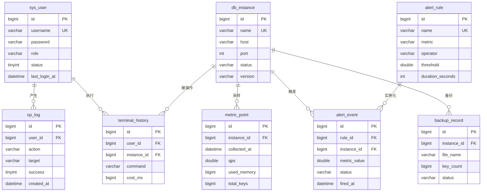

# 控制台数据库设计

库：`tiering_console`（MySQL 8.0，utf8mb4）
管理方式：Flyway（`console-server/src/main/resources/db/migration`）

## 1. ER 图

## 2. 表说明

| 表 | 用途 | 关键约束 | 设计取舍 |
| --- | --- | --- | --- |
| `sys_user` | 平台账号 | `username` 唯一 | 角色用枚举而非 RBAC 表：角色固定 3 种，避免过度设计 |
| `op_log` | 审计 | `created_at` 索引 | 只追加不更新；30 天保留 |
| `db_instance` | 纳管实例 | `(host,port)` 唯一、`name` 唯一 | 口令列不返回前端，仅存库 |
| `metric_point` | 指标采样 | `(instance_id, collected_at)` 联合索引 | 宽表（单行 12 列）而非 EAV，查询趋势只需一次范围扫描 |
| `alert_rule` | 告警规则 | `name` 唯一 | `instance_id` 可为空，表示全实例生效 |
| `alert_event` | 告警事件 | `(status, fired_at)` 索引 | 观测值列名 `metric_value`，避开 SQL 保留字 `value` |
| `backup_record` | 备份记录 | `(instance_id, created_at)` 索引 | 文件落在控制面本地卷，库内只存元数据 |
| `terminal_history` | 终端历史 | `created_at` 索引 | 命令截断到 500 字符，避免超长行 |

## 3. 容量估算

| 表 | 增长速率 | 年增量（单实例） | 处置 |
| --- | --- | --- | --- |
| `metric_point` | 12 行/分钟（5s 采样） | ≈ 630 万行 | 保留 72 小时，实际稳态 < 5 万行 |
| `op_log` | 取决于操作 | 万级 | 保留 30 天 |
| `terminal_history` | 取决于使用 | 万级 | 随 `op_log` 一并人工归档 |
| 其余 | 配置类 | 百级 | — |

## 4. 迁移脚本

| 版本 | 内容 |
| --- | --- |
| `V1__init.sql` | 8 张表 + 索引 + 注释 |
| `V2__seed_default_instance.sql` | 幂等插入本机默认实例 `local-6379` |

> 表结构由 Flyway 独占管理，Hibernate 仅做映射（`ddl-auto: none`），
> 避免 ORM 反向改库。
