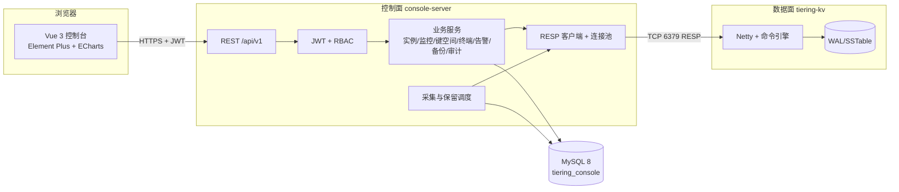
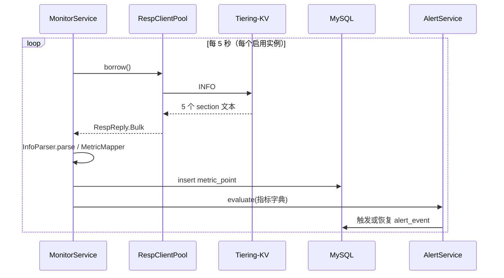
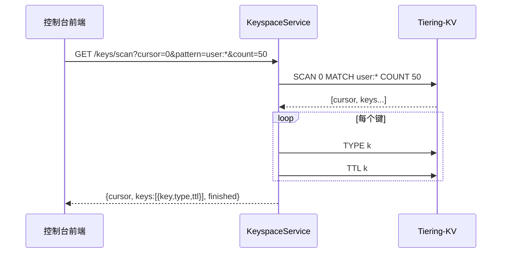
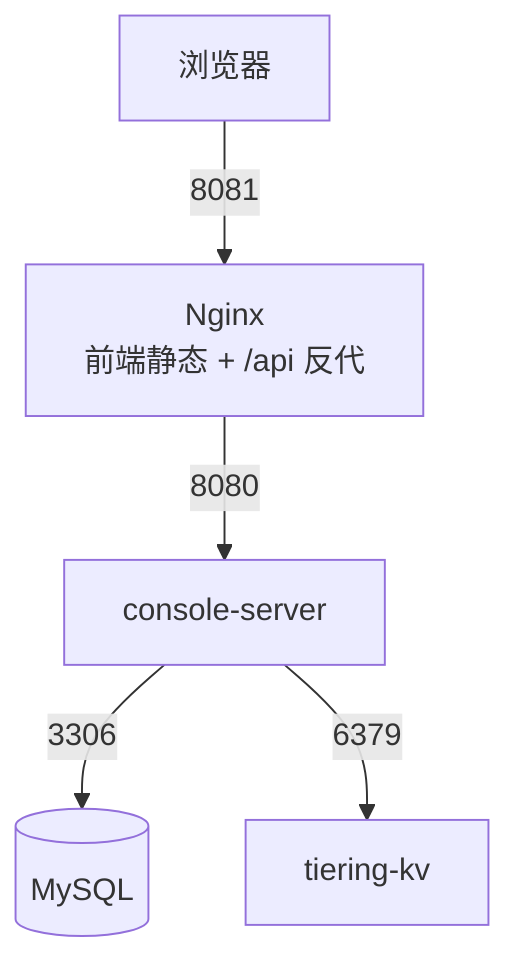

# Web 运维管理平台设计说明

> 对应实现：`console-server/`（控制面后端）、`console-web/`（展示面）
> 相关决策：ADR-0355（INFO 增强）、ADR-0356（控制面独立）、ADR-0357（RESP 客户端与指标）、ADR-0358（逻辑备份）

## 1. 总体架构



分层职责：

| 层 | 组件 | 职责 | 不做什么 |
| --- | --- | --- | --- |
| 展示面 | `console-web` | 交互、图表、表单校验 | 不直连数据库/内核 |
| 控制面 | `console-server` | 认证授权、业务编排、指标采集、审计 | 不存业务数据以外的内容 |
| 数据面 | `tiering-kv` | 协议解析、存储、事务、集群 | 不承担鉴权/UI 逻辑 |

## 2. 控制面模块划分

```
io.tieringkv.webconsole
├── config/      安全、CORS、Jackson、引导数据、配置属性
├── security/    JWT 签发校验、过滤器、当前用户
├── domain/      8 个 JPA 实体 + 6 个枚举
├── repository/  Spring Data JPA 仓储
├── service/     Auth/User/Instance/Monitor/Metric/Keyspace/Terminal/Alert/Backup/Audit/Retention
├── resp/        RESP 编解码、客户端、连接池
├── support/     INFO 解析、二进制文本解码
└── web/         REST 控制器 + DTO
```

## 3. 关键时序

### 3.1 指标采集



### 3.2 键空间分页



## 4. 安全模型

| 角色 | 读取 | 键写入/实例/告警/备份 | 用户管理/审计/恢复 |
| --- | --- | --- | --- |
| VIEWER | ✅ | ❌ | ❌ |
| OPS | ✅ | ✅ | ❌ |
| ADMIN | ✅ | ✅ | ✅ |

- 口令使用 BCrypt（强度 10）存储，接口永不回显；
- JWT HS256，默认 12 小时过期，密钥来自 `CONSOLE_JWT_SECRET`；
- 登录失败、写操作、危险命令拦截均写 `op_log`；
- 终端黑名单默认拦截 `FLUSHALL/FLUSHDB/SHUTDOWN/DEBUG`。

## 5. 部署拓扑



一键启动：`cd deploy/console && docker compose up -d --build`。
