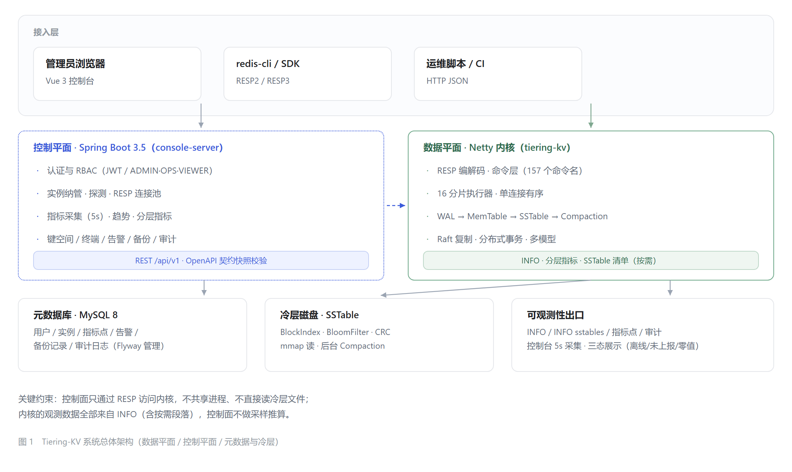
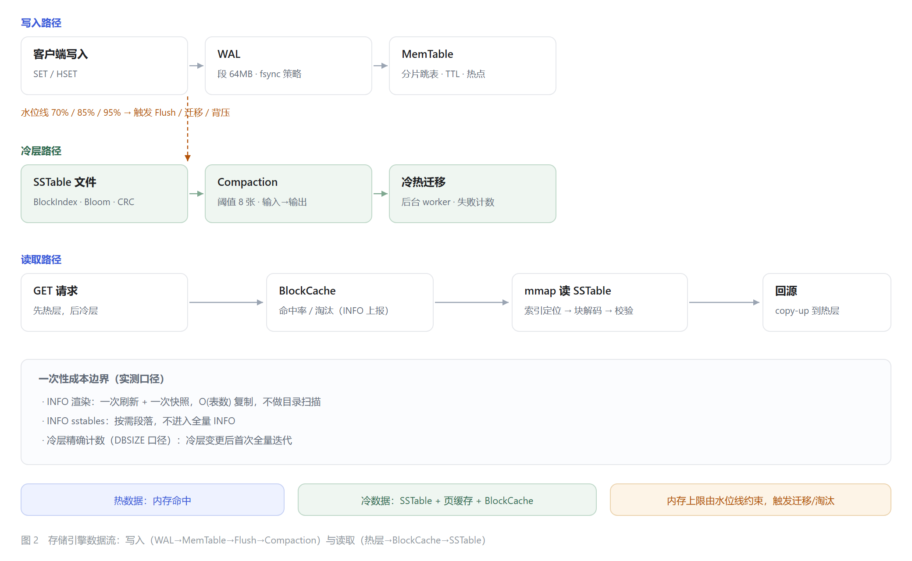
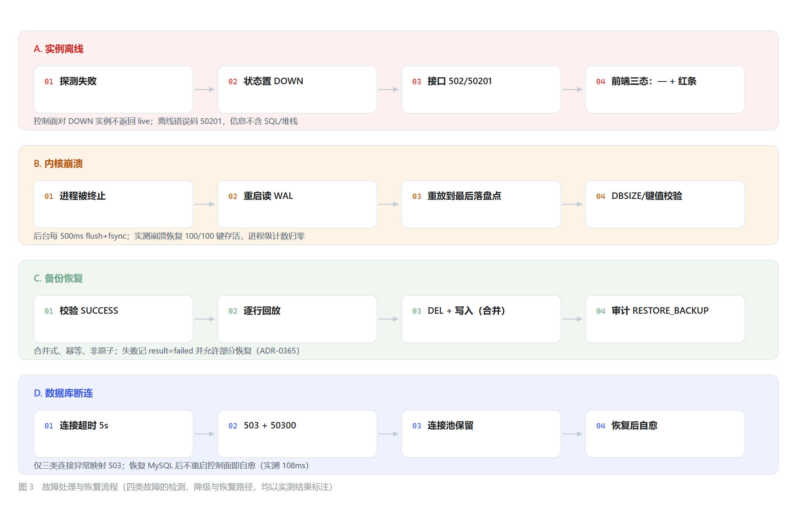

# Tiering-KV 系统设计与工程验证说明

> 论文底稿 · 技术面试材料 · 项目归档
>
> 版本：对应 `e3de9ec`（Phase 11 完成）
> 适用范围：Phase 6–11（可观测性、清单下钻、E2E 验收、复核整改）
> 编写原则：**每个数字都能追溯到一次实际执行**；未经验证的能力不写成保证，统一放在第 10 章"局限性"。

---

## 1. 项目背景与设计目标

### 1.1 问题定义

教学/毕设语境下的 KV 存储，常见两种极端：

- **纯内存实现**：能跑通 RESP 协议与命令语义，但数据量一旦超过堆上限就崩溃，谈不上"存储引擎"；
- **直接搬用现成组件**：调用 RocksDB / TiKV，架构讲不清楚，工程贡献难以界定。

Tiering-KV 选择第三条路：**自己实现 WAL → MemTable → SSTable → Compaction 的 LSM 主链路**，
在此之上做**冷热分层**（内存只留热数据、冷数据落 SSTable），
并对齐 Redis 协议以便用 `redis-cli` / `redis-benchmark` 直接验证；
再配一套独立进程的 **Web 运维控制台**（Vue 3 + Spring Boot），通过 RESP 纳管内核。

### 1.2 设计目标

| 目标 | 具体表述 | 验证方式 |
| --- | --- | --- |
| G1 协议兼容 | RESP2/RESP3，`redis-cli` 可直接连接并执行命令 | 命令层测试、真实 benchmark 客户端 |
| G2 冷热分层 | 内存受配额约束，超水位自动 Flush / 迁移 / 淘汰 | 水位触发测试、迁移吞吐实测（§8.3） |
| G3 崩溃可恢复 | 进程被强制终止后，已落盘数据可重放 | 强杀 + WAL 重放 + 逐键校验（§8.5） |
| G4 可观测 | 分层指标、延迟分位、SSTable 清单全部来自内核真实计数 | INFO 契约测试、控制面解析测试（§6） |
| G5 可运维 | 多实例纳管、告警、备份恢复、审计、权限分级 | E2E 七条闭环（§7.3） |
| G6 可验证 | 每条结论都有对应测试或实测数据，失败状态可区分 | 缺陷矩阵（§9）、局限性（§10） |

### 1.3 非目标（明确不做）

- **不与 Redis 比吞吐**：实测为 Redis 的 0.36–0.47×（§8.2），且本项目承担 WAL 持久化成本、Redis 侧关闭了 RDB/AOF，对己方已属保守口径；结论表述为"同量级、可用"，而非"更快"。
- **不做跨机强一致生产级 Raft**：集群能力为单机多进程验证（ChaosClusterTest），不宣称跨机房容灾。
- **不追求测试数量**：不设覆盖率及格线；覆盖率作为可比基线而非目标。

---

## 2. 系统总体架构



*图 1　Tiering-KV 系统总体架构（数据平面 / 控制平面 / 元数据与冷层）*

### 2.1 三个进程，一条协议边界

| 组件 | 技术栈 | 职责 | 代码规模 |
| --- | --- | --- | --- |
| 数据平面（内核） | Java 21 + Netty | RESP 编解码、命令执行、存储引擎、WAL、冷层、Raft、事务 | 755 个文件 / 约 5.5 万行 |
| 控制平面（console-server） | Spring Boot 3.5 + JPA + MySQL 8 | 认证 RBAC、实例纳管、指标采集、键空间、终端、告警、备份、审计 | 93 个文件 / 约 5 千行 |
| 控制台前端（console-web） | Vue 3.5 + Vite + Element Plus + ECharts | 运行总览、存储分层、SSTable 清单、终端、键空间 | 28 个文件 / 约 6.5 千行 |

**关键约束（架构级）**：

1. 控制面**只通过 RESP** 访问内核，不共享进程、不直接读冷层文件；
2. 所有观测数据来自内核 `INFO`（含按需段落 `INFO sstables`），控制面**不做采样推算**；
3. 三个进程可独立重启：内核重启不影响控制面，控制面重启不影响内核与已采数据。

> 这条边界的价值：内核指标与控制面展示之间只有一层文本契约，任何"看板数字不对"都能二分定位到
> "内核算错"还是"控制面解析错"。Phase 10 的三个缺陷全部落在这条边界的某一侧，验证了它的可用性。

### 2.2 一次请求的完整路径

```text
浏览器 → Vue 路由 → axios(JWT) → /api/v1/keys/detail
      → KeyspaceService → RESP 连接池 → 内核 Netty → 命令分发（16 分片）
      → 存储引擎（MemTable 命中 / 冷层 UnionIterator）
      → RESP 回包 → DTO → JSON → 表格渲染
```

控制面的指标路径相反：每 5 秒对每个启用实例发 `INFO`，解析后落 `metric_point`，
同时驱动告警求值；页面首屏额外走一次"现场读取"（`live`），失败时返回空而不是 0（见 §6.2）。
---

## 3. 核心存储引擎设计



*图 2　存储引擎数据流：写入（WAL→MemTable→Flush→Compaction）与读取（热层→BlockCache→SSTable）*

### 3.1 WAL

| 项 | 设计 |
| --- | --- |
| 分段 | 单段 64 MB，段文件 `%06d.log`，按序号升序重放 |
| 编码 | 记录含操作类型、时间戳、键、值、TTL、序号；CRC 校验，损坏记录计数丢弃 |
| 落盘策略 | `ALWAYS` / `EVERY_SEC`（默认）/ `NO` |
| 空闲语义 | 后台线程每 500 ms 检查 `dirty`，**有新写入才 flush+fsync**（TD-106） |
| 恢复 | 启动时重放全部段到 MemTable；`RecoveryStats` 返回扫描/应用条数 |

**为什么默认 `EVERY_SEC`**：`ALWAYS` 让每次写入都等 fsync，吞吐掉一个数量级；
`EVERY_SEC` 把"进程崩溃丢失窗口"压到调度周期量级（实测 403–421 ms，§8.5），
对当前场景是可接受的权衡——关键是这个窗口**可量化、可写进论文**，而不是"相信它不会丢"。

### 3.2 MemTable

- 分片跳表（16 分片），按无符号字节序（`Arrays.compareUnsigned`）排序；
- 条目带 TTL 与版本号，读取时惰性判过期；热点统计驱动迁移优先级；
- 内存记账由 `MemoryManager` 统一维护，`usedBytes()` 是 O(1) 计数器，**不做遍历**。

### 3.3 SSTable 与读取路径

| 结构 | 作用 |
| --- | --- |
| 数据块 | 按块目标大小（默认 4 KB）切分，块内顺序存储 |
| BlockIndex | 块级索引，定位目标块 |
| BloomFilter | 判定"键一定不存在"，减少无谓块读 |
| Footer | 记录索引/Bloom 偏移与长度 |
| CRC | 块级校验，损坏可检测 |

读取顺序：**热层 → BlockCache → mmap 读 SSTable（索引 → 块解码 → 校验）→ 命中后 copy-up 回热层**。
冷读命中率是分层是否有效的直接信号：演示实例（24 MB 配额、597 MB 冷数据）实测 BlockCache 命中率 **84.8%**；
压力场景（232 MB 冷数据、小缓存）降到 **3.2%**——这不是缺陷，而是"缓存容量 vs 数据集"的真实比例，界面如实展示。

### 3.4 Compaction

- 触发条件：表数量达到阈值（默认 8）；
- 全量与分层两条路径，均通过 `CompactionTask` 归并排序；
- 完成后替换表清单并重写 Manifest，同时回调 `StorageMetrics`（次数/输入字节/输出字节/耗时）。

实测一次合并：**输入 429.9 MB → 输出 191.6 MB，耗时 1,487 ms**（去重与覆盖回收）。
该数字进入 `INFO # Tiering` 的 `tiering_compaction_*` 字段，控制台直接展示，不做二次加工。

---

## 4. 冷热分层机制

### 4.1 水位线驱动

| 水位 | 阈值（默认） | 动作 |
| --- | --- | --- |
| 高水位 | 70% | 触发后台 Flush |
| 迁移水位 | 85% | 启动异步迁移到冷层 |
| 临界水位 | 95% | 背压：限写/拒绝，避免 OOM |

水位是**配额的比例**而非绝对值，因此同一套逻辑在 24 MB 演示实例与 1 GB 默认实例上都成立。

### 4.2 迁移与淘汰

- 迁移 worker 默认 2 个，按热点排序挑选候选键；
- 迁移失败计入 `tiering_migration_failed`，失败不回滚内存（数据仍在热层）；
- 淘汰在临界水位下发生，计数进入 `tiering_block_cache_evictions`。

### 4.3 Flush 与迁移的实测吞吐（Phase 6 报告）

| 场景 | 规模 | 吞吐 | 成功/耗时 |
| --- | --- | --- | --- |
| 自动 Flush | 100K 条 | 857K entries/s | 116.6 ms |
| 自动 Flush | 200K 条 | 844K entries/s | 237.0 ms |
| 异步迁移 | 100K 条 | 297K ops/s | 100%，端到端 P99 69.5 ms |
| 异步迁移 | 1M 条 | 308K ops/s | 100%，端到端 P99 1,397.9 ms |

> 口径：迁移 P99 是"提交→完成"的端到端延迟，包含提交快于消费时的队列堆积；
> 单任务执行延迟远低于此。此处如实保留，不把队列尾延迟说成单次迁移耗时。

### 4.4 内存约束下的稳定性

2 MB 配额下连续写入 20,000 次：**81K puts/s，峰值用量 350 KB（< 2 MB）**，
无 `BackpressureException`，客户线程不执行磁盘 IO（Flush/迁移均在后台 worker）。
这条数据支撑"内存只留热数据"的核心主张。

---

## 5. 分布式与一致性设计

### 5.1 Raft 复制

- `ReplicatedStorageEngine` 包装本地引擎，写请求经 Raft 日志提交后应用；
- 集群成员、任期、日志复制在单机多进程下验证；
- 混沌测试 `ChaosClusterTest`（20 例）覆盖：领导者切换、分区、双向混沌、混合故障。

**诚实边界**：这是**单机多进程**的集群验证，未做跨机网络分区与时钟漂移验证；
论文中应表述为"实现了 Raft 复制路径并通过混沌测试"，而非"生产级分布式容灾"。

### 5.2 分布式事务

- 两阶段提交 + 全局时间戳（借鉴 Percolator 思路，但**未实现其多版本存储与快照读**，见 ADR-0073/0083）：
  `txn.ttl-seconds=60`、`txn.max-duration-seconds=300`；
- 事务状态与锁随 WAL 持久化，重启后由恢复路径清理超时锁；
- 事务相关测试纳入 CI 的 `transaction-e2e` 作业。

### 5.3 与存储层的关系

事务、复制、多模型都建立在同一套 `StorageEngine` 接口之上；
冷热分层对上层透明——`TieringReadStorageEngine` 负责"热层未命中则查冷层并 copy-up"，
因此 Raft/事务不需要知道数据在哪一层。这一点是 §3 与 §5 解耦的关键。
---

## 6. 控制台与可观测性

### 6.1 观测数据从哪来

| 指标 | 来源 | 口径 |
| --- | --- | --- |
| MemTable 用量/条目 | `tiering_memtable_*` | gauge，O(1) 计数器 |
| SSTable 数量/磁盘占用/冷热占比 | `tiering_cold_*` | gauge，Σ 表元数据 |
| Flush 次数/字节 | `tiering_flush_*` | 自启动累计 |
| 迁移 pending/success/failed | `tiering_migration_*` | 累计 |
| Compaction 次数/字节/耗时 | `tiering_compaction_*` | 累计（TD-096 新增） |
| BlockCache 命中/未命中/淘汰 | `tiering_block_cache_*` | 累计 |
| 延迟 P50/P95/P99/max | `latency_*_ms` | 17 桶直方图 + 60 s 滚动窗口（TD-096） |
| 冷层表清单 | `INFO sstables`（按需） | 每表 id/键数/字节/键范围（Base64） |

**一次 INFO 只取一个快照**：`render()` 开头刷新一次 gauge 并取一次 Snapshot，
`# Memory` 与 `# Tiering` 共用，避免同一次响应内数值互相矛盾（TD-097）。

### 6.2 三种"没有数字"的状态必须可区分

| 状态 | 触发 | 界面表现 | 后端依据 |
| --- | --- | --- | --- |
| 请求失败/实例离线 | 拿不到 INFO | 指标显示 `—`、红色提示条 | `live` 为空或状态 DOWN |
| 内核未上报 | INFO 无 `# Tiering` | 虚线提示"未上报" | `tieringReported=false` |
| 真实为零 | 空实例 | 正常显示 0 + "实例为空" | `tieringReported=true` |

这三态是把"没有数据"与"数据是 0"分开的关键；Phase 7 验收时为此单独做了三张对照截图。

### 6.3 多实例隔离

Phase 7 与 Phase 10 两次验证：分别直连两个内核读 INFO，再调控制面 API，逐字段比对，
**每个字段都与它自己的内核一致且两实例数值不同**（18/18 项）。
前端切换实例后，指标、图表、终端会话标题、命令历史全部跟随。

### 6.4 运维能力

| 能力 | 实现要点 | 验证 |
| --- | --- | --- |
| 实例纳管 | 唯一 host:port、探测版本、连接池复用 | E2E-2（9 断言） |
| 键空间 | SCAN 游标、类型识别、HSET 单字段、TTL | E2E-3（14 断言） |
| 在线终端 | 连续会话、危险命令黑名单、按实例隔离 | E2E-4（11 断言） |
| 告警 | 规则（指标/比较符/阈值/持续时长）→ 事件 → 确认 | E2E-6（10 断言） |
| 备份 | 异步导出 JSONL、并发 409、合并式恢复、三类审计 | E2E-5（16 断言） |
| 审计 | 分页/时间/动作筛选、CSV 导出（BOM + 中文表头） | E2E-7（21 断言） |

---

## 7. 工程质量保障

### 7.1 测试分层

| 层 | 内容 | 规模 | 运行方式 |
| --- | --- | --- | --- |
| 内核单测/集成 | 存储、协议、集群、事务、多模型 | **15,014 次执行**（约 6,7xx 个测试方法） | `mvn test` |
| 控制面测试 | 服务、Web、契约快照、安全 | **93 例 / 21 类** | `mvn test`（含 JaCoCo） |
| 前端单测 | 格式化、排序/分页 | **20 例** | `vitest run` |
| UI 冒烟回归 | 登录/总览/终端/键空间/审计/实例 | **12 项** | Playwright |
| API E2E | 7 条业务闭环 | **91 条断言** | Node 脚本 |
| 故障注入 | 离线/崩溃/断库/Token | **22 条断言** | Node + PowerShell |
| 性能基线 | 内核、控制面、WAL、清单 | 见 §8 | 专项脚本 + JUnit 采样 |

**度量口径**（遵循 `docs/testing/measurement-conventions.md`）：

- **测试方法数** ≈ 6,7xx（`@Test` + `@ParameterizedTest` 方法本身）；
- **测试执行次数** = 15,014（Surefire Tests run，参数化每组参数计一次）；
- 两者放大倍率约 2.2×，文档中**不得**把执行次数写成"独立场景数"。

### 7.2 覆盖率（控制面）

| 指标 | Covered | Missed | 覆盖率 |
| --- | --- | --- | --- |
| LINE | 1,329 | 795 | **62.57%** |
| BRANCH | 265 | 386 | 40.71% |
| INSTRUCTION | 5,913 | 4,088 | 59.12% |

- 统计 103 个类，**未排除任何业务类**（DTO/record 的访问器也计入），数字偏低但真实；
- 不设及格线，定位为"可比较的基线"：后续任何一次 `mvn test` 都能复算同一口径。

### 7.3 E2E 的七条闭环

| 闭环 | 断言 | 关键点（不是"能打开页面"） |
| --- | --- | --- |
| E2E-1 认证与权限 | 10 | 改密后旧口令 401；VIEWER 写 403 / 读审计 403；匿名 401 |
| E2E-2 实例管理 | 9 | UP 探测出版本；不可达实例 DOWN；删除后列表不含 |
| E2E-3 键空间 | 14 | 值/类型一致；HSET 两字段删一留一；TTL 到期后**内核 EXISTS=0** |
| E2E-4 在线终端 | 11 | PING→PONG；错误命令 error 标记；危险命令 400；历史按实例隔离 |
| E2E-5 备份 | 16 | 恢复后含逗号/引号的值原样还原；批量首/中/尾抽样；回放数==keyCount；并发 200+409 |
| E2E-6 告警 | 10 | 确定性触发（恒真条件）→ FIRING → resolve → RESOLVED |
| E2E-7 审计 | 21 | 时间范围（本地时区）、动作过滤、失败动作=TERMINAL_BLOCKED、CSV 真解析 |

> 全部断言都在真实内核 + 真实控制面 + 真实 MySQL 上执行，不用静态假数据。

### 7.4 前端验收（Playwright，17 断言）

- **UI-1 终端**：连续 4 条命令按序渲染、每条只渲染一次、错误行样式、标题含实例名；
- **UI-2 状态页**：离线实例顶部"连接失败"、6 个指标全是 `—`、红色提示条；告警"触发中"→"已恢复"；备份状态；
- **UI-3 权限**：VIEWER 访问审计出现"权限不足"；过期 Token 刷新后跳转登录页。
---

## 8. 性能与实验结果

### 8.1 指标口径表（先讲清怎么测，再给数字）

| 指标 | 测试环境 | 测试方法 | 统计口径 | 样本量 |
| --- | --- | --- | --- | --- |
| Redis 对比吞吐/延迟 | 同宿主机 Docker bridge，同客户端 | `redis-benchmark -r 1000000 -d 64` | 服务端吞吐 + 客户端 p50 | 每场景 200,000 请求 |
| 单连接 GET/SET 延迟 | 本机回环，Node RESP 客户端 | 串行 GET+SET | p50/p95/p99（客户端侧） | 每轮 4 s，约 4.6–4.9 万次 |
| INFO 自身耗时 | 同上 | 连续 200 次 `INFO` | p50/p95/max | 200 次 |
| Flush 吞吐 | 本机 SSD，JDK 21，`-Xmx1g` | Phase 6 调度基准 | entries/s | 100K / 200K 条 |
| 迁移吞吐 | 同上，2 worker | 提交→完成 | ops/s 与端到端 P99 | 100K / 1M 条 |
| SSTable 清单成本 | 真实 `ColdStorageEngine` 夹具 | 1/10/100/1000 张表 | 快照/渲染耗时、输出字节 | 每个规模 1 次，含 JIT 冷启动 |
| WAL 落盘延迟 | 真实 WALManager + 文件系统 | 10 轮采样（避开内联 force） | 单轮"写入→文件可见" | 10 轮 |
| 冷层精确计数 | 演示实例 6 表 / 597 MB | 冷层变更后首次 `DBSIZE` | 单次耗时 | 3 次调用 |
| DB 断连降级 | 专用 MySQL（免安装实例） | 停库 → 请求 → 恢复 | 状态码/耗时/自愈耗时 | 1 轮完整注入 |

> **必须区分的四组概念**：
> ① 内存操作延迟（MemTable 直连）vs 网络端到端延迟（Redis 客户端观测）；
> ② 平均延迟 vs P99（本项目一律同时给出，且 P99 来自直方图分桶上界）；
> ③ 内联 fsync（`ALWAYS` 或首次写入）vs 后台周期落盘（`EVERY_SEC`）；
> ④ 进程崩溃恢复（本轮实测）vs 掉电恢复（**未验证**，见 §10）。

### 8.2 与 Redis 7 的横向对比（同机、同客户端、同网络）

| 场景 | Tiering-KV | Redis 7 | 比值 |
| --- | --- | --- | --- |
| SET · c=1 | 10,347 rps / p50 0.079 ms | 21,834 / 0.039 ms | 0.47× |
| GET · c=1 | 11,148 / 0.079 ms | 23,641 / 0.039 ms | 0.47× |
| SET · c=50 | 59,701 / 0.431 ms | 165,975 / 0.159 ms | 0.36× |
| GET · c=50 | 63,512 / 0.423 ms | 161,160 / 0.159 ms | 0.39× |

公平性说明：Redis 关闭 RDB/AOF，Tiering-KV 保持默认 WAL（`EVERY_SEC`）——
即本项目**承担持久化成本**而 Redis 不承担，写路径对比对己方偏保守。

### 8.3 分层调度（Phase 6 报告）

- Flush：857K / 844K entries/s（100K / 200K 条）；
- 迁移：297K / 308K ops/s，成功率 100%，端到端 P99 69.5 ms / 1,397.9 ms；
- 2 MB 配额下 20,000 次写入：81K puts/s，峰值 350 KB，无背压异常。

### 8.4 观测自身的开销（Phase 7）

| 场景 | 吞吐 | p50 | p95 | p99 |
| --- | --- | --- | --- | --- |
| 基线（无 INFO 流量） | 11,452 ops/s | 0.135 ms | 0.331 ms | 0.537 ms |
| 叠加 50 次/秒 INFO | 12,061 ops/s | 0.134 ms | 0.325 ms | **0.503 ms** |

`INFO` 自身：p50 **0.246 ms**、p95 0.509 ms、max 3.286 ms（200 次）。
结论：在当前数据规模（≤ 8 张表）下，观测对业务延迟**无可测影响**；成本随表数线性增长且被 Compaction 阈值约束。

### 8.5 持久化边界（Phase 11 采样）

```text
[wal-latency] 10 轮后台落盘延迟(ms)= 407.4 407.8 403.1 404.9 406.6 407.0 420.8 408.5 406.3 420.6
              最坏 = 420.8 ms
```

- **进程崩溃**：最多丢失最近一个未落盘窗口，实测 403–421 ms；
- 崩溃恢复实测：写入 100 个唯一键 → 等过窗口 → 强制终止 → 重启，**100/100 存活、0 损坏**；
- 修复前同一场景丢失 **99/100**（见 §9 TD-103）；
- `force()` 同时 flush + fsync，因此**掉电**窗口与调度周期同量级；但本阶段**未做掉电注入**，不作强断言。

### 8.6 SSTable 清单规模化（Phase 9）

| 表数 | 快照（`List.copyOf`） | 渲染（文本 + Base64） | 输出大小 |
| --- | --- | --- | --- |
| 1 | 7 µs | 1,949 µs（含 JIT） | 191 B |
| 10 | 7 µs | 96 µs | 953 B |
| 100 | 9 µs | 573 µs | 8,797 B |
| 1,000 | 52 µs | 2,236 µs | 97,003 B |

控制面 1,000 行输入：解析 **9.1 ms**，JSON **145,925 B**，内核文本 121,954 B。
并发一致性：写线程持续 `writeTable`+`compactAll`、3 个读线程校验，
每次快照均满足"行数之和 == 总计"，无撕裂。

### 8.7 一次性成本（冷层精确计数）

| 调用 | 耗时 |
| --- | --- |
| 冷层变更后首次 `DBSIZE`（6 表 / 597 MB / 230 万键） | **17.1 ms** |
| 随后两次 | 0.63 ms / 0.39 ms |
| `INFO`（缓存命中） | 0.68 / 0.65 / 0.54 ms |

### 8.8 故障注入的量化结果（Phase 10/11）

| 故障 | 指标 | 结果 |
| --- | --- | --- |
| 实例离线 | 接口状态/错误码 | 502 / 50201，信息不含 SQL/堆栈 |
| 内核崩溃 | 键存活率 | 100/100，值无损坏，进程级计数归零 |
| 数据库断连 | 响应耗时 / 状态码 | **5,046 ms → 503 + 50300** |
| 数据库恢复 | 不重启控制面的自愈耗时 | **108 ms**（登录 200） |
| Token 过期 | 401 区分性 | 篡改→401；有效签名+过期→401；有效未过期→200 |
---

## 9. 缺陷修复与工程验证



*图 3　故障处理与恢复流程（四类故障的检测、降级与恢复路径，均以实测结果标注）*

### 9.1 缺陷—验证矩阵

| 缺陷 | 原始问题 | 修改方案 | 验证方法 | 最终结果 |
| --- | --- | --- | --- | --- |
| **TD-101** | 同一实例并发提交备份，两个请求都成功，产生两个并行导出 | 按实例串行化"检查 RUNNING + 落库" | 并发探针（5 轮） | 修复前 5/5 轮 200/200；修复后 **5/5 轮 200/409** |
| **TD-102** | 失败操作的审计随业务事务回滚，拦截命令查不到记录 | `AuditService.record` 改为 `REQUIRES_NEW` | 失败操作后再查审计 | `TERMINAL_BLOCKED` 可查，`success=false` 过滤有记录 |
| **TD-103** | `wal.fsync=EVERY_SEC` 空闲期不落盘（数据留在 64 KB 缓冲） | WAL 增加后台 500 ms flush+fsync | 写入→等待→强制终止→重启 | 修复前丢失 **99/100**；修复后 **100/100** |
| **TD-104** | 备份的创建/恢复/下载无审计 | 注入 `AuditService`，记录三类动作（含失败） | 按 action 查询 | CREATE/RESTORE/DOWNLOAD 均有记录 |
| **TD-105** | 数据库不可用也返回 500 + 内部术语 | 仅对事务创建/连接获取/资源不可用映射 503 | 停库→请求→恢复 | **5046 ms → 503 + 50300**；恢复后 108 ms 自愈 |
| **TD-106** | 空闲期每 500 ms 仍做无意义的 flush+fsync | `WALWriter` 增加 `dirty` 标记 | 空闲 2 s 观察文件大小 | 文件大小不变，不再空转 |

### 9.2 这套体系是怎么发现问题的

三个缺陷都不是"读代码猜出来的"，而是测试逼出来的：

1. **TD-101**：E2E-5 用 `Promise.all` 同时发两个备份请求，断言"一个 200 一个 409"——
   第一次跑就发现两个 200。随后写了 `probe-backup-race.mjs` 连跑 5 轮，5/5 复现，才确认不是偶发。
2. **TD-102**：E2E-7 要查"失败操作的审计"，先造一次被拦截的 `FLUSHALL`，结果查不到任何记录；
   而 `TerminalService` 明明写了 `auditService.record(..., false)`——顺着事务注解找到根因。
3. **TD-103**：F2 崩溃注入原本预期"100 个键全部存活"，实测只活 1 个；
   读 `WALWriter` 才发现 `EVERY_SEC` 只在 append 时判断"距上次 ≥1s"，空闲时永远不落盘。

共性：**先有断言，再有失败，最后才有修复**。测试的价值不在数量，而在于它敢在真实场景下断言。

### 9.3 修复的边界控制

| 原则 | 落实 |
| --- | --- |
| 只改必要代码 | TD-101 只加锁不改接口；TD-105 只加专项处理器，不动全局兜底 |
| 不改变既有契约 | 本轮无 API 变更；503 是新增分支，原 500 路径保留给其他异常 |
| 有对照实验 | 三个缺陷都有"修复前失败 → 修复后通过"的记录 |
| 不删测试换通过 | 新增 6 个用例（并发、审计、WAL、503），未删除任何既有断言 |

---

## 10. 局限性与未来工作

### 10.1 已验证与未验证（必须先说清）

| 能力 | 状态 | 证据/缺口 |
| --- | --- | --- |
| 进程崩溃恢复 | ✅ 已验证 | 100/100 键存活（§8.5） |
| 掉电恢复 | ❌ 未验证 | 需虚拟化/物理断电注入，当前环境不具备；`force()` 同时 flush+fsync，但**不宣称**掉电零丢失 |
| 跨机 Raft | ❌ 未验证 | 仅单机多进程混沌测试 |
| 备份恢复原子性 | ❌ 未实现 | 中途失败会留下已写入部分，见 ADR-0365 |
| 恢复并发保护 | ❌ 未实现 | 两个恢复同时执行会互相覆盖 |

### 10.2 已知设计限制

1. **备份恢复非原子**：逐行回放，失败不回滚；返回值是"回放条数"而非"成功键数"。
2. **恢复无并发保护**：与备份创建的单实例串行不同，恢复没有互斥。
3. **审计覆盖不完整**：目前记录登录、键操作、实例、告警、用户、终端、备份；
   键空间读取、指标查询等高频只读操作不落审计（有意的取舍，避免审计表膨胀）。
4. **延迟分位是分桶估算**：17 个固定桶，返回桶上界并以实测 max 封顶；不是精确分位。
5. **冷层精确计数有一次性成本**：`DBSIZE` 在冷层变更后首次调用需全量迭代（实测 17.1 ms）。
6. **覆盖率 62.57%**：DTO/异常分支占比较大，尚未针对极端分支补测。

### 10.3 未来工作（按价值排序）

| 优先级 | 工作 | 理由 |
| --- | --- | --- |
| P1 | 掉电/文件系统级崩溃注入 | 补齐持久化承诺的最后一块证据 |
| P1 | 恢复的并发保护与原子性（临时命名空间 + 切换） | 让"恢复"具备可回滚语义 |
| P2 | 跨机 Raft 基准与网络分区注入 | 把集群能力从"能跑"提升到"可验证" |
| P2 | 延迟直方图支持动态桶 / 分位精确化 | 当前 P99 是桶上界，长尾分辨率有限 |
| P3 | 增量备份（变更流） | 纯功能扩展，需先有 CDC |

### 10.4 关于 AI 辅助开发的说明

本项目的实现与验证过程中使用了 AI 编码助手（包括本对话中的自动化执行），
具体分工应如实表述为：

- **由本人决定**：技术选型（LSM + 冷热分层 + 独立控制面）、架构边界（控制面只走 RESP）、
  Phase 划分与验收标准、缺陷是否修复及如何修复、取舍（如不与 Redis 比吞吐）；
- **AI 辅助**：代码生成与重构、测试脚本编写、文档草稿、命令执行与数据采集；
- **可核验性**：所有结论均可通过第 11 章的命令复现，或追溯到具体测试/ADR/截图。

---

## 11. 证据索引与复现

### 11.1 每章对应的证据

| 章节 | 证据位置 |
| --- | --- |
| §2 架构 | 图 1；`console-server/src/main/java/.../web/*.java`；`config/application.yaml` |
| §3 存储引擎 | `src/main/java/io/tieringkv/storage/{wal,memory,cold}`；ADR-0002/0005/0007/0014/0018 |
| §4 冷热分层 | `storage/tiering/*`；`docs/benchmark/tiering-report.md` |
| §5 分布式 | `cluster/*`；`ChaosClusterTest`；ADR-0352 |
| §6 可观测性 | `observability/ServerInfoProvider.java`；`SstableInfoRenderer.java`；ADR-0362/0363/0364 |
| §7 工程质量 | `docs/testing/phase10-e2e.md`；`console-web/scripts/phase10/*` |
| §8 性能 | `docs/benchmark/{production-baseline,tiering-report,tiering-vs-redis7}.md`；本文件 §8 |
| §9 缺陷 | `docs/adr/ADR-0365-backup-restore-semantics.md`；提交 `9acf3c8`、`e3de9ec` |

### 11.2 复现命令

```powershell
# 全量测试（内核）
mvn -o -B "-Dsurefire.excludedGroups=benchmark" test

# 控制面测试 + 覆盖率
cd console-server; mvn -s maven-settings.xml test   # 报告 target/site/jacoco

# 前端单测 / 构建 / UI 回归
cd console-web; npm test; npm run build; node scripts/ui-regression.mjs

# 端到端业务闭环 + 故障注入（需先拉起本地栈）
.\scripts\dev-up.ps1
cd console-web; pwsh -NoProfile -File scripts/phase10/run-e2e.ps1

# 单点故障注入
node scripts/phase10/faults-api.mjs f1|f4
pwsh -NoProfile -File scripts/phase10/f3-db-outage.ps1

# WAL 落盘延迟采样
cd ..; mvn -o -B "-Dtest=WALDurabilityTest" test
```

### 11.3 图表源文件

| 图 | 源文件 | 位图 |
| --- | --- | --- |
| 图 1 总体架构 | `docs/design/figures/fig1-architecture.svg` | `fig1-architecture.png`（2080×1240） |
| 图 2 存储数据流 | `docs/design/figures/fig2-storage-flow.svg` | `fig2-storage-flow.png`（2080×1280） |
| 图 3 故障恢复 | `docs/design/figures/fig3-failure-recovery.svg` | `fig3-failure-recovery.png`（2080×1320） |
| 图 4 核心存储类图 | `docs/design/figures/fig4-storage-class.mmd`（Mermaid） | `fig4-storage-class.png`（2564×1586） |
| 图 5 INFO 时序 | `docs/design/figures/fig5-info-sequence.mmd` | `fig5-info-sequence.png`（2387×1150） |
| 图 6 备份恢复时序 | `docs/design/figures/fig6-backup-sequence.mmd` | `fig6-backup-sequence.png`（2333×2160） |

> 图 1–3 由 `gen-figures.mjs` 直接生成 SVG/PNG；图 4–6 以 Mermaid（`.mmd`）为可编辑源，
> 由 `render-mermaid.mjs` 渲染为 SVG/PNG，类图关系取自实际源码字段与继承。
> 论文章节草稿见 `docs/thesis/chapter3-storage-engine.md` 与 `chapter4-control-plane.md`。

---

## 附录 A　术语表

| 术语 | 含义 |
| --- | --- |
| MemTable | 内存写缓冲，分片跳表，按字节序有序 |
| SSTable | 不可变磁盘表，含块、索引、Bloom、CRC |
| Flush | 将 MemTable 落成 SSTable |
| Compaction | 合并多张 SSTable，回收覆盖与墓碑 |
| 冷热分层 | 内存只保留热数据，冷数据落盘并按需回源 |
| gauge / counter | 瞬时值 / 自启动累计值（重启归零） |
| 三态 | 请求失败 / 内核未上报 / 真实为零 |

---

## 附录 B　论文拆分建议

本文件不是论文正文，而是**素材总集**。按学位论文的常见结构可直接拆分：

| 论文章节 | 取用本文件的哪些部分 | 需要补充的工作 |
| --- | --- | --- |
| 第 1 章 绪论 | §1.1 问题定义、§1.2 目标、§1.3 非目标 | 补充国内外研究现状（LSM、冷热分层、Redis 生态） |
| 第 2 章 相关技术 | §3.1–§3.3（WAL/LSM/SSTable 原理性描述） | 增加文献引用与原理对比 |
| 第 3 章 系统总体设计 | §2 全文 + 图 1 | 补充需求分析（功能/非功能）条目化 |
| 第 4 章 核心模块实现 | §3、§4、§5 + 图 2 | 补充关键类图与接口定义 |
| 第 5 章 可观测性与控制台 | §6（图表可取自 `docs/screenshots/v2/`） | 补充界面截图与交互说明 |
| 第 6 章 系统测试与结果 | §7、§8、§9 + 图 3 | 补充测试环境表格、用例编号 |
| 第 7 章 总结与展望 | §10 全文 | 结合 §10.3 展开未来工作 |

**写作提示**：

- §8 的每个数字都带口径，直接引用时**必须连同口径一起引用**（例如"P99 0.503 ms"要说明是"单连接串行 GET+SET，客户端侧观测，4 秒约 4.8 万次"）；
- §9 的缺陷矩阵可以整表搬入"测试与结果分析"，它比"跑通了 15,014 个测试"更有说服力；
- §10 的"已验证 / 未验证"表格建议原样保留，答辩时被问到的正是这些边界。