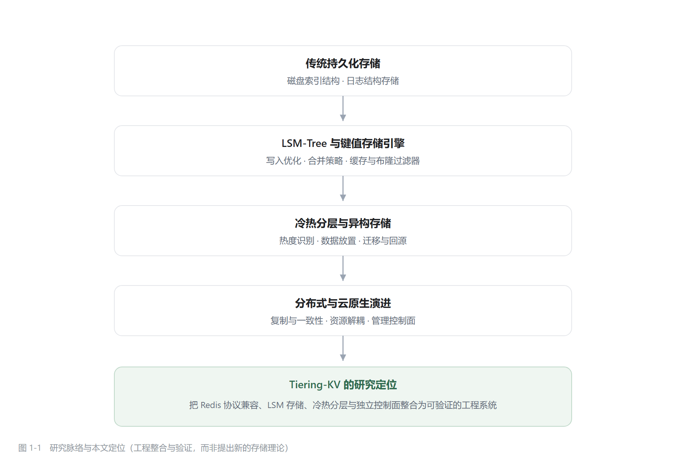

# 第一章　绪论

> 论文正文初稿 · 对应基线 `425f4c6`
> 图表：图 1-1（研究脉络与本文定位）
> 文献：15 篇核心（见 `chapter1-reference-map.md`），技术规范单列

## 1.1 研究背景与研究意义

### 1.1.1 背景

键值存储是互联网系统最基础的组件之一。以 Redis 为代表的内存键值数据库凭借丰富的数据结构与亚毫秒级响应，
长期承担缓存、会话、计数器与排行榜等职责。但它的容量模型有一个硬约束：**数据必须整体驻留在内存中**。
当数据集从 GB 级增长到数十 GB 甚至更大时，内存成本与单机容量同时成为瓶颈，而其中真正被频繁访问的往往只是一小部分"热数据"。

另一条技术路线是持久化存储引擎。LSM-Tree 通过"内存有序结构 + 磁盘顺序写 + 后台合并"，
把随机写转化为顺序写，在写入密集的场景下显著优于传统的磁盘索引结构 [1]；
Bigtable 则给出了这一思想在工业系统中的工程形态——内存表、不可变文件与合并的三段式结构 [2]。
在此基础上，"把冷数据放到慢速介质、把热数据留在内存"的分层存储成为自然延伸：
近年来的研究进一步关注**热度识别与记录提升**，即写入热点与读取热点可能并不在同一层级 [6]，
以及本地介质与远端存储组合时的放置、缓存与恢复问题 [7]。

与此同时，数据库系统的部署形态也在变化。云原生数据库把计算与存储解耦，用弹性资源与副本一致性支撑多租户场景 [13]；
数据中心资源解耦后，数据组织方式本身也需要重新设计 [14]。这使得"管理面"从附属工具变成一等公民：
系统的可观测性、可运维性与可验证性，直接决定了它能否被真正使用。

### 1.1.2 研究问题

上述三条线索交汇处存在一个工程问题：**能否在一个协议兼容的键值引擎中，同时做到"内存受配额约束"、
"冷数据可按需回源"与"运行状态可被外部验证"？**

这个问题的难点不在单点技术，而在三者的耦合：分层会引入新的状态（谁在内存、谁在磁盘、迁移进行到哪一步），
这些状态必须被一致地观测；而观测本身又会带来开销，需要在指标完整性与业务延迟之间取舍。

### 1.1.3 研究意义

本文的意义体现在两个层面。

**工程层面**：把 Redis 协议兼容、LSM 存储、冷热分层与独立控制面整合为一套可运行、可观测、可运维的系统，
并给出每条能力"被证明到什么程度"的明确边界。对于教学与中小规模部署场景，这种"可解释的完整实现"
比直接调用成熟组件更有参考价值。

**方法层面**：本文把"可证伪断言"作为验证的核心手段——每条结论都对应一个可以被推翻的检查点，
并用故障注入去主动制造失败。实践证明，这套方法发现的不是语法错误，而是并发一致性、持久化语义与审计完整性上的真实缺陷。

*图 1-1　研究脉络与本文定位（工程整合与验证，而非提出新的存储理论）*

如图 1-1 所示，本文不试图提出新的存储理论，而是站在既有研究之上做**工程整合与验证**：
把已被验证的机制组合成一个协议兼容、可观测、可验证的系统，并如实标注每项能力的证据等级。

---

## 1.2 国内外研究现状

### 1.2.1 LSM-Tree 与键值存储研究

LSM-Tree 的原始动机是降低高频写入下的索引维护成本：把随机更新先写入内存有序结构，
积累到阈值后顺序落盘，再用后台合并把多层文件整理成有序序列 [1]。
Bigtable 把这一思想工程化，明确了"内存表—不可变文件—合并"的职责划分 [2]，
此后绝大多数基于 LSM 的键值存储都沿用了这一骨架。

但 LSM 并非没有代价。围绕它形成了三组此消彼长的放大：**写放大**（同一份数据在合并中被反复重写）、
**读放大**（一次查询可能要查多层多个文件）与**空间放大**（旧版本与删除标记占用空间）。
后续研究大体沿着"在某一个放大上换取代价"展开：

- Monkey 研究布隆过滤器的内存分配，指出过滤器占用的内存与读放大之间存在最优分配点 [3]；
- Dostoevsky 进一步讨论合并频率的选择，说明"合并得多"会降低读与空间放大但抬高写放大，
  并提出根据负载自适应地减少"多余合并" [4]；
- 国内综述则从工程实现角度梳理了 LSM 键值存储的关键技术与优化方向 [5]。

**比较与评述**：这一方向的研究已经相当充分，但结论高度依赖负载假设。
对于以内存命中的热读为主、写入相对均匀的场景，"按表数阈值触发合并"这类简化策略
虽然牺牲了部分空间回收效率，却换来了行为可预测与实现成本可控——这正是本文采取的策略，
其代价在 3.6.5 中有明确说明。

### 1.2.2 冷热分层与异构存储研究

分层存储的基本假设是"访问分布不均"：少数热数据承担多数访问，其余数据可以放到更慢、更便宜的介质上。
但要把它做成工程机制，需要回答三个问题：**如何识别热度、何时迁移、迁移期间如何保证一致性**。

HotRAP 指出，在采用分层存储的 LSM 系统中，**写入热点与读取热点可能位于不同层级**：
新写入的数据停留在上层，而真正被频繁读取的记录可能已被下沉，导致读性能与存储效率之间出现矛盾；
其解法是跟踪记录热度并把热点记录提升回上层 [6]。
RocksMash 则把分层扩展到"本地存储 + 云存储"的组合，讨论数据放置、细粒度缓存（LAP cache）与故障恢复 [7]。

**比较与评述**：两项工作的共同点是把"放置决策"看作动态优化问题，差异在于介质假设——
前者面向 SSD/HDD 的层级，后者面向本地与远端的分层。二者都表明：冷热分层的关键不是"能不能落盘"，
而是"热度判断与迁移时机"。

与它们相比，本文的分层是**水位驱动**的简化机制：按内存使用率触发落盘与迁移，
没有实现基于访问频次的热点提升。这一取舍让系统行为容易解释与测试，但也意味着在访问分布剧烈倾斜时，
热记录可能仍留在冷层（3.7.5 已列为局限）。

### 1.2.3 分布式键值存储与一致性机制

当单机容量与可用性都不再足够时，系统需要走向多副本。围绕"多副本如何达成一致"，形成了两条代表性路线。

一条是**去中心化的最终一致**路线。Dynamo 用一致性哈希做分片、用向量时钟处理冲突、用可调读写法定人数在
可用性与一致性之间滑动 [9]，其目标是"永远可写"。另一条是**基于共识的强一致**路线：
Raft 把共识分解为领导者选举、日志复制与安全性三个子问题 [8]，
以更易实现与解释的方式达到与 Paxos 同等的安全性，成为近年来分布式存储的主流选择。

跨分片事务则引出时间戳问题。Spanner 用 TrueTime 把"时间不确定性"显式暴露，通过等待不确定区间获得外部一致性 [10]；
Percolator 用"时间戳 + 锁记录"替代阻塞式两阶段提交，在 Bigtable 之上实现跨行事务 [11]；
混合逻辑时钟（HLC）则在无法获得全局物理时钟时，用"物理毫秒 + 逻辑计数"保证时间戳单调可比 [12]。

**比较与评述**：三种时间戳方案对应不同的假设与代价——TrueTime 需要专用硬件（GPS/原子钟），
TSO 需要集中式授时服务，HLC 只需要松散同步的物理时钟但只能保证单调与因果序。
本文采用"Raft 复制 + HLC/TSO 时间戳 + 两阶段提交"的组合，属于第三类：
代价低、可解释，但**不提供线性一致读**，也未实现 Percolator 的多版本存储（5.5.3、5.6.4 已明确边界）。

### 1.2.4 云原生数据库与控制平面研究

云原生数据库的核心是**资源解耦**：把计算、存储与日志分离，使三者可以独立扩展与故障恢复。
综述性工作系统梳理了这一形态下的关键技术，包括计算存储分离的架构、副本一致性、弹性资源管理与故障恢复 [13]；
针对解耦数据中心的讨论则进一步指出，当网络成为存储访问的一部分时，数据组织方式（放置、缓存、复制）需要重新设计 [14]。

**比较与评述**：这类研究关注的往往是"如何让数据库本身更云化"。
而另一个常被忽视的维度是**管理面**：当实例数量增加、部署形态多样时，
纳管、监控、备份与审计本身就成为系统能力的一部分。
本文采取的做法是把控制面做成**独立进程**，只通过协议访问数据面，
从而在不改造存储引擎的前提下获得管理能力（第 4 章）。这一设计与"计算存储分离"的动机一致，
但解耦的是"管理与数据"，而非"计算与存储"。

### 1.2.5 系统可观测性与运行管理研究

随着系统从单体走向多服务，故障定位的难度从"看日志"变成了"跨服务追踪"。
针对十家企业微服务实践的调查显示，指标与追踪已成为故障定位的基础设施，
而观测数据的价值取决于它能否被**结构化地采集与关联** [15]。

**比较与评述**：该方向的成果多面向"服务调用链"，而存储系统的观测对象不同——
它关心的是容量、分层、缓存命中、合并进度这些**内部状态**。
两者的共同要求是"指标口径一致、缺失与为零可区分"。
本文据此设计了分层指标与三态展示（4.4），但**没有实现分布式链路追踪**，
因此不引用追踪相关成果作为自身能力的依据。

### 1.2.6 国内外研究现状评述

把上述五个方向放在一起看，可以看到一条清晰的演进链（图 1-1）：
存储结构从"降低写放大"出发，逐步引入分层与异构介质；
分布式能力从"可用性优先"走向"可验证的强一致"；
部署形态从单机走向解耦，管理面随之独立；
而观测能力则从"看指标"走向"可验证的指标体系"。

这些方向之间并非彼此独立，而是相互牵引：

1. **分层把存储问题变成了状态问题**。一旦数据分布在多个层级，系统就必须维护"谁在哪里、迁移到哪一步"的状态，
   这直接要求更强的观测能力 [6][7]；
2. **分布式把状态问题变成了时序问题**。多副本与跨分片事务需要全局可比的时间戳，
   而时间戳方案的选择又会反过来限制一致性等级 [8][10][12]；
3. **云原生把时序问题变成了管理问题**。资源解耦后，实例数量与形态增加，
   纳管、审计与故障恢复必须由独立的管理面承担 [13][14]；
4. **可观测性贯穿以上三层**。但现有研究多面向服务调用链 [15]，
   对"存储内部分层状态"的指标体系讨论较少。

由此可以归纳出三点工程挑战，它们构成本文的切入点：

- **协议兼容与分层的耦合**：分层机制必须在既有协议语义下工作，不能要求客户端改造；
- **内部状态的可验证性**：瞬时值、累计值与缺失值必须可区分，否则观测数据无法用于判断；
- **验证成本**：崩溃、掉电与跨机故障难以在普通实验环境中复现，结论必须标注证据边界。

需要强调的是，本文**不主张**"国内外尚无类似系统"或"首次提出分层键值引擎"。
HotRAP 等工作已经表明 LSM 与分层存储的结合是活跃研究方向 [6]，
本文的定位是：面向 **Redis 协议兼容**的键值引擎，探索冷热分层与分布式管理能力的**系统设计、工程实现与验证方法**。

---

## 1.3 本文研究内容

围绕上述挑战，本文完成四项工作，每一项对应一个章节，并与第六章的验证结果一一对应。

**（1）可解释的 LSM 存储内核与冷热分层机制（第三章）。**
针对"内存装不下"的问题，实现预写日志、分片内存表、带块索引与布隆过滤器的不可变表、按阈值触发的合并，
并在此之上用水位线驱动落盘、迁移与背压。研究重点是**让分层行为可解释、可观测**：
内存用量由统一记账维护，分层状态通过 `INFO` 暴露给外部。

**（2）独立的控制平面与可观测性体系（第四章）。**
针对"内部状态不可验证"的问题，实现以标准协议纳管的控制面，提供认证授权、指标采集、键空间、终端、告警、备份与审计；
并确立三条规则：指标只来自内核计数、缺失与为零必须可区分、失败状态必须有明确错误码。

**（3）受限范围的分布式与一致性能力（第五章）。**
针对"多副本与跨分片事务"，实现 Raft 日志复制、Region 分片与基于时间戳的两阶段事务，
并明确其证据边界：**在单机多进程环境下验证**，不声称生产级跨机共识。

**（4）以可证伪断言为核心的工程验证方法（第六章）。**
针对"结论无法追溯"的问题，建立单元/集成测试、端到端业务闭环、故障注入、性能基准与覆盖率五个层次，
并用这套方法发现并修复了持久化、并发一致性与审计完整性上的真实缺陷。

---

## 1.4 论文组织结构

全文共七章，组织如下：

| 章 | 内容 | 与其他章的关系 |
| --- | --- | --- |
| 第一章 | 绪论：研究背景、现状评述、研究内容与结构 | 提出研究问题 |
| 第二章 | 相关技术与系统总体设计：需求、技术选型、总体架构 | 回答"用了什么、为什么" |
| 第三章 | 核心存储引擎设计与实现：WAL、MemTable、SSTable、合并、分层、缓存 | 回答"存储如何实现" |
| 第四章 | 控制与管理模块设计与实现：协议接入、可观测性、认证审计、备份恢复 | 回答"管理与观测如何实现" |
| 第五章 | 分布式架构与一致性机制：分片、Raft、时间戳、两阶段事务、迁移 | 回答"分布式能力到什么程度" |
| 第六章 | 系统测试与实验结果分析：策略、环境、闭环、故障注入、性能、覆盖率、缺陷案例 | 回答"是否有效、边界在哪" |
| 第七章 | 总结与展望：工作总结、成果、局限、后续方向 | 收束全文 |

各章之间遵循"提出问题—确定技术底座—实现—验证—总结"的逻辑：
第二至第五章的每一项设计，都能在第六章找到对应的验证结果；第六章的每一组数据，都能追溯到具体测试或实验。

---

## 参考文献（本章）

[1] P. E. O'Neil, E. Cheng, D. Gawlick, E. J. O'Neil. The Log-Structured Merge-Tree (LSM-Tree).
    *Acta Informatica*, 33(4): 351–385, 1996.

[2] F. Chang, J. Dean, S. Ghemawat, et al. Bigtable: A Distributed Storage System for Structured Data.
    *Proceedings of OSDI 2006*, pp. 205–218.

[3] N. Dayan, M. Athanassoulis, S. Idreos. Monkey: Optimal Navigable Key-Value Store.
    *Proceedings of ACM SIGMOD 2017*.（页码待核）

[4] N. Dayan, S. Idreos. Dostoevsky: Better Space-Time Trade-Offs for LSM-Tree Based Key-Value Stores
    via Adaptive Removal of Superfluous Merging. *Proceedings of ACM SIGMOD 2018*.
    DOI: 10.1145/3183713.3196927.

[5] 吕萌, 华文镝, 谢平. 基于 LSM 树的键值存储系统技术研究综述. 计算机科学, 50(8): 1–15, 2023.
    DOI: 10.11896/jsjkx.220900178.

[6] J. Qiu, F. Yuan, M. Gao, H. Zhang. HotRAP: Hot Record Retention and Promotion for LSM-trees with
    Tiered Storage. *Proceedings of USENIX ATC 2025*, pp. 497–511.

[7] P. Xu, et al. RocksMash: Building a Fast and Efficient LSM-tree Store by Integrating Local Storage
    with Cloud Storage. *ACM Transactions on Architecture and Code Optimization*, 19(3), 2022.
    DOI: 10.1145/3527452.

[8] D. Ongaro, J. Ousterhout. In Search of an Understandable Consensus Algorithm.
    *Proceedings of USENIX ATC 2014*, pp. 305–319.

[9] G. DeCandia, D. Hastorun, M. Jampani, et al. Dynamo: Amazon's Highly Available Key-value Store.
    *Proceedings of ACM SOSP 2007*, pp. 205–220.

[10] J. C. Corbett, J. Dean, M. Epstein, et al. Spanner: Google's Globally-Distributed Database.
    *Proceedings of OSDI 2012*.（页码待核）

[11] D. Peng, F. Dabek. Large-scale Incremental Processing Using Distributed Transactions and
    Notifications. *Proceedings of OSDI 2010*.（页码待核）

[12] S. S. Kulkarni, M. Demirbas, D. Madappa, B. Avva, M. Leone. Logical Physical Clocks.
    *Proceedings of OPODIS 2014*, LNCS 8878, pp. 17–32.

[13] H. Dong, C. Zhang, G. Li, H. Zhang. Cloud-Native Databases: A Survey.
    *IEEE Transactions on Knowledge and Data Engineering*, 36(12): 7772–7791, 2024.
    DOI: 10.1109/TKDE.2024.3397508.

[14] Q. Zhang, et al. Rethinking Data Management Systems for Disaggregated Data Centers.
    *Proceedings of CIDR 2020*.

[15] B. Li, et al. Enjoy your observability: an industrial survey of microservice tracing and analysis.
    *Empirical Software Engineering*, 27(1), Article 25, 2022.
    DOI: 10.1007/s10664-021-10063-9.

## 技术规范（单列）

[S1] Redis. Redis Protocol Specification (RESP). https://redis.io/docs/latest/develop/reference/protocol-spec/

[S2] Netty Project. Netty Documentation. https://netty.io/

[S3] Prometheus. Metric Types. https://prometheus.io/docs/concepts/metric_types/

[S4] OpenTelemetry. Semantic Conventions for Metrics. https://opentelemetry.io/docs/specs/semconv/