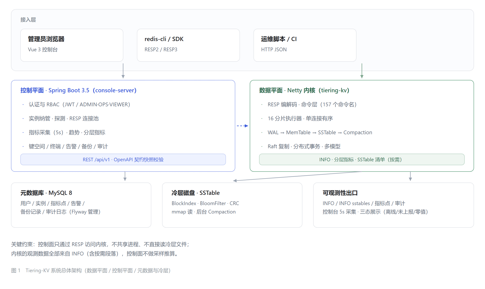

# 第二章　相关技术与系统总体设计

> 论文正文初稿 · 基线 `6439ecf`
> 图表：图 2-1（系统总体架构）、表 2-1（需求与目标映射）、表 2-2（核心技术选型）
> 基线：`6439ecf`
> 本章定位：回答"采用了哪些技术、为什么采用、系统如何组织"；具体实现见第三至第五章。

## 2.1 系统需求与设计目标

### 2.1.1 需求来源

系统的需求来自一个具体的使用场景：在单机资源有限的环境中，承载明显超出内存容量的键值数据，
同时保持 Redis 生态的可用性，并能被运维人员观测与管理。由此归纳出四类需求。

**功能需求**：支持 Redis 常用命令族（字符串、哈希、列表、集合、有序集合、流、地理、位图等），
提供多模型值（JSON、时序、向量）与 SQL 访问能力；支持多实例纳管、键空间浏览、在线终端、
告警、备份恢复与审计。

**性能需求**：写入路径不因持久化而不可用；读取热数据应有内存级延迟；
冷数据回源应可预测且可观测；分层调度不应阻塞客户端线程。

**可靠性需求**：进程异常终止后，已落盘的数据可恢复；多副本场景下写入经共识后生效；
控制面在依赖故障（数据库不可用）时能给出明确错误并在依赖恢复后自愈。

**管理需求**：权限分级、操作可追溯、指标可验证、失败状态可区分（而非以 0 掩盖）。

### 2.1.2 设计目标

**表 2-1　需求、设计目标与对应章节**

| 需求 | 设计目标 | 主要落实章节 |
| --- | --- | --- |
| 功能完整 | R1 协议兼容：RESP2/RESP3，可用标准客户端直连 | 4.2 |
| 功能完整 | R2 数据模型：覆盖常用命令族与多模型值 | 4.2 |
| 性能 | R3 写路径可用：持久化不阻塞客户端线程 | 3.3、3.7 |
| 性能 | R4 分层有效：内存占用受配额约束，冷数据按需回源 | 3.7 |
| 可靠性 | R5 崩溃可恢复：已落盘数据可重放，丢失窗口可量化 | 3.3 |
| 可靠性 | R6 复制一致：写经共识生效，单节点故障不丢已提交数据 | 5.3、5.4 |
| 管理 | R7 可观测：指标来自内核计数，缺失与为零可区分 | 4.4 |
| 管理 | R8 可运维：实例、告警、备份、审计、权限齐备 | 4.5、4.6 |

### 2.1.3 非目标

- 不与 Redis 比吞吐：本项目承担预写日志的持久化成本，Redis 对比基准关闭了 RDB/AOF；
- 不提供跨机强一致的生产级共识：现有集群能力在单机多进程下验证；
- 不实现完整的多版本并发控制：时间戳用于事务与锁判定，存储层不保留多版本。

---

## 2.2 相关核心技术

### 2.2.1 Java 21 与 JVM

选择 JVM 而非 C/C++ 的理由是**工程可验证性**：JVM 提供成熟的并发原语、内存可见性语义与
可观测工具（JFR、堆转储），便于在论文中复现实验与解释现象；JDK 21 的虚拟线程与
`FileChannel` 异步接口也为后续扩展留出空间。代价是 GC 抖动与内存开销，
因此系统把"内存记账"做成显式机制（见 3.4），而不是依赖堆自动管理。

### 2.2.2 Netty 与 RESP 协议

RESP 是 Redis 的线协议，分为 RESP2 与 RESP3：前者用 `+ - : $ *` 五种前缀表达简单字符串、错误、
整数、批量字符串与数组；后者增加了 map、set、push 等类型。系统支持两者常用子集，
使 `redis-cli` 与主流 SDK 可以直接连接。

网络层采用 Netty（事件驱动、零拷贝、可插拔编解码），原因是需要**在单连接上保证响应有序**：
命令按 key 分发到多个执行器并行处理，若直接写回会乱序，因此引入序号与顺序写回机制（见 4.2.2）。

### 2.2.3 LSM-Tree

LSM-Tree 的核心是把随机写转化为顺序写：写入先进入内存结构，积累到阈值后顺序落盘，
后台合并多层以控制读放大（O'Neil 等，1996）[1]。它牺牲部分读性能换取写吞吐与空间利用率，
与本项目"内存装不下、写入频繁、读取以热数据为主"的负载特征吻合，因此选作存储主结构。

### 2.2.4 Raft 与混合逻辑时钟

Raft 用"领导者选举 + 日志复制"把一致性问题分解为三个子问题（领导者选举、日志复制、安全性），
比 Paxos 更易实现与解释（Ongaro 与 Ousterhout，2014）[11]。本项目以 Raft 作为多副本写入的共识层。

混合逻辑时钟（HLC）把物理时间与逻辑计数结合：物理时间前进时取物理值，回拨时用逻辑计数保证单调，
从而在分布式事务中得到可比的时间戳（Kulkarni 等，2014）[14]。

**边界说明**：HLC 只解决"时间戳单调可比"，**不等于**多版本并发控制；系统没有实现多版本存储与垃圾回收。

### 2.2.5 Spring Boot 与控制平面

控制平面选择 Spring Boot，原因是需要快速组织 REST 接口、鉴权、数据访问与定时任务，
并把"管理面"与"数据面"彻底分离：控制面只通过 RESP 访问内核，不共享进程、不直接读冷层文件。
这一边界使两侧可以独立部署与验证，也让故障定位可以二分（内核算错或控制面解析错）。

---

## 2.3 存储引擎相关技术

### 2.3.1 预写日志（WAL）

WAL 的作用是在修改落入内存结构之前，先把"这次修改"变成可重放的事实。
工业系统通常提供三种落盘策略：每次写都同步（`ALWAYS`）、按周期批量同步（`EVERY_SEC`）、
仅写操作系统缓冲（`NO`）。本项目默认采用周期同步，并把"丢失窗口"作为可度量指标而非隐含假设。

**关键认知**：`EVERY_SEC` 只有在"有写入时才触发同步"是不够的——空闲期最后一次写入可能长期停留在用户态缓冲。
因此实现上必须有独立的周期性刷出机制（详见 3.3.3 的缺陷与修复）。

### 2.3.2 内存表（MemTable）

内存表需要同时满足"有序"与"并发安全"。常见方案是跳表（无锁读、段级写锁）与红黑树（全局锁）。
本项目选择分片跳表：范围扫描天然有序，写入按 key 哈希到分片，降低锁竞争。
内存占用由统一记账维护，使水位判定可以 O(1) 读取。

### 2.3.3 不可变磁盘表（SSTable）与布隆过滤器

SSTable 一旦写出即不可变，内部由数据块、块索引、布隆过滤器与校验组成。
布隆过滤器（Bloom，1970）[16]用少量位数组回答"键一定不存在"，把无效块读挡在磁盘之前；
Bigtable 的工程实践也采用这一组合（Chang 等，2006）[2]。本项目在此基础上加入了块级校验，
使损坏可被检测而非静默返回错误数据。

### 2.3.4 合并（Compaction）

合并解决两个问题：表数量增长带来的读放大，以及旧版本与删除标记占用的空间。
常见策略有 size-tiered（按大小分层合并）与 leveled（按层归并）。本项目采用按表数阈值触发的
简化策略：实现成本低、行为可预测，代价是空间回收不如 leveled 彻底（见 3.6.5）。

---

## 2.4 冷热分层与缓存技术

### 2.4.1 分层的基本思路

冷热分层把"内存容量"变成可配置的硬约束：热数据驻留内存表，超过水位后下沉到冷层，
读取时按需回源并把结果写回热层（copy-up）。这一机制的关键不在"能不能落盘"，
而在**调度与观测**：何时落盘、落多少、失败如何处理、外部如何看到状态。

### 2.4.2 内存映射（mmap）

冷层读取可选择 mmap：把文件映射到进程地址空间，由操作系统页缓存承担缓存职责，
避免用户态缓冲区复制。代价是页错误不可控、内存统计不直观，因此系统把 mmap 作为可选项，
并在其上层提供块缓存以稳定命中率。

### 2.4.3 块缓存策略：LRU 而非 ARC

块缓存按块缓存解码后的数据。候选策略包括 LRU、LFU、ARC 与 TinyLFU。
项目早期评估过 ARC（Megiddo 与 Modha，2003）[17]——它通过 B1/B2 幽灵队列感知"被淘汰键的再次访问"，
对突发访问模式更友好；但块缓存的访问局部性强、容量以条目计，ARC 的收益不足以抵消实现与维护成本，
最终采用 LRU（访问序链表）。

**表述边界**：ARC 是**评估过的备选方案**，不是本系统的实现；引用它用于说明选型过程，而非声称具备自适应缓存能力。

### 2.4.4 异步迁移与背压

迁移在线程池中执行，客户端线程不参与磁盘 IO；当内存达到临界水位时，系统对写入施加背压，
以避免"迁移追不上写入"导致的内存溢出。背压是一种显式的降级策略，
其触发与解除都需要被观测（见 3.7.2）。

---

## 2.5 分布式与一致性技术

### 2.5.1 分片

分片有两个层次：进程内按 key 哈希分片（保证同 key 串行），集群级按 key 范围划分为 Region，
每个 Region 对应一个复制组。前者解决并发正确性，后者解决容量与迁移单位。

### 2.5.2 Raft 复制

每个复制组内由 Raft 决定日志顺序：写入先追加日志，多数派确认后提交并应用到状态机。
领导者在任期内唯一，日志按任期与索引比较，保证已提交条目不被回滚。

**证据边界**：本项目的 Raft 实现与测试均在**单机多进程**环境下完成，
网络分区由进程或传输层模拟，未覆盖真实跨机网络抖动与时钟漂移。
因此本文只声称"实现了 Raft 复制路径并通过混沌测试"，不声称生产级跨机共识能力。

### 2.5.3 时间戳与两阶段提交

跨分片事务采用"两阶段提交 + 全局时间戳"的骨架：协调者分配开始时间戳，参与者在写入时加锁并记录时间戳，
提交阶段写入提交时间戳并释放锁；崩溃或超时由后台锁清理机制依据事务状态决定提交或回滚。

这一骨架借鉴了 Percolator 的设计思想（Peng 与 Dabek，2010）[13]——用"时间戳 + 锁记录"替代阻塞式两阶段提交。
**但本项目没有实现 Percolator 的多版本存储与快照读**：时间戳用于事务可见性与锁判定，
读请求得到的是某一时间戳下"已提交"的视图，不提供线性一致读。

### 2.5.4 MVCC 的基本概念与本文边界

多版本并发控制（MVCC）通过为每个数据项保留多个版本，使读不阻塞写、写不阻塞读，
并用可见性规则决定某事务能看到哪个版本。完整实现需要版本存储、版本清理（GC）与快照管理。
本项目**只实现了时间戳与可见性判定的最小子集**，存储层保留单版本；
因此本文不使用"完整 MVCC"这一表述。

---

## 2.6 系统总体架构设计

*图 2-1　Tiering-KV 系统总体架构（接入层 / 数据平面 / 控制平面）*

### 2.6.1 三个层面

**接入层**：浏览器（Vue 控制台）、`redis-cli` / SDK（RESP2/RESP3）、运维脚本（HTTP JSON）。
接入层不参与存储逻辑，只负责协议转换与请求发起。

**数据平面**：Netty 接入、命令层（按 key 分片执行）、存储引擎（预写日志 → 内存表 → 不可变表 → 合并）、
冷热分层（水位、迁移、淘汰、块缓存），以及可选的复制与事务层。数据平面的唯一职责是"正确存取数据"。

**控制平面**：Spring Boot 服务 + MySQL 元数据库 + Vue 控制台，负责认证授权、实例纳管、指标采集、
键空间浏览、在线终端、告警、备份恢复与审计。控制平面不持有业务数据，只持有元数据与操作记录。

### 2.6.2 边界与数据流

两条数据流贯穿系统：

- **数据流**：客户端 → Netty → 命令层 → 存储引擎 →（未命中）冷层 → 回源写回热层；
- **观测流**：内核计数器 → `INFO` 文本（含按需段落）→ 控制面解析 → 指标存储 → 界面/告警/审计。

两条流在物理上分离、在契约上耦合：控制面只依赖 `INFO` 的文本格式，不依赖内核内部结构。
这一设计使"界面数字不对"可以被快速二分定位。

### 2.6.3 核心技术选型

**表 2-2　系统核心技术选型及应用**

| 技术 | 应用位置 | 选型依据 | 备注（边界） |
| --- | --- | --- | --- |
| Java 21 | 核心运行环境 | 并发原语、可观测工具、生态成熟 | GC 抖动由显式内存记账缓解 |
| Netty | 网络接入 | 事件驱动、编解码可插拔 | 需自建响应保序机制 |
| RESP2/RESP3 | 协议兼容 | 生态工具可直接连接 | 支持常用子集，非全集 |
| LSM-Tree | 存储主结构 | 写入吞吐与有序存储 | 合并策略为简化版 |
| mmap | 冷层读取（可选） | 减少一次数据拷贝 | 与块缓存并用 |
| LRU | 块缓存 | 访问局部性强、实现简单 | ARC 为评估项，未采用 |
| Raft | 多副本共识 | 可解释、易实现、社区验证充分 | 单机多进程验证 |
| HLC | 时间戳管理 | 物理与逻辑结合、单调可比 | 不等于完整 MVCC |
| 两阶段提交 | 跨分片事务 | 语义清晰、可恢复 | 借鉴 Percolator 思路，未实现快照读 |
| Spring Boot | 控制平面 | 快速组织 REST/鉴权/定时任务 | 与数据面进程隔离 |
| MySQL 8 | 元数据存储 | 事务与查询能力成熟 | 仅存元数据与审计，不存业务数据 |

---

## 2.7 本章小结

本章确定了系统的技术底座与总体结构。技术选择遵循三条原则：

1. **与负载特征匹配**：LSM 对应"写多、内存受限"的负载；LRU 对应块缓存的强局部性；
   Raft 对应"多副本、可恢复"的可靠性诉求。
2. **可解释、可验证**：选择 Netty、Raft、LSM 这些机制清晰的技术，便于在论文中展开论证；
   对每个选型都记录了备选方案与放弃理由（如 ARC、leveled 合并）。
3. **边界明确**：对"评估过的方案"与"实际实现的方案"、"单机验证"与"跨机验证"、
   "时间戳可见性"与"完整 MVCC"逐项标注边界，避免后文出现能力升级。

后续章节按"总体 → 实现 → 验证"展开：第三章实现存储引擎与冷热分层，
第四章实现控制平面与可观测性，第五章讨论分布式与一致性，第六章给出测试与实验结果。

---

## 本章引用文献

本章引用 [1][2][11][13][14][16][17]，完整条目见文末《参考文献》；
协议与网络库规范见文末"技术规范"（S1、S2）。