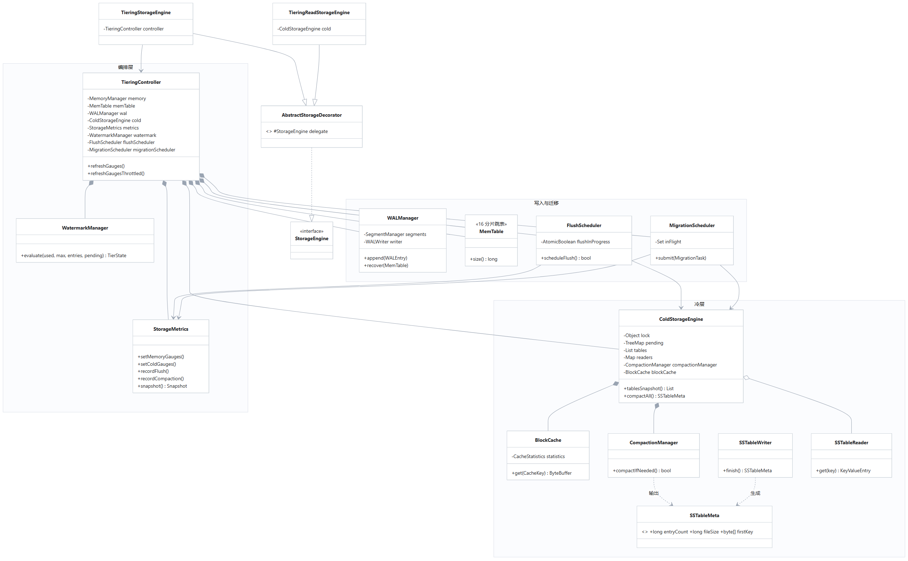

# 第三章　系统核心存储引擎设计与实现

> 论文正文初稿 · 对应基线 `4cc7a62`（Phase 11 之后）
> 图表：图 2（存储数据流）、图 4（核心存储模块类图）
> 数据来源：`docs/benchmark/*`、`docs/testing/*`、本仓库实测（口径见 §3.9）

## 3.1 设计目标与问题背景

### 3.1.1 为什么自己实现 LSM 主链路

KV 存储的教学实现通常止步于"内存哈希表 + RESP 协议"，其问题不在功能而在**容量模型**：
数据必须整体驻留内存，一旦超过堆上限就不可用。另一方面，直接引入 RocksDB / LevelDB 作为存储层，
虽然能获得成熟的分层能力，但核心机制成为黑盒，无法在论文中展开论证，也难以界定本人工作量。

因此本章的设计起点是：**在可控复杂度内，完整实现一条可解释、可观测、可验证的 LSM 写入与读取链路**，
再在其上叠加冷热分层，使"内存只保留热数据"成为结构性保证，而不是靠调参。

LSM-Tree 的核心思想早在 1996 年由 O'Neil 等人提出：把随机写转化为顺序写，
用多层有序结构加后台合并换取写吞吐 <sup>[1]</sup>；Bigtable 进一步给出了"内存表 + 不可变 SSTable + 合并"
的工程化形态 <sup>[2]</sup>，本项目的 WAL / MemTable / SSTable / Compaction 四段式结构与之一致。

### 3.1.2 设计目标

| 编号 | 目标 | 衡量方式 |
| --- | --- | --- |
| S1 | 写路径不丢已确认的数据 | 强杀后 WAL 重放，逐键校验 |
| S2 | 内存占用受配额约束 | 水位线 + 背压，2 MB 配额下 2 万次写入不超限 |
| S3 | 冷数据可按需回源 | 冷读命中率、copy-up 行为 |
| S4 | 状态可被外部观测 | `INFO # Tiering` 全部字段来自真实计数 |
| S5 | 复杂度可控 | 单机单进程可完整运行，组件间依赖单向 |

### 3.1.3 非目标

- 不追求与 Redis 同等的内存写性能（实测为 Redis 的 0.36–0.47×，见 §3.9）；
- 不实现完整 MVCC 快照隔离：版本号仅用于写入顺序与 TTL 守卫；
- 不做跨机分布式存储引擎（集群能力见第五章，且为单机多进程验证）。

---

## 3.2 总体方案与模块划分

### 3.2.1 分层结构

存储引擎自下而上分为四层（图 4）：

| 层 | 组件 | 职责 |
| --- | --- | --- |
| 持久化层 | `WALManager` / `WALWriter` / `SegmentManager` | 顺序追加、分段、落盘、恢复 |
| 内存层 | `MemTable` / `MemoryManager` / `SkipList` | 有序内存表、字节记账、TTL |
| 冷层 | `ColdStorageEngine` / `SSTableReader` / `SSTableWriter` / `CompactionManager` / `BlockCache` | 不可变表、索引与布隆过滤、合并、块缓存 |
| 编排层 | `TieringController` / `WatermarkManager` / `FlushScheduler` / `MigrationScheduler` / `StorageMetrics` | 水位判定、调度、指标 |

### 3.2.2 依赖方向与装饰器

所有上层能力都通过 `StorageEngine` 接口接入，装饰器模式串联：

```text
StorageEngine (interface)
  └── AbstractStorageDecorator (abstract, delegate)
        ├── TieringStorageEngine      // 写路径：水位判定 + Flush/迁移调度
        └── TieringReadStorageEngine  // 读路径：热层未命中则查冷层并 copy-up
```

选择装饰器而非"在 MemTable 里判断冷层"的原因是：**读写路径的关注点不同**。
写入要决定"何时落盘"，读取要决定"去哪里找"，把两者拆成两个装饰器后，
每个类的职责单一，也便于分别测试（`TieringStorageEngineTest` / `TieringReadStorageEngineTest`）。

### 3.2.3 关键选型与理由

| 决策点 | 选择 | 备选与理由 |
| --- | --- | --- |
| 内存索引 | 16 分片跳表（无锁读 + 段写锁） | 红黑树并发写锁粒度大；跳表实现简单、范围扫描天然有序 |
| 键序 | `Arrays.compareUnsigned`（无符号字节序） | 与 RESP 二进制键一致；避免字符串解码开销与本地化差异 |
| 冷层格式 | 块 + 块索引 + 布隆过滤 + CRC 的自定义格式 | 直接复用 SSTable 开源格式会引入外部依赖，且不利于论文解释 |
| 块缓存策略 | LRU（accessOrder） | 评估过 LFU 与 ARC <sup>[5]</sup>（ADR-0012），块缓存访问局部性强、ARC 的 ghost 机制收益有限，最终取 LRU（ADR-0028） |
| 合并策略 | 表数阈值触发全量/分层合并 | 与工业界 size-tiered 思路一致，实现成本低于 leveled |

---

## 3.3 WAL：顺序持久化与恢复

### 3.3.1 设计目标

WAL 的唯一职责是**在返回成功之前，把这次修改变成可重放的事实**。
它不参与查询，不保证"立即落盘"，但必须让"丢失窗口"可度量。

### 3.3.2 结构

| 元素 | 实现 |
| --- | --- |
| 段文件 | `%06d.log`，默认单段 64 MB，按序号升序枚举 |
| 记录 | 操作类型、时间戳、键、值、TTL、单调序号；`WALRecord.encode/decode` |
| 完整性 | CRC 校验；损坏记录计入 `RecoveryStats.corruptedRecordsDiscarded` 并跳过 |
| 写缓冲 | `BufferedOutputStream`（64 KB）+ `FileChannel.force(true)` |
| 落盘策略 | `ALWAYS` / `EVERY_SEC`（默认）/ `NO` |

### 3.3.3 关键实现：空闲期也必须落盘

最初 `EVERY_SEC` 的实现是"在 append 时判断距上次 force 是否 ≥1 秒"，
这意味着**最后一次写入之后的空闲期不会触发落盘**：数据留在 64 KB 用户态缓冲里，
进程一旦被强杀就永久丢失。故障注入实测：写入 100 个键、等待 1.8 秒、强制终止，重启后**只剩 1 个键**。

修复方式是在 `WALManager` 中引入后台调度器（守护线程，500 ms 周期），并给 `WALWriter` 增加 `dirty` 标记：

清单 3-1　WALWriter 的 dirty 标记与按需落盘

```java
// WALWriter：只有存在未落盘写入才真正 force，避免空闲期空转
public void force() throws IOException {
    if (!dirty) return;
    segments.current().force();  // flush + channel.force(true)
    dirty = false;
}
```

修复后同一场景 **100/100 键存活**；10 轮采样得到的后台落盘延迟为 **403–421 ms**（最坏 420.8 ms）。
这给出一个可写入论文的定量结论：**进程崩溃最多丢失最近一个调度窗口内的写入**，
而不是"可能丢失任意量"。

### 3.3.4 恢复流程

```text
启动 → 枚举段文件（升序）→ 逐条解码 → CRC 校验 → 按序号重放至 MemTable
     → 应用 TTL（按记录时间戳 + ttl 计算绝对过期点）→ 返回 RecoveryStats
```

恢复不重建索引，只回放；冷层数据不在 WAL 中，由 Manifest 恢复，两者互不干扰。

### 3.3.5 局限

- `EVERY_SEC` 的语义是"最多丢一个窗口"，**不等于**"掉电安全"：`force()` 同时 flush+fsync，
  但本项目未做掉电注入，不对掉电场景作承诺；
- 单段 64 MB 固定，不支持按写入速率自适应；
- 恢复时间与 WAL 体积线性相关，尚无 checkpoint 加速（`CheckpointManager` 已实现但默认未启用）。

---

## 3.4 MemTable：内存有序表与内存记账

### 3.4.1 设计目标

MemTable 要在**支持并发读写**的前提下保持**有序**（供范围扫描与 Flush 顺序写出），
并把内存占用变成**可查询的精确值**（水位判定依赖它）。

### 3.4.2 结构

- 16 个分片，每片由 `SkipList` 承载，按无符号字节序排序；
- 每个条目是 `KeyValueEntry`：键、值、时间戳、TTL、版本号；
- 内存记账由 `MemoryManager` 维护 `AtomicLong usedBytes`，写入加、删除/过期减；
- `size()` 返回 O(1) 计数器值，**不做遍历**（这是 `INFO` 能够在亚毫秒级返回的前提）。

### 3.4.3 内存记账与水位

`MemoryManager` 只回答两个问题：当前用了多少、上限多少。
水位判定交给 `WatermarkManager`：

**表 3-1　水位状态与对应动作**

| 状态 | 条件（默认） | 动作 |
| --- | --- | --- |
| NORMAL | < 70% | 无 |
| HIGH | ≥ 70% | 触发 Flush |
| MIGRATE | ≥ 85% | 启动异步迁移 |
| CRITICAL | ≥ 95% | 背压：限写或拒绝 |

把"记账"和"决策"分开，使得水位策略可以独立单测（`WatermarkManagerTest` 覆盖各边界），
也方便在演示实例（24 MB 配额）与默认实例（1 GB）之间切换而不改逻辑。

### 3.4.4 TTL 的处理

TTL 不靠后台扫描删除，而是**读取时惰性判定**：`MemTable` 在 `get` 时比较 `now` 与条目过期点，
过期即视为不存在；`TTLManager` 负责定期回收以释放内存。
这样避免了"定时任务扫描全表"的抖动，代价是过期数据会短暂占内存。

### 3.4.5 局限

- 分片数固定 16，不能随核数扩展；
- 版本号只用于写入顺序，未实现快照读；
- 大 value 直接驻留内存，没有大对象下沉策略。

---

## 3.5 SSTable：不可变磁盘表

### 3.5.1 设计目标

SSTable 一旦写出就不再修改，因此它的设计目标是：**顺序写、范围读、少读块**。

### 3.5.2 文件布局

清单 3-2　SSTable 文件布局

```text
+----------------+  数据块（blockTargetBytes，默认 4 KB）
|   Data Blocks  |  块内按字节序排列的 KeyValueEntry
+----------------+
|   Block Index  |  每块首键 → (offset, length)
+----------------+
|   Bloom Filter |  m 位数组 + k 个哈希，误判率由 bitsPerKey 控制
+----------------+
|     Footer     |  索引/Bloom 的偏移与长度、魔数
+----------------+
```

块级 CRC 用于检测损坏；布隆过滤器借鉴 Bloom 的经典结论 <sup>[3]</sup>：
用少量位数组即可把"键一定不存在"的判断前置，避免无效块读。Bigtable 也在 SSTable 中采用了同样的组合 <sup>[2]</sup>。

### 3.5.3 写与读

**写**：`SSTableWriter` 顺序追加条目，块满即落盘并记录索引；`finish()` 写索引、Bloom、Footer，
返回 `SSTableMeta`（id、条目数、字节数、首末键）。

**读**：`SSTableReader` 先查块索引定位块，再在块内二分查找（`Keys.compare`），最后校验 CRC。
冷层读取可走 mmap（`useMmap`），把页缓存交给操作系统；上层 `BlockCache` 则缓存解码后的块。

### 3.5.4 元数据与键范围

`SSTableMeta` 是 record，字段为 `id / fileName / entryCount / fileSize / firstKey / lastKey`。
其中 `firstKey`/`lastKey` 是**写入顺序的首末条目**，只有在"写入有序"的前提下才是范围边界——
这一点由 Flush 与 Compaction 保证（两者都按字节序遍历）。

> 工程细节：`INFO sstables` 输出键范围时使用 Base64，并在协议中显式声明 `sstable_key_order:bytewise`。
> 原因是数字型键（`tier:1000000` 与 `tier:999999`）在字节序下呈现"看起来反了"的顺序，
> 若不声明比较器语义，读者会误判为缺陷。

### 3.5.5 局限

- 无块级压缩，磁盘占用高于工业实现；
- 单表最大条目数受 Flush 触发时机影响，没有按大小切分；
- 读放大为 O(表数)，未做分区索引（bloom 只能减少无效表访问）。

---

## 3.6 Compaction：合并与空间回收

### 3.6.1 设计目标

合并要解决两个问题：**表数量增长导致读放大**，以及**旧版本与墓碑占用空间**。

### 3.6.2 触发与执行

- 触发条件：`tables.size() >= compactionThreshold`（默认 8）；
- 全量合并 `compactAll()` 与分层合并 `compactLeveled()` 两条路径；
- `CompactionTask` 对输入表做多路归并，按字节序输出，保留最新版本；
- 完成后 `installCompaction` 删除输入文件、重写 Manifest、替换表清单；
- 通过 `CompactionListener` 回调 `StorageMetrics`，使指标与行为同步。

### 3.6.3 并发安全

表清单的读取与替换共用同一把锁：`tablesSnapshot()` 返回 `List.copyOf(tables)` 的不可变副本，
`installCompaction` 在锁内整体替换。因此外部观察到的永远是"合并前"或"合并后"的完整状态，
不会引用已删除的表。

该性质由测试固定：写线程持续 `writeTable` + `compactAll`，3 个读线程循环取快照并校验
"逐行之和 == 总计"，1500 ms 内无一次撕裂（Phase 9）。

### 3.6.4 实测

| 场景 | 输入 | 输出 | 耗时 |
| --- | --- | --- | --- |
| 演示实例一次全量合并 | 429.9 MB | 191.6 MB | 1,487 ms |

输出显著小于输入，说明覆盖版本与墓碑被回收；该组数字直接来自 `INFO # Tiering` 的
`tiering_compaction_input_bytes / output_bytes / latency_ms`，不是事后统计。

### 3.6.5 局限

- 阈值为固定表数，不感知单表大小，可能出现"少量大表"或"多量小表"；
- 合并期间不限制写入速率，极端情况下会与 Flush 争抢磁盘；
- 未实现增量（leveled）合并的完整策略。

---

## 3.7 冷热分层：水位、迁移与缓存

### 3.7.1 设计目标

让"内存占用"成为**可配置的硬约束**：无论写入多少数据，内存使用都不超过配额，
超出部分自动下沉到冷层，并在读取时按需回源。

### 3.7.2 触发链路

```text
写入 → MemTable（记账）→ WatermarkManager.evaluate
     ├─ HIGH      → FlushScheduler.scheduleFlush() → SSTable
     ├─ MIGRATE   → MigrationScheduler.submit() → 迁移到冷层
     └─ CRITICAL  → BackPressureController → 限写/拒绝
```

三个动作都是**后台执行**，客户端线程从不做磁盘 IO——这一点由 Phase 6 实验验证：
2 MB 配额下连续写入 2 万次，客户线程未出现阻塞，峰值内存 350 KB。

### 3.7.3 读取回源

`TieringReadStorageEngine` 拦截读请求：

1. 先查 MemTable；
2. 未命中则通过 `UnionStorageIterator` 合并冷层表（新→旧）；
3. 命中后把条目 **copy-up** 回热层，使后续访问命中内存。

`UnionStorageIterator` 的存在使得"多表覆盖同一键"的场景仍返回最新值，
这也是 `INFO sstables` 中多张表键范围重叠却语义正确的原因。

### 3.7.4 BlockCache

冷层块缓存采用 LRU（`accessOrder=true`），按块缓存解码后的 `ByteBuffer`，
容量以条目数计。指标包括 hits / misses / evictions / hitRate，全部进入 `INFO`。

实测两个极端：

| 场景 | 数据集 | 缓存 | 命中率 |
| --- | --- | --- | --- |
| 演示实例 | 597 MB 冷数据 | 默认容量 | **84.8%** |
| 压力场景 | 232 MB 冷数据 | 小容量 | **3.2%** |

两者都不是"错误"，而是"缓存容量 / 工作集"的真实比例；界面如实展示，不做平滑或隐藏。

### 3.7.5 局限

- 迁移按热点排序，但热点统计窗口固定，突发流量下可能迁移"刚热起来的键"；
- 淘汰与迁移共用配额，临界水位下的策略是"先限写再淘汰"，未做更细的 QoS；
- BlockCache 未做字节级容量控制，与内存配额存在口径差异。

---

## 3.8 核心模块类图（图 3-2）



*图 3-2　核心存储模块类图（编排层 / 写入与迁移 / 冷层；关系取自实际字段与继承）*

类图说明三点：

1. **继承关系只有一处**：`TieringStorageEngine` 与 `TieringReadStorageEngine` 都继承
   `AbstractStorageDecorator`，后者实现 `StorageEngine` 接口；其余均为组合或依赖；
2. **组合关系体现生命周期**：`TieringController` 持有 `MemTable`/`WALManager`/`ColdStorageEngine`/
   `StorageMetrics`/两个调度器，随控制器创建与关闭；`ColdStorageEngine` 持有 `BlockCache` 与 `CompactionManager`；
3. **依赖关系体现调用**：`FlushScheduler` 与 `MigrationScheduler` 都依赖 `ColdStorageEngine` 与 `StorageMetrics`，
   但彼此不知道对方存在，调度解耦。

---

## 3.9 实验与结果

### 3.9.1 环境

| 项 | 值 |
| --- | --- |
| 硬件 | Windows 11 · 20 逻辑核 · 31.6 GB 内存 · SSD（本地基准）；Docker bridge 网络（对比基准） |
| JDK | 21（Microsoft OpenJDK 21.0.12） |
| 引擎配置 | 16 分片；WAL 段 64 MB、`fsync=EVERY_SEC`；compaction 阈值 8；水位 70/85/95 |
| 堆 | 默认 `-Xmx1g`；分层专项实验 `-Xmx2g`（Redis 对比时双方一致） |

### 3.9.2 与 Redis 7 的横向对比

**表 3-2　与 Redis 7 的吞吐与延迟对比（同机、同客户端）**

| 场景 | Tiering-KV | Redis 7 | 比值 |
| --- | --- | --- | --- |
| SET · c=1 | 10,347 rps / p50 0.079 ms | 21,834 / 0.039 ms | 0.47× |
| GET · c=1 | 11,148 / 0.079 ms | 23,641 / 0.039 ms | 0.47× |
| SET · c=50 | 59,701 / 0.431 ms | 165,975 / 0.159 ms | 0.36× |
| GET · c=50 | 63,512 / 0.423 ms | 161,160 / 0.159 ms | 0.39× |

**口径**：同机、同客户端（`redis-benchmark`）、同 Docker 网络；`-n 200000 -c {1,50} -r 1000000 -d 64`；
Redis 关闭 RDB/AOF，Tiering-KV 保持默认 WAL——即本项目承担持久化成本而 Redis 不承担。
因此该比值应理解为"在承担 WAL 的前提下，达到 Redis 的 1/3 左右"，而非"性能等价"。

### 3.9.3 分层调度

**表 3-3　Flush 与异步迁移的吞吐**

| 场景 | 规模 | 吞吐 | 备注 |
| --- | --- | --- | --- |
| 自动 Flush | 100K 条 | 857K entries/s | 116.6 ms |
| 自动 Flush | 200K 条 | 844K entries/s | 237.0 ms |
| 异步迁移 | 100K 条 | 297K ops/s | 成功率 100%，端到端 P99 69.5 ms |
| 异步迁移 | 1M 条 | 308K ops/s | 成功率 100%，端到端 P99 1,397.9 ms |

P99 为"提交→完成"的端到端延迟，包含提交快于消费时的队列堆积；单任务执行延迟远低于此。

### 3.9.4 持久化边界

**表 3-4　WAL 持久化边界的实测结果**

| 实验 | 结果 |
| --- | --- |
| 写入 100 键 → 等 1.8 s → 强制终止 → 重启 | 修复前 **99/100 丢失**；修复后 **100/100 存活** |
| 后台落盘延迟（10 轮采样） | 403–421 ms（最坏 420.8 ms） |
| 空闲 2 s 文件大小 | 不变（`dirty` 标记避免空转 fsync） |

### 3.9.5 存储结构与清单成本

**表 3-5　不同表数量下的清单成本**

| 表数 | 快照（`List.copyOf`） | 渲染（文本+Base64） | 输出 |
| --- | --- | --- | --- |
| 1 | 7 µs | 1,949 µs（含 JIT） | 191 B |
| 10 | 7 µs | 96 µs | 953 B |
| 100 | 9 µs | 573 µs | 8,797 B |
| 1,000 | 52 µs | 2,236 µs | 97,003 B |

### 3.9.6 小结

本引擎在**承担 WAL 持久化**的前提下达到 Redis 约 1/3 的吞吐，
分层调度在 100K–1M 规模下保持 100% 迁移成功率，内存严格受配额约束，
崩溃恢复的丢失窗口被量化为"一个 500 ms 调度窗口"（实测 403–421 ms）。
这些结论共同支撑了设计目标 S1–S5，但 S1 仅覆盖**进程崩溃**，不含掉电。

---

## 3.10 本章局限

1. 掉电恢复未验证；
2. 合并策略为固定表数阈值，非 size-tiered；
3. 无压缩，磁盘占用偏高；
4. BlockCache 为 LRU，未采用 ARC（评估见 ADR-0012）；
5. 冷层 `DBSIZE` 需要全量迭代（实测 17.1 ms 首次），未做增量计数。

---

## 参考文献（本章）

[1] P. E. O'Neil, E. Cheng, D. Gawlick, E. J. O'Neil. The Log-Structured Merge-Tree (LSM-Tree).
    *Acta Informatica*, 33(4): 351–385, 1996.

[2] F. Chang, J. Dean, S. Ghemawat, et al. Bigtable: A Distributed Storage System for Structured Data.
    *Proceedings of OSDI 2006*, pp. 205–218.

[3] B. H. Bloom. Space/Time Trade-offs in Hash Coding with Allowable Errors.
    *Communications of the ACM*, 13(7): 422–426, 1970.

[4] M. Kleppmann. *Designing Data-Intensive Applications*. O'Reilly Media, 2017.（第 3 章：存储与检索）

[5] N. Megiddo, D. S. Modha. ARC: A Self-Tuning, Low Overhead Replacement Cache.
    *Proceedings of FAST 2003*.（本项目评估后未采用，见 ADR-0012）