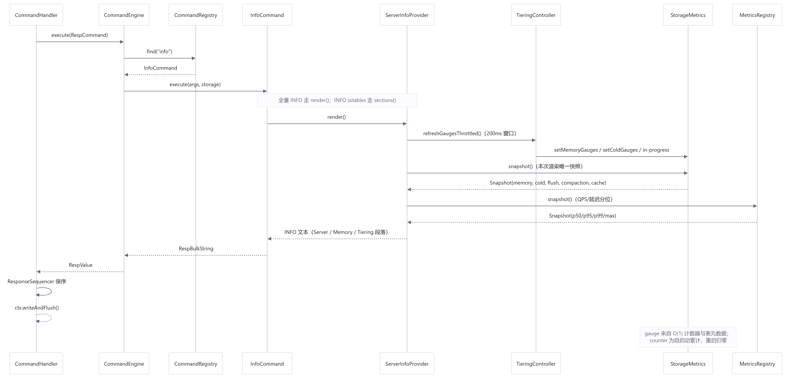
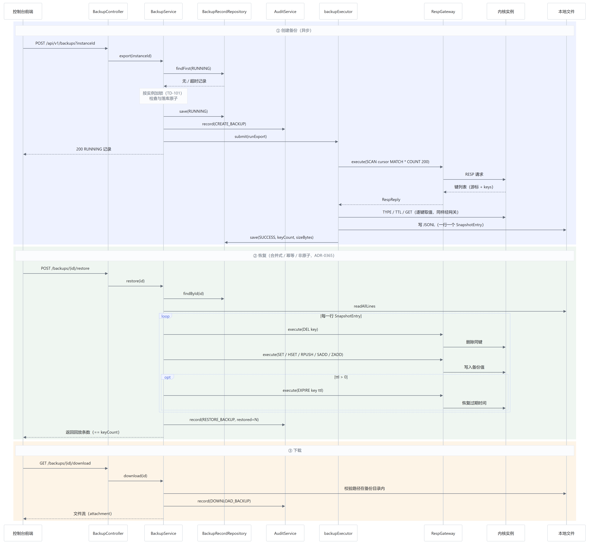

# 第四章　系统控制与管理模块设计与实现

> 论文正文初稿 · 对应基线 `6439ecf`
> 图表：图 2-1（总体架构）、图 4-1（INFO 时序）、图 4-2（备份恢复时序）
> 数据来源：`docs/testing/phase10-e2e.md`、`docs/api/openapi.json`、本仓库实测

## 4.1 设计目标与问题背景

### 4.1.1 为什么需要独立的控制面

内核是一个 RESP 服务，只认命令、不认人：它能回答"这个键是什么"，但回答不了
"谁在什么时候改了它""现在有几个实例、哪个掉线了""上次备份能不能恢复"。
如果把这些能力塞进内核进程，会带来两个问题：

1. **故障域扩大**：控制台的 bug（如一次慢查询、一次 OOM）会拖垮数据面；
2. **协议污染**：管理类命令会进入 Redis 命令空间，破坏兼容性。

因此本项目把控制面做成**独立进程**（Spring Boot），只通过 RESP 与内核通信（图 2-1）。
这条边界带来两个直接收益：内核可单独升级/重启；控制面可独立部署与限流。

### 4.1.2 设计目标

| 编号 | 目标 | 衡量方式 |
| --- | --- | --- |
| C1 | 协议兼容、零侵入 | 只用标准 RESP 命令，不新增管理命令（`INFO <section>` 除外） |
| C2 | 观测数据可信 | 所有指标来自内核计数，缺失时显式提示而非补零 |
| C3 | 操作可追溯 | 登录/写入/实例/告警/备份/终端全部落审计 |
| C4 | 失败状态明确 | 401/403/404/409/502/503 各有明确语义 |
| C5 | 多实例隔离 | 切换实例后指标、图表、会话、历史全部跟随 |

### 4.1.3 非目标

- 不做多租户（所有登录用户看到同一批实例）；
- 不做告警的通知渠道（邮件/短信），仅落事件表；
- 不做跨集群联邦管理。

---

## 4.2 RESP 协议与 Netty 接入

### 4.2.1 协议实现

内核实现了 RESP2 与 RESP3 的常用子集：简单字符串、错误、整数、批量字符串、数组、
以及 RESP3 的 map/set/push 类型。协议解析由 `RespRequestParser` 完成，
命令分发由 `CommandEngine` 负责。

选择自己实现而非引入 Lettuce/Jedis 服务端库的原因是：**我们要控制执行语义**——
分片调度、事务排队、慢命令计量都在这一层，借用现成框架反而不好插入。

### 4.2.2 Netty 接入与并发模型

清单 4-1　Netty 接入管线

```text
ChannelPipeline: 解码器 → CommandHandler → CommandEngine → KeyShardExecutor(16)
                                  ↓
                          ResponseSequencer（保序）→ writeAndFlush
```

- `CommandHandler` 继承 `ChannelInboundHandlerAdapter`，在 `channelRead` 中解析并执行；
- `CommandEngine` 把命令按 key 哈希到 16 个执行器之一，保证**同 key 串行**；
- `ResponseSequencer` 解决"多分片并行执行、单连接按序返回"的问题：
  每条命令带序号，只有队首完成才写出，避免响应乱序。

并发模型的选择依据是"**单连接语义正确优先于极限吞吐**"：
Redis 客户端默认假设响应与请求一一对应且有序，乱序会让上层 SDK 直接错乱。

### 4.2.3 命令层与扩展

157 个命令名由 `CommandCatalog` 注册，按族组织（string / hash / list / set / zset / stream /
geo / bit / json / ts / vector / 管理类）。每个命令实现 `Command` 接口：

清单 4-2　命令接口

```java
RespValue execute(List<byte[]> args, StorageEngine storage);
```

多模型命令（`json`、`ts.*`、`vector.*`）通过 `MultiModelCommand` 统一转发，
避免为每个子命令写一个类。

### 4.2.4 局限

- 未实现 RESP3 的全部类型与 pub/sub 推送语义；
- 分片数固定 16；
- 慢命令只计量不熔断。

---

## 4.3 命令执行与存储引擎的边界

### 4.3.1 接口收敛

所有命令只依赖 `StorageEngine` 接口，不直接触碰 MemTable 或 SSTable。
因此存储层可以替换（如加 VectorIndex 装饰器）而不影响命令。

### 4.3.2 事务与集群的接入点

事务（`MULTI/EXEC/WATCH`）在命令层拦截并排队；集群模式由 `ReplicatedStorageEngine` 包装存储接口，
把写请求转成 Raft 日志。两者都不修改命令实现本身。

### 4.3.3 局限

跨节点事务使用两阶段提交 + 全局时间戳 <sup>[19][20]</sup>，借鉴 Percolator 的设计思想 <sup>[13]</sup>，
但**未实现其多版本存储与快照读**（详见 5.5.3 与 5.6.4）。
一致性验证限于单机多进程。

---

## 4.4 INFO 可观测性：从内核计数到界面数字

### 4.4.1 设计目标

让"界面上看到的每个数字"都能追溯到内核的一个计数器或表元数据，
并且**缺失、为零、失败**三种情况必须可区分。

### 4.4.2 数据来源分层

| 类别 | 例子 | 语义 | 重启后 |
| --- | --- | --- | --- |
| Gauge | MemTable 用量、SSTable 数量、磁盘占用 | 瞬时值 | 由 WAL 重放 + Manifest 重建 |
| Counter | Flush 次数、Compaction 次数、迁移成功/失败、缓存命中 | 自启动累计 | 归零 |
| 直方图 | P50/P95/P99/max | 17 桶 + 60 s 滚动窗口 | 归零 |

### 4.4.3 请求时序



*图 4-1　INFO 请求处理时序（含 gauge 刷新、单快照、延迟分位读取）*

关键设计点有三：

1. **节流刷新**：`refreshGaugesThrottled()` 在 200 ms 内复用上次结果，避免高频 INFO 反复复制表清单；
2. **单快照**：`render()` 开头刷新一次 gauge 并取一次 `StorageMetrics.Snapshot`，
   `# Memory` 与 `# Tiering` 共用，杜绝"内存 3.1 MB / MemTable 3.4 MB"这类自相矛盾；
3. **锁外编码**：快照是 `List.copyOf` 的不可变副本，Base64 与字符串拼接都在锁外完成。

### 4.4.4 延迟分位

延迟用固定分桶直方图而非平均值：17 个上界（50 µs–5 s），每桶一个 `LongAdder`；
`LatencyStats` 维护 current/previous 两个窗口，**读取时惰性轮转**（60 s），不需要额外线程。
分位返回桶上界，并以实测最大值封顶，避免出现 `P95 > max` 的荒谬读数；窗口无样本时返回 0 而不是历史累计。

### 4.4.5 实测开销

| 场景 | 吞吐 | p99 |
| --- | --- | --- |
| 无 INFO 流量 | 11,452 ops/s | 0.537 ms |
| 叠加 50 次/秒 INFO | 12,061 ops/s | **0.503 ms** |

`INFO` 自身 p50 0.246 ms、p95 0.509 ms（200 次）。结论：观测对业务延迟无可测影响。

### 4.4.6 局限

- 分位是分桶估算，不是精确分位；
- 200 ms 节流意味着 gauge 最多滞后一个窗口；
- 冷层精确计数（`DBSIZE` 口径）在变更后首次需要全量迭代。

---

## 4.5 控制面：认证、审计与多实例

### 4.5.1 认证与授权

- JWT（HS256）+ BCrypt 口令；token TTL 默认 720 分钟；
- 三级角色：ADMIN / OPS / VIEWER；写接口用 `@PreAuthorize` 注解控制；
- 权限矩阵由测试固定：VIEWER 写键空间 403、读审计 403、读备份 200；匿名 401。

### 4.5.2 审计

审计表记录：时间、用户、动作、对象、详情、IP、成功与否。
关键实现细节是：**失败操作必须留痕**。

早期 `AuditService.record()` 与业务方法共享事务，业务抛异常时记录被一起回滚，
导致"被拦截的终端命令查不到审计"。修复方式是把该方法标注为 `REQUIRES_NEW`，
使其在独立事务中提交，与调用方成败无关。

导出为 CSV，带 UTF-8 BOM 与中文表头，便于 Excel 直接打开；测试用 RFC4180 解析器校验，
而不是按逗号切分。

### 4.5.3 多实例隔离

控制面按实例维护独立的 RESP 连接池与指标序列；前端切换实例时，
指标、图表、终端会话标题、命令历史全部跟随。

验证方法是"双向比对"：直连内核读 INFO，再调控制面 API，逐字段比较；
两个实例各 9 项检查全部一致，且两实例数值互不相同（18/18）。

### 4.5.4 失败语义

**表 4-1　控制面的失败状态与错误码**

| 状态 | 场景 | 错误码 |
| --- | --- | --- |
| 401 | 未认证 / token 过期或签名非法 | 40100 |
| 403 | 角色不足 | 40300 |
| 404 | 实例/规则/备份不存在 | 40400 |
| 409 | 同实例已有备份在跑 | 40900 |
| 502 | 内核不可达（连接失败） | 50201 |
| 502 | 内核返回不可解析内容 | 50200 |
| 503 | 数据库不可用 | 50300 |

503 的引入是复核阶段的整改：数据库断连原本返回 500 + 内部术语，
现在只对"事务创建失败 / 连接获取失败 / 资源不可用"三类异常映射为 503，
文案为"数据库暂不可用，请稍后重试"，不暴露 SQL、驱动或堆栈。

### 4.5.5 局限

- 单租户，所有登录用户共享实例视图；
- 审计只覆盖写操作与登录，高频只读不落库；
- token 无刷新机制，过期后需重新登录。

---

## 4.6 备份与恢复

### 4.6.1 设计目标

在不阻塞内核的前提下导出一致性可接受的逻辑快照，并支持**可重复、可审计**的恢复。

### 4.6.2 时序



*图 4-2　备份 / 恢复 / 下载时序（含鉴权、审计、网关与文件读写）*

### 4.6.3 三个关键决策

**① 异步 + 单实例串行**

`export()` 立即返回 `RUNNING` 记录，真正导出在线程池中执行；
同一实例的"检查 RUNNING + 落库"必须原子，否则两个并发请求会双双成功（实测 5/5 轮复现）。
修复后并发请求稳定返回 `200 + 409`。

**② 合并式、幂等、非原子（ADR-0365）**

- 合并式：逐条 `DEL` 后写回，备份中不存在的键**保留**；
- 幂等：同一份备份重复恢复结果一致；
- 非原子：中途失败不回滚，已写入部分保留，并记录 `result=failed restored=N`。

**③ 三类操作全部审计**

`CREATE_BACKUP` / `RESTORE_BACKUP`（含失败）/ `DOWNLOAD_BACKUP`。
这是复核阶段补上的缺口：在此之前，系统能恢复数据，却无法追溯"谁创建的、谁恢复的、谁下载的"。

### 4.6.4 实验

| 项 | 结果 |
| --- | --- |
| 导出规模 | 3,123 键 / 约 400 KB JSONL |
| 恢复完整性 | 回放数 == 记录 keyCount（3,123/3,123）；批量首/中/尾抽样 3/3 |
| 特殊字符 | 含逗号、引号的值原样还原 |
| 并发提交 | 修复前 200/200（5/5 轮）；修复后 **200/409**（5/5 轮） |
| 合并语义 | 备份后新增的键在恢复后仍存在 |

### 4.6.5 局限

- 恢复无并发保护（两次恢复会互相覆盖）；
- 全量读入内存（`readAllLines`），上限由 `MAX_KEYS` 与堆大小约束；
- 无增量备份与 PITR。

---

## 4.7 本章实验与小结

### 4.7.1 端到端验收

**表 4-2　七条业务闭环的断言与代表结果**

| 闭环 | 断言数 | 代表结果 |
| --- | --- | --- |
| 认证与权限 | 10 | 改密后旧口令 401；VIEWER 越权 403 |
| 实例管理 | 9 | 探测 UP/DOWN；删除后列表不含 |
| 键空间 | 14 | TTL 到期后内核 `EXISTS=0` |
| 在线终端 | 11 | 危险命令 400；历史按实例隔离 |
| 备份恢复 | 16 | 回放数==keyCount；并发 200+409 |
| 告警 | 10 | 确定性触发 → FIRING → RESOLVED |
| 审计 | 21 | 时间/动作过滤；CSV 每行列数一致 |

合计 91 条断言，全部在真实内核 + 真实 MySQL 上执行。

### 4.7.2 故障注入

**表 4-3　四类故障注入的实测结果**

| 故障 | 结果 |
| --- | --- |
| 实例离线 | 502/50201，前端显示 `—` 与红色提示 |
| 内核崩溃 | 100/100 键存活，进程级计数归零 |
| 数据库断连 | 5,046 ms 返回 503+50300；恢复后 108 ms 自愈（不重启控制面） |
| Token | 篡改→401；有效签名+过期→401；有效未过期→200 |

### 4.7.3 小结

控制面通过"只走 RESP"的边界保持了与内核的低耦合，
用"单快照 + 三态展示"保证了观测数据的可信性，
用"审计 + 明确的失败码"保证了操作可追溯，
用"异步 + 串行化 + 合并式恢复"给出了备份能力的可用语义。

---

## 4.8 本章局限

1. 单租户、无细粒度实例授权；
2. 恢复无并发保护、非原子；
3. 审计不覆盖只读操作；
4. 覆盖率 62.57%，异常分支覆盖不足；
5. 告警只有事件记录，无通知渠道。

---

## 本章引用文献

本章引用 [11][13][19][20]，完整条目见文末《参考文献》。
协议、网络库与指标语义规范见文末"技术规范"（S1、S2）。