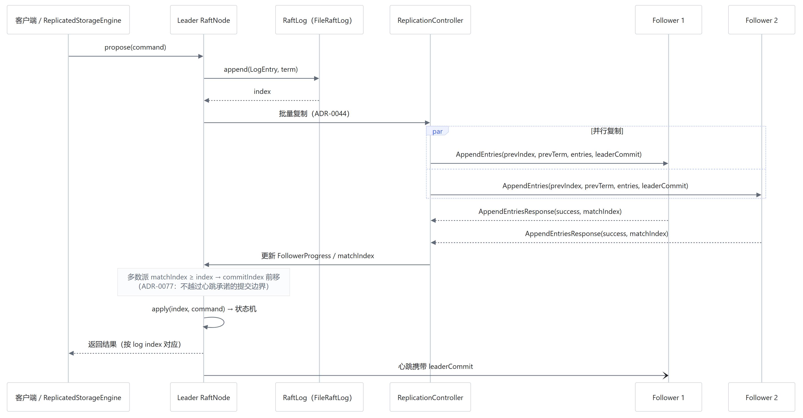
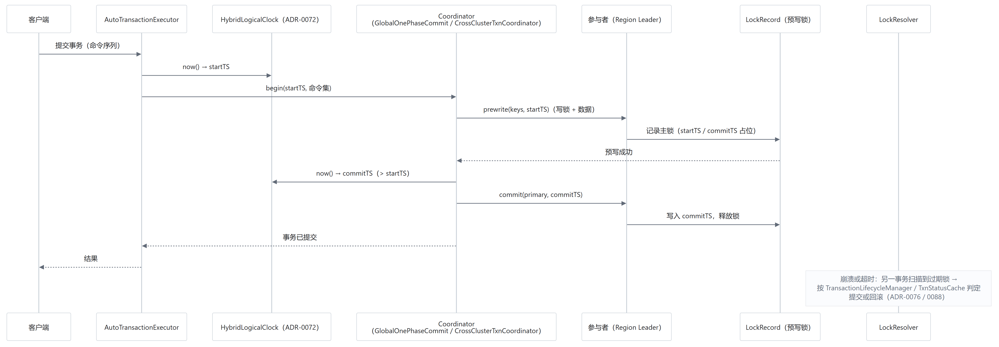

# 第五章　分布式架构与一致性机制设计

> 论文正文初稿 · 对应基线 `4cc7a62`
> 图表：图 5-1（集群与分片）、图 5-2（Raft 日志复制）、图 5-3（分布式事务协调）
> 依据：`cluster/**`、`cluster/raft/**`、`transaction/**`、ADR-0037～0091、ADR-0298/0339/0352

## 5.0 证据分级说明（本章的阅读前提）

分布式能力最容易"过度声明"。本章对每一项能力标注证据等级，且严格区分三档：

| 等级 | 含义 | 本章标注为 |
| --- | --- | --- |
| **E1 已实现且验证** | 有对应实现，且有通过的自动化测试（本次全量回归覆盖） | "已实现并通过测试" |
| **E2 已实现但验证有限** | 有实现与测试，但只覆盖单机多进程 / 特定传输，未做真实跨机故障 | "已实现，在单机多进程环境下验证" |
| **E3 设计/部分实现，未完成验证** | 有代码或 ADR，但缺少端到端验证 | "设计方案，尚未完成验证" |

> 本章不出现"生产级""跨机房容灾"这类未经本环境验证的表述。
> 需要强调的是：`mvn test` 全量回归 **15,014 次执行、0 失败**，其中包含 62 个集群测试类、
> 33 个事务测试类、12 个 Region 测试类；它们的通过只证明"在本机多进程模型下行为正确"。

---

## 5.1 设计目标与总体架构

### 5.1.1 目标

单机引擎解决了"内存装不下"，但没解决"一台机器装不下"。分布式层的目标是：

**表 5-1　分布式设计目标与证据等级**

| 编号 | 目标 | 证据等级 |
| --- | --- | --- |
| D1 | 多副本写入经共识后应用，单节点故障不丢已提交数据 | E2（单机多进程） |
| D2 | 数据按 Region 分片，支持拆分/合并/迁移 | E1（`RegionSplitTest`/`RegionMergeTest`） |
| D3 | 元数据自身高可用（元数据 Raft 组） | E1（`MetadataTest`/`MetadataLeaderFailoverTest`） |
| D4 | 跨分片事务具备原子性 | E2（`CrossNodeTransactionTest`/`TxnNetworkFailureTest`） |
| D5 | 时间戳单调，读能看到已提交写 | E1（HLC + TSO 单测） |
| D6 | 跨机房/跨云事务 | E3（ADR-0109/0214/0339，仅单机模拟） |

### 5.1.2 分层

```text
客户端（ClusterClient）──按 Region 路由──┐
                                        ▼
   元数据 Raft 组（MetadataServer / MetadataRaftGroup / ClusterMetadata）
                                        │
        ┌───────────────┬───────────────┴───────────────┐
     节点 A           节点 B                          节点 C
   Region1(L)        Region1(F)                     Region1(F)
   Region2(F)        Region3(L)                     Region3(F)
        └──────── ReplicatedStorageEngine（每 Region 一个 RaftNode）────────┘
                                        │
                       本地 StorageEngine（WAL → MemTable → SSTable）
```

关键设计：**Raft 是"存储适配器"，不是新的存储引擎**。`ReplicatedStorageEngine` 包装本地引擎，
写请求先追加到 Raft 日志，提交后由状态机回调 apply 到本地引擎；读请求直接读本地（ADR-0037）。
因此第三章的 WAL / MemTable / SSTable 完全不用改。

### 5.1.3 非目标

- 不做跨数据中心的多活写入（多地域方案见 ADR-0109/0123，属 E3）；
- 不做动态成员变更的在线扩缩容（有 Region 迁移，无节点级 rebalance 验证）；
- 不提供线性一致读（`readTS` 为 HLC 快照读，见 §5.5）。

---

## 5.2 集群管理与数据分片

### 5.2.1 两级分片

| 层级 | 机制 | 说明 |
| --- | --- | --- |
| 进程内 | 16 个 key 分片 + `KeyShardExecutor` | 保证同 key 串行（ADR-0023） |
| 集群级 | Region（按 key 范围切分） | 每 Region 一个 Raft 组（ADR-0057/0058） |

两级分片解决不同问题：进程内分片解决**并发正确性**，Region 分片解决**容量与迁移单位**。

### 5.2.2 元数据

`ClusterMetadata` 维护 Region → 节点映射，由 `MetadataRaftGroup` 复制（ADR-0047/0095），
`MetadataServer` 对外提供查询与变更。客户端先查元数据，再直连 Region Leader。

元数据高可用由 `MetadataLeaderFailoverTest` 覆盖（E1）。

### 5.2.3 Region 生命周期

| 操作 | 实现 | 证据 |
| --- | --- | --- |
| 拆分 | `SplitController` + `SplitSnapshot` + `SplitWriteBuffer`（ADR-0061） | `RegionSplitTest`（E1） |
| 合并 | `MergeController` + `MergeTask`（ADR-0062） | `RegionMergeTest`（E1） |
| 迁移 | `RegionRaftMigrationManager`（ADR-0063/0067） | `RegionChaosTest`（E2） |
| 动态再平衡 | 负载驱动调度（ADR-0126/0132） | E3（有实现，未做多节点压力验证） |

拆分期间用写缓冲承接增量写入，快照完成后回放，避免"拆分瞬间丢写"。

---

## 5.3 Raft 共识与日志复制



*图 5-2　Raft 日志复制时序（批量 AppendEntries、多数派提交、状态机应用）*

### 5.3.1 实现范围

`RaftNode` 是一个**完整但精简**的实现（ADR-0037～0044）：

| 能力 | 实现要点 | 证据 |
| --- | --- | --- |
| 角色与任期 | `RaftState`、`Term`，任期单调 | `RaftTest`（E1） |
| 选举 | 随机化超时 + 投票请求（`VoteRequest/Response`） | `RaftTest`（E1） |
| 心跳 | 固定间隔，携带 `leaderCommit`（ADR-0077） | `RaftTest`（E1） |
| 日志复制 | 批量 `AppendEntries` + inflight 上限 + group commit（ADR-0044） | `RaftTest`/`ReplicatedAtomicOpsTest`（E1） |
| 持久化 | `FileRaftLog`（段文件 + 编码，ADR-0039）、`RaftPersistentState` | `Phase22DiskChaosTest`（E2） |
| 快照 | `SnapshotManager` + `InstallSnapshot`（ADR-0040） | `RaftTest`（E1） |
| 传输 | 可替换：本地内存 / Netty TCP | `TcpClusterIntegrationTest`（E2） |
| 原子读改写 | ATOMIC 命令入日志、按 log index 回传（ADR-0352/TD-081） | `ReplicatedAtomicOpsTest`（E1） |

### 5.3.2 提交规则

- Leader 维护每个 Follower 的 `matchIndex`；当多数派的 `matchIndex ≥ index` 时推进 `commitIndex`；
- `commitIndex` 不越过"心跳承诺的边界"（ADR-0077），避免新 Leader 回滚已应用条目；
- 应用（apply）与提交分离：`CommitNotifier` 通知状态机按 index 顺序应用。

### 5.3.3 与存储层的接口

清单 5-1　ReplicatedStorageEngine 的写路径示意

```java
// ReplicatedStorageEngine：写经日志，读走本地（简化示意）
public void put(KeyValueEntry entry) {
    long index = raftNode.propose(encode(entry));   // 追加日志并等待提交
    // 提交流程中由 stateMachine 回调 apply → delegate.put(entry)
}
```

**边界**：Raft 只负责"日志顺序"，不负责"值语义"；覆盖、TTL、版本由本地引擎决定。

### 5.3.4 局限

- 未实现 Pre-Vote 与 CheckQuorum；
- 成员变更未实现联合共识（joint consensus）；
- 传输层虽有 Netty 实现，但未在真实多机网络下做分区注入（E2）。

---

## 5.4 故障检测、领导者选举与恢复

### 5.4.1 检测

- Follower 在选举超时内未收到心跳 → 转为 Candidate 发起投票；
- Leader 通过 `FollowerProgress` 判断落后程度，必要时降级；
- `LeaderTransferManager` 支持主动转移（`TimeoutNowRequest`）。

### 5.4.2 选举与脑裂防护

随机化超时 + 任期比较保证同一任期最多一个 Leader；
`LeaderElection` 只在获得多数派投票后提升为 Leader。

### 5.4.3 恢复路径

| 场景 | 恢复方式 | 证据 |
| --- | --- | --- |
| Follower 重启 | 从 `FileRaftLog` 重放未提交条目，向 Leader 对齐 | `Phase22DiskChaosTest`（E2） |
| Leader 失效 | 重新选举；新 Leader 不回滚已提交条目 | `FailoverTest`/`ChaosClusterTest`（E2） |
| 日志落后过多 | `InstallSnapshot` 全量同步 | `RaftTest`（E1） |
| 网络分区 | 少数派不提交，恢复后追平 | `ChaosValidationTest`（E2） |

### 5.4.4 局限

- 全部在**单机多进程**下验证：分区用进程/传输层模拟，未做真实网络抖动与时钟漂移；
- 未验证"跨机房 RTT 下的选举风暴"这类长尾场景（E3）。

---

## 5.5 MVCC 与混合逻辑时钟（HLC）

### 5.5.1 为什么需要 HLC

分布式事务需要"全局可比的时间戳"，但物理时钟会回拨。HLC 用 `physicalMillis × 10^6 + logical`
构造单调时间戳（ADR-0072）：物理时间前进时用物理值，回拨时用逻辑计数保证**不倒退**。

### 5.5.2 实现

| 组件 | 职责 |
| --- | --- |
| `HybridLogicalClock` | `now()` 返回单调时间戳；观测到更大值时追赶 |
| `HybridClockCalibrator` | 与 TSO 对齐，避免长时间漂移 |
| `TimestampOracle` / `ResolvedTimestampService` | 分配 `startTS`/`commitTS` 与安全读水位 |
| `AutoTransactionExecutor` | 读请求 `readTS = max(HLC.now(), oracle.peek())` |

读路径的关键约束写在代码注释里：**HLC 可能略落后于 oracle 已分配的 commitTS**，
因此读水位取两者较大值，保证"已提交可见"。

### 5.5.3 MVCC 的实际范围

| 能力 | 状态 |
| --- | --- |
| 写入版本号（供 WAL 排序与 TTL 守卫） | E1，第三章已述 |
| 事务快照读（readTS 下可见性） | E2：`AutoTransactionExecutor` 读路径 |
| 多版本存储与 GC | E3：未实现完整 MVCC 表，仅锁记录携带时间戳 |

> 必须说明：本项目**没有**实现 Percolator 的完整 MVCC 存储（多版本列 + GC），
> 时间戳主要用于事务可见性与锁判定；把它称为"完整 MVCC"是不准确的。

### 5.5.4 局限

- 未处理时钟漂移超阈值的告警与降级；
- TSO 单点（有 `ResolvedTimestampService` 冗余设计，未做故障注入验证）。

---

## 5.6 基于 Percolator 思想的分布式事务协调



*图 5-3　分布式事务协调时序（startTS/commitTS、预写锁、提交与锁清理）*

### 5.6.1 协议

事务协议采用 Percolator 的"两阶段 + 时间戳"骨架（Peng & Dabek, OSDI 2010）：

1. **Prewrite**：用 `startTS` 在各参与者写入数据与锁（`LockRecord`）；
2. **Commit**：协调者取 `commitTS > startTS`，先提交主锁，再提交其余锁；
3. **清理**：后台 `LockResolver` 扫描过期锁，依据事务状态决定提交或回滚。

与经典 2PC 的差异：参与者不阻塞等待协调者，而是把"锁 + 时间戳"写进存储，
由后续读/后台任务解析——这正是 Percolator 用"单点时钟 + 锁表"替代阻塞式 2PC 的思路。

### 5.6.2 实现组件

| 组件 | 职责 | 证据 |
| --- | --- | --- |
| `GlobalOnePhaseCommit` / `CrossClusterTxnCoordinator` | 协调者（本地/跨集群） | `GlobalOnePhaseCommitTest`（E2） |
| `LockRecord` / `TxnStatusCache` | 锁与事务状态 | `CrossNodeTransactionTest`（E2） |
| `LockResolver` / `TransactionLifecycleManager` | 锁清理与生命周期 | `CoordinatorCrashRecoveryTest`（E2） |
| `TxnHeartbeatManager` / `TxnTimeoutScheduler` | 心跳与超时（ADR-0088） | `TxnNetworkFailureTest`（E2） |
| `PersistentExecJournal` | 决策日志持久化（ADR-0081/0091） | `PersistentExecJournalTest`（E1） |

### 5.6.3 决策顺序

主锁提交先于其余锁（ADR-0087）：只要主锁状态可查，其余锁的归属就能确定，
避免"部分提交、无法判定"的中间态。该顺序由 `CrossClusterDecisionLog` 记录，
崩溃后据此恢复。

### 5.6.4 与 Percolator 的差异（必须写明）

| 维度 | Percolator | 本项目 |
| --- | --- | --- |
| 底层存储 | Bigtable（多版本） | 自研 LSM（单版本 + 锁记录） |
| 快照读 | `readTS` 多版本可见 | `readTS` 仅用于事务可见性判定（E2） |
| 锁清理 | 客户端惰性清理 | 后台 `LockResolver` 主动清理 |
| 跨集群 | 不涉及 | 有 `CrossClusterTxnCoordinator`（E3，单机模拟） |

### 5.6.5 局限

- 未实现 Percolator 的多版本存储与 GC；
- 跨机房/跨云事务只有单机模拟（E3）；
- 无分布式死锁检测（依赖超时与清理）。

---

## 5.7 数据迁移与一致性保障

| 机制 | 做法 | 证据 |
| --- | --- | --- |
| Region 迁移 | `RegionRaftMigrationManager`：先追平日志，再切换 Leader，最后改元数据 | `RegionChaosTest`（E2） |
| 拆分期间写入 | `SplitWriteBuffer` 承接增量，快照完成后回放 | `RegionSplitTest`（E1） |
| 跨分片事务 | 两阶段 + 时间戳（§5.6） | `CrossNodeTransactionTest`（E2） |
| 冷热迁移 | 第三章的 tiering 机制，与集群层正交 | `SstableInventoryScaleTest` 等（E1） |

一致性边界：**同一 Region 内**由 Raft 保证日志顺序；**跨 Region**由事务时间戳与锁保证；
两者都不提供跨 Region 的线性一致读。

---

## 5.8 测试验证与局限性分析

### 5.8.1 测试规模

| 域 | 测试类 | 代表用例 |
| --- | --- | --- |
| 集群 | 62 | `ChaosClusterTest`（20 例）、`FailoverTest`、`FailureInjectionTest`、`TcpClusterIntegrationTest` |
| Region | 12 | `RegionSplitTest`、`RegionMergeTest`、`RegionChaosTest`、`FiveRegionChaosTest` |
| 事务 | 33 | `CoordinatorCrashRecoveryTest`、`CrossNodeTransactionTest`、`TxnNetworkFailureTest`、`Phase21DistributedChaosTest` |

本次全量回归 15,014 次执行、0 失败，上述测试类全部包含在内。

### 5.8.2 已验证的结论

1. Leader 失效后可重新选举，已提交条目不被回滚（`ChaosClusterTest`）；
2. 日志持久化后重启可恢复未应用条目（`Phase22DiskChaosTest`）；
3. Region 拆分/合并后数据范围正确、无丢失（`RegionSplitTest`/`RegionMergeTest`）；
4. 事务在协调者崩溃后可依据决策日志恢复（`CoordinatorCrashRecoveryTest`）；
5. 原子字符串操作经 Raft 复制后结果一致（`ReplicatedAtomicOpsTest`）。

### 5.8.3 未验证的结论（不得写成已实现）

**表 5-2　未验证结论清单（不得写成已实现）**

| 项 | 状态 | 原因 |
| --- | --- | --- |
| 跨机网络分区与时钟漂移 | E3 | 需多台物理机/可控网络，本环境不具备 |
| 跨机房/跨云事务 | E3 | 仅单机模拟，无真实 RTT 与故障 |
| 掉电恢复 | E3 | 需断电注入（第三章同理） |
| 线性一致读 | 不做 | 设计上只提供 readTS 快照读 |
| 完整 MVCC + GC | 未实现 | 仅为锁与可见性使用时间戳 |

### 5.8.4 小结

本章的分布式能力可以概括为：**在单机多进程环境下，实现了可运行的 Raft、Region 分片与
基于时间戳的两阶段事务，并通过了对应的混沌与故障测试；但跨机网络、跨机房事务与掉电场景
均未验证**。这一区分既是本章的结论，也是全文"证据可追溯"原则的体现。

---

## 参考文献（本章）

[1] D. Ongaro, J. Ousterhout. In Search of an Understandable Consensus Algorithm.
    *Proceedings of USENIX ATC 2014*, pp. 305–319.

[2] D. Peng, F. Dabek. Large-scale Incremental Processing Using Distributed Transactions and Notifications.
    *Proceedings of OSDI 2010*.

[3] J. C. Corbett, J. Dean, M. Epstein, et al. Spanner: Google's Globally-Distributed Database.
    *ACM Transactions on Computer Systems*, 31(3), 2013.（TrueTime 与 HLC 的对照）

[4] S. S. Kulkarni, A. Demirbas, et al. Logical Physical Clocks and Consistent Snapshots in Globally Distributed Databases.
    *OPODIS 2014*.（HLC 原始论文）

[5] F. Chang, J. Dean, S. Ghemawat, et al. Bigtable: A Distributed Storage System for Structured Data.
    *Proceedings of OSDI 2006*.（Percolator 的底层存储）

[6] P. A. Bernstein, V. Hadzilacos, N. Goodman. *Concurrency Control and Recovery in Database Systems*.
    Addison-Wesley, 1987.（两阶段提交基础）