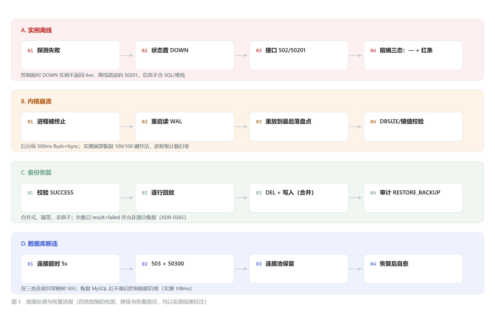

# 第六章　系统测试与实验结果分析

> 论文正文初稿 · 对应基线 `6439ecf`
> 图表：图 6-1（故障处理与恢复流程）
> 数据来源：`docs/testing/phase10-e2e.md`、`docs/benchmark/*`、本次实测输出

## 6.1 测试目标与测试策略

### 6.1.1 测试要回答的问题

第三至五章说明了"系统如何设计"，本章只回答三个问题：

1. **设计是否被实现**——每个设计点在代码里是否真的存在，能否被测试观察到；
2. **实现是否有效**——在真实运行（真实内核、真实数据库、真实浏览器）下是否产生预期行为；
3. **结论的边界在哪**——哪些结论只在本环境成立，哪些根本未被验证。

因此本章遵循三条写作原则：

- **实验结果与设计描述分开**：不拿设计目标代替实测结果；
- **性能数据必须带口径**：环境、方法、样本量、统计方式缺一不可；
- **不做能力升级**：单机多进程的 Raft 测试不写成跨机生产验证。

### 6.1.2 分层策略

| 层 | 目标 | 手段 | 规模 |
| --- | --- | --- | --- |
| 单元 / 集成 | 组件行为正确 | JUnit 5（内核、控制面） | 15,014 次执行 / 93 例 |
| 前端单元 | 纯逻辑正确 | Vitest | 20 例 |
| 界面回归 | 关键页面不退化 | Playwright 冒烟 | 12 项 |
| 业务闭环 | 端到端可用 | Node API 脚本 + 真实内核/MySQL | 91 条断言 |
| 故障注入 | 异常路径正确 | 进程/数据库/令牌注入 | 22 条断言 |
| 性能 | 量化能力 | 基准脚本 + 采样 | 见 6.6 |

**为什么以 API 级为主**：业务逻辑的正确性用 API 断言最快、最稳；
UI 只验证"浏览器实际表现"（终端连续会话、离线三态、权限跳转），
不把七条闭环全部搬进 Playwright——那样脚本会慢到没人跑。

---

## 6.2 测试环境与配置

| 项 | 值 |
| --- | --- |
| 操作系统 | Windows 11（本地基准）；Docker 29.8 / WSL2（横向对比） |
| CPU / 内存 | 20 逻辑核 / 31.6 GB |
| JDK | Microsoft OpenJDK 21.0.12 |
| 内核 | Netty + 16 分片；WAL 段 64 MB，`fsync=EVERY_SEC`；compaction 阈值 8；水位 70/85/95 |
| 控制面 | Spring Boot 3.5 + JPA + HikariCP（`connection-timeout=5000`） |
| 数据库 | MySQL 8，端口 3307，独立 datadir（`%LOCALAPPDATA%\tieringkv-mysql`） |
| 前端 | Vite 5 + Vue 3.5，端口 5173，Chromium（Playwright） |
| 端口拓扑 | 内核 6379 / 测试实例 6383、6384；控制面 8080；前端 5173 |
| 浏览器 | Playwright Chromium，1440×1000 / 1280×800 两种视口 |

---

## 6.3 核心功能测试

### 6.3.1 存储与分层

| 验证点 | 测试类（代表） | 结论 |
| --- | --- | --- |
| WAL 追加 / 恢复 / 损坏丢弃 | `WALTest`、`WALDurabilityTest` | 重放正确，损坏记录被计数丢弃 |
| MemTable 有序 / TTL / 并发 | `MemTableTest`、`TTLManagerTest` | 字节序正确，过期惰性判定 |
| SSTable 写读 / 索引 / Bloom / CRC | `SSTableTest`、`BloomFilterTest` | 读路径命中率与校验符合预期 |
| Compaction 合并与回收 | `CompactionTest`、`SstableInventoryScaleTest` | 输入 429.9 MB → 输出 191.6 MB |
| 冷热迁移与背压 | `TieringControllerTest`、`MigrationSchedulerTest` | 迁移成功率 100%，2 MB 配额不超限 |

### 6.3.2 集群与事务

| 域 | 测试类数 | 代表用例 |
| --- | --- | --- |
| 集群 | 62 | `ChaosClusterTest`（20 例）、`FailoverTest`、`TcpClusterIntegrationTest` |
| Region | 12 | `RegionSplitTest`、`RegionMergeTest`、`RegionChaosTest` |
| 事务 | 33 | `CoordinatorCrashRecoveryTest`、`CrossNodeTransactionTest`、`TxnNetworkFailureTest` |

> 这些测试全部在**单机多进程**模型下运行；跨机网络分区与时钟漂移未覆盖（见 6.9）。

### 6.3.3 控制台

| 模块 | 验证点 | 结果 |
| --- | --- | --- |
| 认证 | JWT 签发、过期、篡改、角色矩阵 | 401/403 符合预期 |
| 实例 | 纳管唯一性、探测 UP/DOWN、多实例隔离 | 18/18 字段一致且互不相同 |
| 键空间 | SCAN 游标、类型识别、HSET 单字段、TTL | 与内核 EXISTS 一致 |
| 可观测性 | INFO 解析、三态展示、SSTable 清单 | 与直连内核逐字段一致 |

---

## 6.4 端到端业务闭环测试

### 6.4.1 七条闭环与断言

**表 6-1　七条业务闭环的断言与代表结果**

| 闭环 | 断言数 | 代表结果 |
| --- | --- | --- |
| E2E-1 认证与权限 | 10 | 改密后旧口令 401；VIEWER 写 403 / 读审计 403；匿名 401 |
| E2E-2 实例管理 | 9 | 探测 UP 并返回版本；不可达实例 DOWN；删除后列表不含 |
| E2E-3 键空间 | 14 | 值/类型一致；HSET 两字段删一留一；TTL 到期后内核 `EXISTS=0` |
| E2E-4 在线终端 | 11 | PING→PONG；错误命令 error 标记；危险命令 400；历史按实例隔离 |
| E2E-5 备份 | 16 | 恢复后含逗号/引号的值原样还原；回放数 == keyCount；并发 200+409 |
| E2E-6 告警 | 10 | 确定性触发 → FIRING → resolve → RESOLVED |
| E2E-7 审计 | 21 | 时间范围/动作过滤；CSV 真解析；三类备份审计存在 |
| **合计** | **91** | 全部通过 |

> 口径说明：91 是**断言条数**，不是测试用例数，也不是测试方法数。
> 一条断言对应一个可证伪的事实（如"恢复回放数 == 记录 keyCount"）。

### 6.4.2 断言的写法

每条断言都要求"可证伪"，典型反例与正确写法：

| 不合格 | 合格 |
| --- | --- |
| 页面能打开 | 离线时 6 个指标全部显示 `—`，且红色提示条存在 |
| 备份成功 | 恢复后含逗号/引号的值原样还原，且回放数 == keyCount |
| TTL 设置成功 | 到期后**内核** `EXISTS=0`（而非控制面返回 200） |
| 导出 CSV | 每行列数与表头一致（用 RFC4180 解析器校验） |

---

## 6.5 故障注入与恢复测试



*图 6-1　故障处理与恢复流程（四类故障的检测、降级与恢复路径）*

**表 6-2　四类故障注入的实测结果**

| 故障 | 注入方式 | 断言数 | 结果 |
| --- | --- | --- | --- |
| F1 实例离线 | 指向无人监听端口 | 6 | `live` 为空、状态 DOWN、接口 502/50201、信息不含 SQL/堆栈 |
| F2 内核崩溃 | 写入 100 键 → 强制终止 → 重启 | 5 | 100/100 键存活、值无损坏、进程级计数归零 |
| F3 数据库断连 | 停止专用 MySQL → 请求 → 恢复 | 8 | 5,046 ms 返回 503+50300；恢复后 108 ms 自愈 |
| F4 Token | 篡改签名 / 自签过期 Token | 3 | 篡改→401；有效签名+过期→401；有效未过期→200 |
| **合计** | — | **22** | 全部通过，环境恢复 |

---

## 6.6 性能测试与分析

### 6.6.1 口径先于数字

| 指标 | 环境 | 方法 | 统计口径 | 样本 |
| --- | --- | --- | --- | --- |
| Redis 对比 | 同机 Docker bridge，同客户端 | `redis-benchmark -r 1000000 -d 64` | 服务端吞吐 + 客户端 p50 | 每场景 20 万请求 |
| 单连接 GET/SET | 本机回环，Node RESP | 串行 GET+SET | 客户端侧 p50/p95/p99 | 每轮 4 s（约 4.6–4.9 万次） |
| INFO 自身 | 同上 | 连续 200 次 `INFO` | p50/p95/max | 200 次 |
| Flush / 迁移 | 本机 SSD，`-Xmx1g` | Phase 6 调度基准 | entries/s、ops/s、端到端 P99 | 100K / 200K / 1M |
| WAL 落盘 | 真实 WAL + 文件系统 | 10 轮采样（避开内联 force） | 单轮"写入→文件可见" | 10 轮 |

**必须区分的四组概念**：

① 内存操作延迟（MemTable 直连） vs 网络端到端延迟（客户端观测）；
② 平均延迟 vs P99（本文一律同时给出，P99 来自直方图分桶上界）；
③ 内联 fsync（`ALWAYS` 或首次写入） vs 后台周期落盘（`EVERY_SEC`）；
④ 进程崩溃恢复（已实测） vs 掉电恢复（未验证）。

### 6.6.2 与 Redis 7 的对比

**表 6-3　与 Redis 7 的吞吐与延迟对比（同机、同客户端、同网络；与表 3-2 为同一组实验，此处用于结果分析）**

| 场景 | Tiering-KV | Redis 7 | 比值 |
| --- | --- | --- | --- |
| SET · c=1 | 10,347 rps / p50 0.079 ms | 21,834 / 0.039 ms | 0.47× |
| GET · c=1 | 11,148 / 0.079 ms | 23,641 / 0.039 ms | 0.47× |
| SET · c=50 | 59,701 / 0.431 ms | 165,975 / 0.159 ms | 0.36× |
| GET · c=50 | 63,512 / 0.423 ms | 161,160 / 0.159 ms | 0.39× |

公平性：Redis 关闭 RDB/AOF，Tiering-KV 保持默认 WAL——本项目承担持久化成本，
对比对己方偏保守。结论表述为"同量级、可用"，不写"性能优于 Redis"。

### 6.6.3 观测开销

| 场景 | 吞吐 | p99 |
| --- | --- | --- |
| 无 INFO 流量 | 11,452 ops/s | 0.537 ms |
| 叠加 50 次/秒 INFO | 12,061 ops/s | **0.503 ms** |

`INFO` 自身 p50 0.246 ms、p95 0.509 ms、max 3.286 ms。结论：观测无可测影响（在 ≤ 8 张表的规模下）。

### 6.6.4 持久化边界

```text
[wal-latency] 10 轮后台落盘延迟(ms)= 407.4 407.8 403.1 404.9 406.6 407.0 420.8 408.5 406.3 420.6
              最坏 = 420.8 ms
```

**表 6-4　WAL 持久化边界的实测结果**

| 实验 | 结果 |
| --- | --- |
| 修复前：写 100 键 → 等 1.8 s → 强制终止 | 重启后 **99/100 丢失** |
| 修复后：同场景 | **100/100 存活**，值无损坏 |
| 后台落盘延迟（10 轮） | 403–421 ms（最坏 420.8 ms） |
| 空闲 2 s 文件大小 | 不变（`dirty` 标记避免空转 fsync） |

### 6.6.5 合并与清单成本

| 项 | 结果 |
| --- | --- |
| 一次全量合并 | 输入 429.9 MB → 输出 191.6 MB，1,487 ms |
| 清单快照（1,000 张表） | 52 µs；渲染 2,236 µs；输出 97,003 B |
| 冷层精确计数（6 表 / 597 MB） | 首次 17.1 ms，随后 0.63/0.39 ms |

---

## 6.7 工程质量与覆盖率

**表 6-5　测试与质量指标汇总**

| 指标 | 结果 | 说明 |
| --- | --- | --- |
| 内核测试执行 | **15,014**（0 失败，**13 跳过**） | Surefire Tests run，含参数化展开 |
| 控制面测试 | **93**（21 个类，0 失败） | JUnit 5 + MockMvc |
| 业务闭环断言 | **91** | 7 条闭环 |
| 故障注入断言 | **22** | 4 类故障 |
| Playwright | **17/17** | 3 组界面场景 |
| Vitest | **20/20** | 格式化、排序/分页 |
| UI 回归 | **12/12** | 页面冒烟 |
| 行覆盖率 | **62.57%**（1,329/2,124） | 控制面，未排除业务类 |
| 分支覆盖率 | **40.71%**（265/651） | 同上 |
| 指令覆盖率 | **59.12%**（5,913/10,001） | 同上 |

### 6.7.1 关于 13 项跳过

13 项跳过全部是**环境门控**，不计入通过数量：

| 测试类 | 数量 | 跳过原因 |
| --- | --- | --- |
| `KubernetesInClusterValidationTest` | 3 | 缺少 `TIERINGKV_KIND_CLUSTER` 环境变量 |
| `RealBlockDeviceChaosTest` / `RealBlockDeviceExerciseTest` | 6 | 仅 Linux，Windows 上禁用 |
| `RealContainerDiskChaosTest` / `RealNetworkChaosTest` | 4 | 需要容器化磁盘/网络混沌环境 |

### 6.7.2 覆盖率的正确解读

- 覆盖率衡量"代码被测试触达的比例"，**不是可靠性指标**，也不能推出"缺陷更少"；
- 本项目不设及格线，覆盖率作为**可复算的基线**：任何一次 `mvn test` 都能得到同一口径；
- 统计包含 DTO / record 的访问器，因此数字偏低但真实。

---

## 6.8 缺陷发现与修复验证

### 6.8.1 缺陷矩阵

**表 6-6　六个缺陷的发现、修复与验证**

| 缺陷 | 原始问题 | 修复 | 验证方式 | 结果 |
| --- | --- | --- | --- | --- |
| TD-101 | 同实例并发备份双双成功 | 按实例串行化检查+落库 | 并发探针 5 轮 | 5/5 → **200/409** |
| TD-102 | 失败操作审计随事务回滚 | `REQUIRES_NEW` | 拦截命令后查审计 | 记录可查 |
| TD-103 | 空闲期 WAL 缓冲不落盘 | 后台 500 ms flush+fsync | 强杀 + 重启校验 | 99/100 丢失 → **100/100** |
| TD-104 | 备份操作无审计 | 三类动作写入审计 | 按 action 查询 | 均有记录 |
| TD-105 | 数据库不可用返回 500 | 三类连接异常映射 503 | 停库→请求→恢复 | **5046 ms → 503**，108 ms 自愈 |
| TD-106 | 空闲期空转 fsync | `dirty` 标记 | 空闲 2 s 观察文件 | 大小不变 |

### 6.8.2 案例一：TD-103（WAL 持久化）

**问题背景**：默认 `fsync=EVERY_SEC`，实现为"append 时若距上次 force ≥1 s 才落盘"。

**复现条件**：写入 100 个唯一键 → 等待 1.8 s（无后续写入）→ 强制终止进程 → 重启。

**观察结果**：重启后只恢复 1 个键。原因是数据停留在 64 KB 的 `BufferedOutputStream`，
空闲期没有任何 append，因此永远不触发 force。

**修复机制**：`WALManager` 启动守护调度线程，每 500 ms 检查 `dirty`；有未落盘写入才 `flush + channel.force(true)`。

**验证过程**：

1. 修复后同一场景 **100/100 键存活，值无损坏**（F2，5 条断言）；
2. 新增 `WALDurabilityTest`：空闲期写入 1.6 s 内必落盘；空闲 2 s 文件大小不变（避免空转）；
3. 10 轮采样得到落盘延迟 **403–421 ms**，把"最多丢多少"从定性变成定量。

**实验结论**：进程崩溃的丢失窗口 ≤ 一个调度周期（实测最坏 420.8 ms）。
**不成立的推论**：该实验**不能**证明掉电安全——未做断电注入。

### 6.8.3 案例二：TD-101（备份并发）

**问题背景**：`export()` 先查"是否存在 RUNNING 记录"，再插入新记录，两步不在同一临界区。

**复现条件**：`Promise.all` 同时发两个 `POST /backups`，连续 5 轮。

**观察结果**：**5/5 轮均返回 200/200**，同一实例并行跑了两个导出任务。

**修复机制**：按实例加锁，把"检查 + 落库"合并为一个临界区，导出仍在线程池执行（不阻塞请求）。

**验证过程**：并发探针 **5/5 轮 200/409**；E2E-5 断言"并发创建产生 200 + 409"；
新增并发单测（两线程 + 屏障，断言恰好一次成功、一次冲突）。

**实验结论**：并发一致性缺陷只能靠"同时发请求 + 稳定复现"发现，单线程用例永远测不出来。

### 6.8.4 案例三：TD-105（数据库故障恢复）

**问题背景**：数据库不可用时，请求返回 500 + `Could not open JPA EntityManager for transaction`。

**复现条件**：停止专用 MySQL（非共享实例）→ 发登录请求 → 恢复 MySQL → 不重启控制面再发请求。

**观察结果**：

| 阶段 | 修复前 | 修复后 |
| --- | --- | --- |
| 断连时 | 500 + 内部术语 | **503 + 50300「数据库暂不可用，请稍后重试」**，5,046 ms 返回 |
| 恢复后 | 需重启控制面 | **不重启即可登录（108 ms）** |

**修复机制**：只对 `CannotCreateTransactionException` / `DataAccessResourceFailureException` /
`CannotGetJdbcConnectionException` 三类异常映射 503，其余异常仍走原有兜底。

**实验结论**：控制面具备"依赖故障降级 + 自愈"能力；文案不泄漏 SQL/凭据/堆栈。

---

## 6.9 测试局限性分析

| 限制 | 说明 | 影响 |
| --- | --- | --- |
| 跨机未验证 | 集群/事务测试均在单机多进程 | 不能声称生产级跨机共识 |
| 掉电未验证 | 无断电注入手段 | 持久化结论仅覆盖进程崩溃 |
| 恢复非原子 | ADR-0365：失败不回滚 | 不能声称"恢复可回滚" |
| 13 项跳过 | K8s/块设备/容器网络 | 不计入通过率 |
| 覆盖率 62.57% | 异常分支覆盖不足 | 不能等价为"缺陷更少" |
| 性能口径 | 单机、page cache 热、无跨机网络 | 不能与 TiKV 等分布式系统直接对比 |
| UI 覆盖窄 | 只 3 组场景 17 条断言 | 交互细节靠人工验收 |

> 另需说明：`91` 与 `22` 是**断言条数**，`15,014` 是**测试执行次数**（含参数化展开），
> 三者口径不同，不可相加或互相替代。

---

## 6.10 本章小结

1. **功能层面**：七条业务闭环 91 条断言全部通过，说明"从登录到备份恢复"的链路在真实环境下可用；
2. **可靠性层面**：四类故障注入 22 条断言通过，其中 TD-103 把"崩溃丢多少"从定性变为 403–421 ms 的定量结论；
3. **性能层面**：在承担 WAL 的前提下达到 Redis 的 0.36–0.47×，观测开销在 ≤8 张表时无可测影响；
4. **工程层面**：15,014 次内核执行 + 93 例控制面 + 20 例前端单测 + 12 项 UI 回归，
   控制面行覆盖率 62.57%（可复算基线）；
5. **边界**：跨机、掉电、恢复原子性、13 项环境门控测试均未覆盖，结论不外推。

这些结果共同支撑一个判断：**系统在单机范围内是可运行、可观测、可运维、可验证的**；
而"分布式生产级"所需的跨机验证，属于本论文未完成的部分，留待第七章讨论。

---

## 本章引用文献

本章为实验与结果分析，未引入新的学术文献；涉及的机制与工具见第 2–5 章及文末《参考文献》。
技术规范 S3（指标类型）、S4（语义约定）见文末"技术规范"清单。